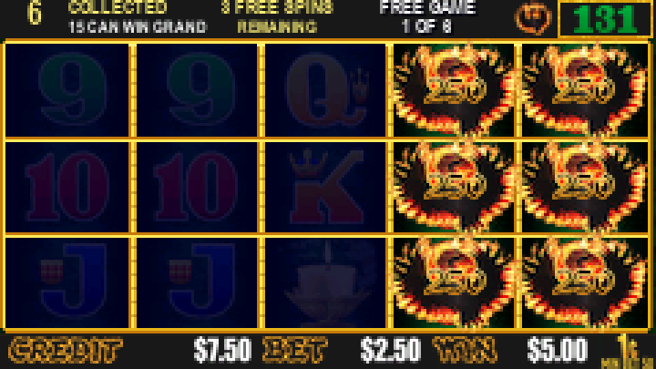

# Current release notes

## 0.2.106

- SELECT BET opens on the current denomination, then advances to the selected line count and bet multiplier. Changing a group preserves a valid selection; unavailable choices fall back to the first offered option.
- Removed the looping reel rumble and its Sound-menu setting. Reel stops, Phoenix cues, win jingles and feature music remain available.
- Added CLEAR BALANCE to Add Credits. It returns to the game at zero; enabled auto-refill applies when another spin is requested.
- Free Game progress remains visible during nested Phoenix Hold features and their fire transitions.
- The browser game uses the same current source and includes a GitHub link. Completed browser updates now refresh older cached game tabs automatically.

## Validation status

Native firmware and offline assets passed full write/readback verification. Startup confirmed the current version, a healthy random service, all 60 atlas frames,1,000 credits, zero actions and autoplay off.

Automated checks cover actual Main/UI controls,172 wager-selection cases, finite audio and feature programs, manual/autoplay routes and fail-closed random-source handling. The source-bound browser build is tested in Chromium. Physical speaker fidelity and original casino odds remain unqualified.

The game uses Mbed TLS 3.6.7 AES-256 CTR-DRBG. Model I (`0x00020012`) retains its existing prices, weights and numerical Grand schedules. The first NIST STS study covers 15 test families and 188 rows over 1,000 sequences of 1,000,000 bits, with no aggregate proportion/uniformity flags; it does not establish physical entropy quality or Nevada approval.

See [testing](docs/testing.md) and [math and evidence](docs/math-and-evidence.md).
