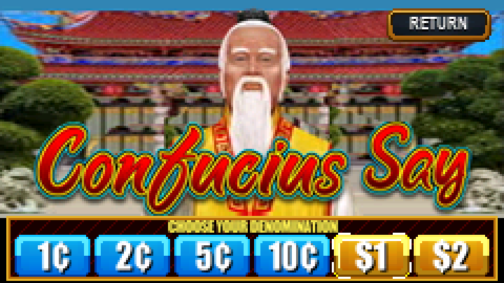
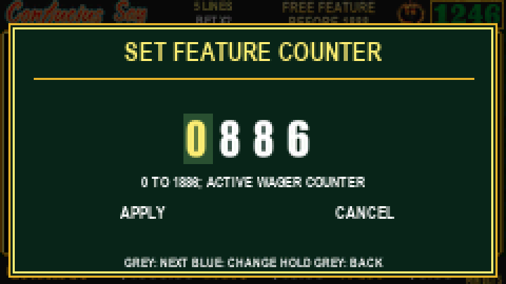

# Current release notes

## 0.2.151

- Custom Amount drops unused leading zeros as you move right: **$1.00** instead of **$00,001.00**.
- Moving left reveals larger digit positions again.
- Updated browser build, voucher examples and signed-flasher release.

## 0.2.150

- Two-stage denomination and wager selection with publisher Confucius/temple artwork and original title.
- Each denomination restores its last settled reel display; changing lines/bet within it keeps that display until another spin.
- Balance is the first Game Menu entry; Custom Amount starts at $00,000.00 and confirms with INSERT CREDITS.
- High Limit offers $1/$2/$5/$10/$25/$50/$100 and the directly filmed $5/50-line/3x/$750 selection.
- Higher-denomination money/credit formatting and source-derived offer documentation.
- Source, browser, wiki tables and signed-flasher bundle synchronized for this release.

## 0.2.143

- Wager-screen Return and hold-grey apply the selected denomination and lines without spinning.
- Unaffordable red BET selects its counter before the normal funding check; equal-credit same-denomination bets retain their shared bank.
- Custom Amount comes first in Credits; holding blue moves to the digit on the left.
- Editable Stardust voucher uses matching varied decorative identifiers, written amounts and the cash-in sound.
- Small startup progress overlay retains the game behind it.
- Flat jackpot fields, larger topper/amounts and stationary letter-edge fire.
- Reconstructed red temple courtyard behind the original clean publisher figure.
- Jackpot amounts, outcome weights and CSPRNG provider are unchanged.

## 0.2.141

- Opening a menu pauses the feature and its music. Returning to play continues the tune from its paused position instead of replaying the opening bells.
- Sound-menu auditions use a separate playback context, preserving the paused game's music position.
- The same menu behavior is included in the Stick firmware and browser game.

## 0.2.140

- Seven-row Game Menu with Settings grouping Sound and Display. Button shortcuts for wagers, autoplay and the live Jackpots board remain available; rumble is not used.
- Paylines opens on the active layout and browses all six line selections without changing the wager.
- Grand uses one continuous WINNER count for Grand, the Major base component and cash, adapted for the single LCD.
- Current model T includes scoped price corrections and source-supported route updates. The guide distinguishes 42/45 documented 50-line matches and 13/17 documented 100-line matches from local fallbacks.
- Every boot or browser reload begins with 1,000 default-denomination credits, fresh opening reels and autoplay off.

Current source, browser, firmware and media identities are recorded in [release metadata](RELEASE.json). [Testing](docs/testing.md) distinguishes source checks, byte readback, startup, physical controls/audio and original-machine fidelity. Local return references are not recovered casino odds.

## 0.2.130

- New sessions open on freshly sampled reels. The opening display does not place a bet, pay a win, advance the counter, record a spin or start a bonus. Credits still start at 1,000 and autoplay starts off.
- Counter editing stays within 0–1886 throughout. The first digit alternates 0/1; subsequent digits follow the selected prefix. When a larger prefix makes the old remainder invalid, the editor fits it within the ceiling. Apply and Cancel retain their existing behavior; jackpot amount editing is unchanged.
- The browser game, player guide, gallery and signed firmware package describe the same final source.

### 0.2.130 validation

Final firmware and offline assets passed complete byte-exact readback on StickS3. Healthy startup verified 1,000 credits, zero actions, autoplay off and all 60 Phoenix animation frames. Browser checks covered three distinct unpaid startup boards, every counter boundary wrap, menus, exact cash values and offline/cache updates.

The startup regression compared 1,024 test entropy tapes and 8,192 following Base/Free/Hold actions with the prior source: financial states, entropy requests and the next random reservoir matched. Startup boards containing feature symbols remained idle and unawarded. All 7,548 legal counter value/focus transitions passed an independent oracle, and the actual menu path passed 2,511 checks with address/undefined-behavior sanitizers. These are software regressions, not measurements of casino frequencies.

Original casino probabilities and complete factory artwork/audio remain unrecovered. The [math reference](docs/math-and-evidence.md) explains the local model and its limits.
