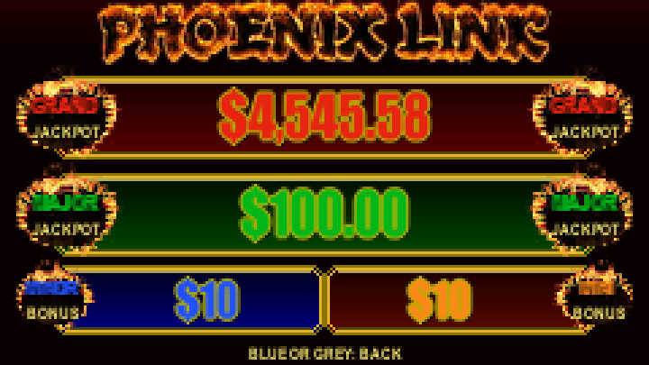
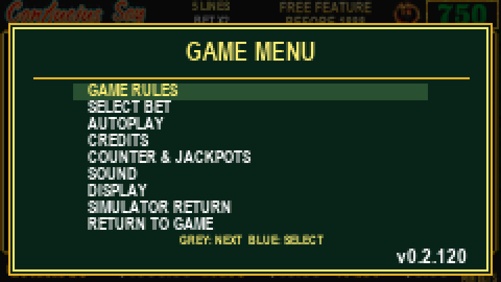
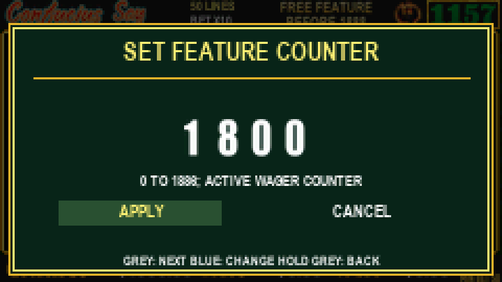
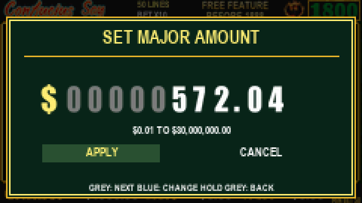

# Current release notes

## 0.2.120

- Double-press the large grey button for the live Grand, Major, Minor and Mini board. It uses the Phoenix Link wordmark, animated Phoenix badges, gold frames and separate colored amount panels. Blue or grey closes it without spinning; screen rotation remains under Display.
- Counter & Jackpots has its own Game Menu entry. Credits contains only additions, Clear Balance and Auto Refill. Back returns to the parent menu; Amount Units and the three sound-test labels describe their actual controls.
- Set the active feature counter from 0 to 1886, or enter any jackpot from $0.01 to $30,000,000.00. Apply returns to regular play with autoplay off. Future prizes use the edited amount; landed prizes retain their values. Restore Default Jackpots restores the selected schedule. Preset return estimates are hidden while custom jackpot amounts are active.
- Cash prizes and jackpot pickups retain exact cents throughout display, collection and settlement, including values that are not whole denomination credits. Named 2×/3× multipliers apply once.
- The observed 1¢ / 50-line / 10× Mini is $10; Double Mini pays $20 and Triple Mini pays $30. The affected ideal-return intervals were recalculated. Other Grand schedule amounts are retained.
- Queued-feature capacity is checked before entropy generation or debit. Owed empty-start meter Holds remain supported.
- Wisdom feature text uses the same matte as the compact game header.
- The browser game, guide, numeric reference and gallery describe the same current source. Each new session starts with 1,000 denomination credits and autoplay off.

## Validation status

The final firmware and offline assets build for StickS3. Installation, full readback and fresh startup verification of this exact polished image are pending a device connection.

The final source passed 779 menu checks, 330 wager/Grand display contexts, 5,925 custom-jackpot checks and source-bound media verification. Real Chrome passed 242 functional checks, six visual checks and 27 same-version cache-upgrade checks, including offline fresh startup. Exact-cent accounting, failure atomicity, outcome independence and the default ideal-model calculations have separate source tests. See [release metadata](RELEASE.json) and [testing](docs/testing.md).

Original casino probabilities remain unrecovered. The return reference covers the stated default-price ideal-uniform model; custom prices or repeated manual counter changes are outside that calculation.
