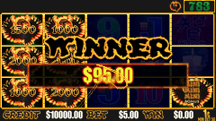
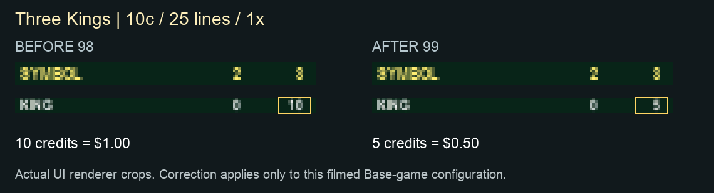
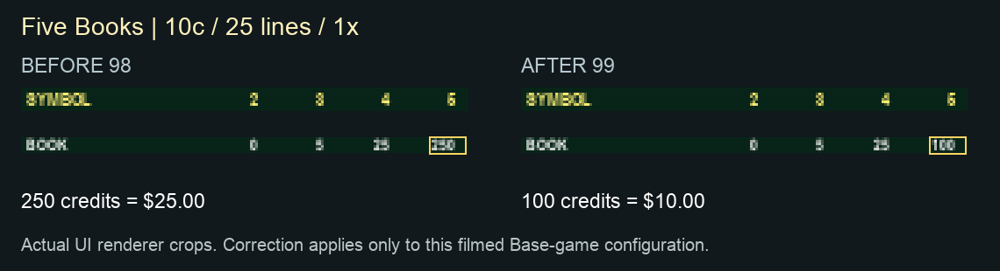
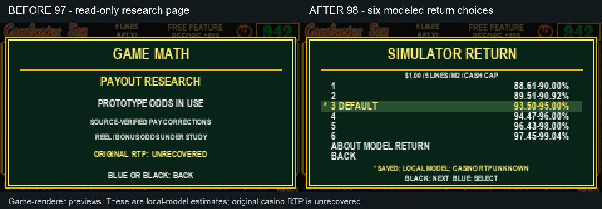
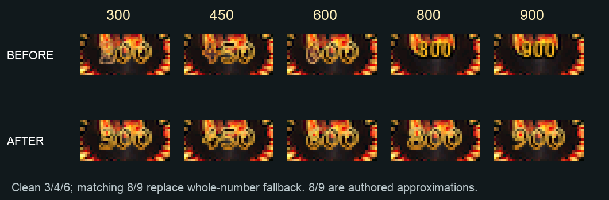
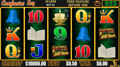
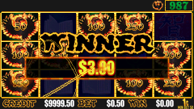

# Version history and pending work

This is a curated account of implemented changes and clearly labeled candidates. It records implemented changes and verification limits. The first public snapshot is version 102; version 100 was prepared locally and was not published. Installation, native verification and software-only validation are separate statuses.

## 0.2.102 — first public snapshot

- Fresh native startup captures eight offline hardware-entropy bytes before application M5 peripheral initialization, releases the temporary source, and passes the exact 64-bit value to the UI, including zero.
- Valid saved credits, meter banks, owed work and PCG continuation restore unchanged. Autoplay starts off.
- Firmware source, source-exported lookup documentation, current synthetic gallery and playable WebAssembly demo are synchronized to accepted102. Native Main and browser IndexedDB ownership are tested separately.
- This startup engineering change adds no probability weights, audio clips or artwork. The original machine's PAR, RNG and complete audiovisual banks remain unrecovered.
- First public version is 102 by request; the following planned public snapshots remain 110, 120 and subsequent ten-version milestones. GitHub/Pages live deployment is verified separately by the release owner.

## 0.2.101 — multiplied Mini/Minor presentation

- Double/Triple Mini and Minor collect in separate visible increments, each relaunching the Phoenix from the same cell. The earlier flight/trail can finish behind the next, and the stacked label remains intact.
- The WINNER amount follows those increments; the committed Engine payout happens once. Existing collection audio remains one request per physical cell.
- Source-fitted unit spacing1067ms and ordinary spacing 1333 ms remain local timing fits; universal manufacturer timing and original repeated named-prize sound are not established.
- The native offscreen benchmark adds 80 repeated-flight frames. Prices, probabilities, numerical Grand schedule, audio bytes, RNG and save format stay unchanged from 100.

## 0.2.100 — prepared local snapshot, not published

- Source-only firmware package with required textures, fonts, audio banks and offline media; excludes private player banks and research/build artifacts.
- Player/developer wiki covers controls, all twelve symbols, combinations, Free/Twin games, Hold, revival, jackpots, meter continuity, sound, saving and remaining fidelity limits.
- Fresh C++ export documents 48,000 Base/Free lookup entries, 205 active line paths and 55 offered wagers. These are implemented values, not recovered casino odds.
- Fourteen current-version synthetic screenshots/GIFs replace the older gallery baseline. Their [manifest](docs/gallery-manifest.json) pins exact source and image hashes.
- Source-first browser build, save/offline checks and Pages deployment are assembled separately from native hardware verification. Publication remains pending; see [browser play](docs/browser-play.md).
- Native 100 app/saved-prefix/assets readback, boot restoration, immutable frame capture and 935 offscreen rendering frames passed; all eight pixel-comparison categories report zero mismatches. Credits, collection meter and current wager were preserved with autoplay off.
- Compared with 99, the device's gameplay, art, audio, RNG, probabilities and numerical Grand schedule are unchanged. The source label/runtime identity advance to 100.
- Public snapshots continue at 110, 120 and subsequent ten-version milestones. Local development and validated flashes continue between snapshots.

## 0.2.99 — installed and native verified

- At 10¢ / 25 lines / 1× paid Base, three Kings change from 10 to 5 unit credits ($1.00→$0.50). The [scoped payout reference](docs/payouts.md#version-99s-two-scoped-corrections) identifies the original Line11 caption.

- At the same configuration, five Books change from250 to 100 unit credits ($25.00→$10.00), verified by the original Line22 caption.

- Model H (`0x00020011`) retains probabilities, Free prices and all 7,200 Grand integers. Known G/F/D/E saved liabilities continue through existing canonical Main checkpoints; qualified future paid play adopts the new model at a safe boundary.
- Diagnostic model identification derives from the actual Engine constant. Controls, graphics and audio remain otherwise unchanged from 98.
- Actual accepted Main 130 processes/5,097 assertions, full renderer/transport/credit-audio/target checks, app and saved-prefix readback, native boot/frame and 935-frame renderer comparisons pass. Credits, meter, wager, grid and action count were preserved; autoplay was off before any new action. This does not establish casino calibration or physical acoustic identity.

## 0.2.98 — installed and native boot/frame verified

- SIMULATOR RETURN offers six neutral model choices with current-profile return/edge ranges and future Grand. Only future Grand changes, at a qualified closed Base boundary. Original casino RTP remains unrecovered.
- The real Main owner verifies the canonical record before returning to manual Game. Immutable retries and physical-release/USB-drain fences prevent stale input from becoming a paid action after recovery.
- Phoenix digits 3/4/6 use clean vector reconstructions; matching provisional 8/9 glyphs replace whole-value missing-glyph fallback. Approved 0/1/2/5/7 and existing metrics stay exact. Original 8/9 artwork remains unrecovered.

- Full renderer/transport/target checks, 326 actual accepted-header Main cases with 165 cold processes and 108 unchanged credit/audio assertions pass. Native app/prefix/assets readback, current-bank restoration and frame capture pass; the renderer benchmark was skipped while a Hold feature was owed.
- Version 97's Engine, prices, probabilities, Grand table, audio bank and save schema remain unchanged.

## 0.2.97 — installed and native verified

- Two paid-Base prices corrected at 2¢ / 50 lines / 3×: two Bells pay six credits and three Kings pay fifteen credits. The [payout reference](docs/payouts.md#accepted-version-97s-two-scoped-corrections) lists unit prices and money conversions.
- No symbol-weight, feature-probability, Free-price or retained Grand-integer change. The new model identity preserves known owed contexts until the qualified future Base boundary.
- Actual accepted-header UI/Main checks and the full renderer/ESP32-S3 build pass. App, boot/NVS prefix and offline-asset readback passed; native boot preserved current credits, counter, wager, grid and action count with autoplay off. The 935-frame renderer comparison and immutable screen capture passed.

## 0.2.96 — installed; native boot and renderer verified

- ADD CREDITS offers additive $1k, $10k and $100k choices. Each returns directly to manual gameplay; auto-refill remembers the last addition size.
- Natural non-meter Hold opening draws 1, 2, 3 during the existing lead-in, without delaying or drawing another result.
- Existing Hold music continues through the terminal settled landing. A nonblocking worker fence releases borrowed buffers before the completion phrase begins; stale unheard requests are cancelled on exit.
- Full renderer, credit/audio, transport and target checks pass. Application, saved-data prefix and offline assets were read back after installation. A later native boot restored the current bank and counter exactly, with autoplay off; 935 offscreen rendering frames and an immutable screen capture passed. The physical credit-menu exercise remains unexecuted because the original USB connection disappeared before its first command. Acoustic fidelity is still unverified.
- The battery percentage remains omitted because the voltage-only estimate does not establish the requested five-percentage-point accuracy.

## 0.2.95 — installed and native verified

- Repair the blank $1 / 10-line wager screen with five red buttons using multipliers 1, 2, 3, 4, 5 and calculated ten-line credit amounts.
- Keep the direct Confucius 5/10-line chooser evidence separate from the adapted General Tso family paid-row evidence; no universal wager deck is claimed.
- Native boot preservation, renderer benchmark and frame capture pass. Engine, odds, audio and art banks retain version 94's behavior.

## 0.2.94 — installed and native verified

- Optimize the Phoenix collection emblem and outgoing gold compositor while retaining exact RGB565 pixels, opacity, poses, placement and clocks.
- Native renderer comparisons pass with no Engine, RNG, payout, audio or save-format change. This is a renderer optimization, not a new artwork bank or a measured general FPS claim.

## 0.2.93 — installed and native verified

- Pre-outcome durable checkpoint barrier owned by Main, rather than a renderer mock.
- Exact prepared result must be acknowledged before presentation proceeds; storage latency freezes presentation time and immutable retry paths preserve the result.
- Standalone UI test fixtures explicitly register volatile test ownership; real Main/UI persistence checks keep the actual storage callback.

These changes ship after version 92's historical [save timing limit](docs/saving.md#version-92s-save-timing-limit). Native boot preservation and renderer checks passed; exhaustive physical power-cut testing and flash endurance remain unproven.

## 0.2.92 — scoped Base prices and neutral saved preferences

- Five Base prices corrected at two filmed profiles: 1¢/50/10× and 10¢/100/1×. The [payout reference](docs/payouts.md#version-92s-five-scoped-corrections) lists exact before/after values.
- No reel/feature generation-law retune and no Free-price change in this release; retained Grand amounts stay unchanged.
- Saved math preferences use neutral schedule slots. Known older owed features remain exact through continuation/restart and normalize only at safe qualified Base boundaries.
- Unknown valid contexts remain exportable and can block future paid Base instead of being silently repriced.
- Version-91 graphics and audio remain unchanged. A payout-price correction can affect return/hit statistics even when symbol draws stay unchanged.

## 0.2.91 — calm gold counter rim

- Four-second flame motion around the small 1888 number uses the reel moulding's gold shades.
- Green numerals, padding and border geometry remain unchanged; this is not a larger new panel around the entire top strip.
- No payout, reel/feature probability, Grand schedule or audio-bank change.

## 0.2.90 — live count, MIN BET and renderer work

- Active Hold shows live N COLLECTED / 15 CAN WIN GRAND, without exposing committed future landings before their visual impacts.
- Source-qualified denomination badges add MIN BET by cabinet profile, independently from the currently selected line count.
- Centered WINNER rendering uses sparse immutable programs while preserving reference RGB565 compositing.
- Counter rim motion is slowed and made less distracting; version 91 subsequently selects the gold-only pigment.

## 0.2.89 — centered collection and Twin music

- Centered clean WINNER lettering and running currency over the reels during collection.
- Phoenix pickup flight targets that amount field, preserving the existing collection impact event.
- Source-contour animated number rim; later releases adjust its speed/palette.
- Full reconstructed 27.911-second Twin phrase, independent streaming and return-fire restart after nested Hold.
- Remove an unsupported automatic FreeEnd cue dispatch; keep legacy bank compatibility without claiming that cue belongs on every completion.
- Improve the specific nested-Hold-to-Free return timing without consuming an extra outcome or wager.

## Earlier development summarized

Earlier iterations established offline operation, blue-hold autoplay, source-scoped symbol/payout fixes, animated Wisdom/Sage material, fire/collection trajectories, the cabinet wager deck, separate audio controls and canonical save recovery. The wager screen was later assigned to the **large grey game key**, with long-press settings and double-press rotation; it is not a small-power-key menu.

Earlier prototype return percentages, audio clips, controls and artwork should not be assumed current. Use the exact source version and [evidence scope](docs/sources.md).

## Remaining fidelity work

- Recover or estimate the joint reel/feature law from properly stratified continuous footage; authentic PAR data remains unknown.
- Compare missing animation/cue variants and source eligibility/timing without inventing universal rules from one clip.
- Refine high-resolution source shapes, fonts, wing/fire loops, layering and small-screen spacing.
- Continue acoustic comparison of arrival registers, common cues, full feature order and loudness.
- Revalidate persistence and native latency for the actual final version-100 composition.

These are research/implementation gaps, not announced completed features or a promise of certified 1:1 identity.
