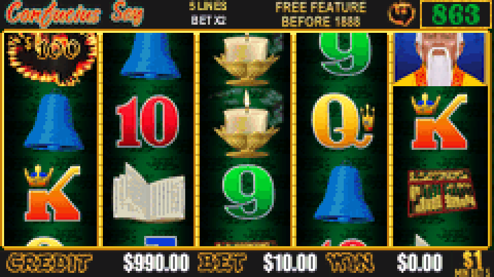

# Confucius Say for StickS3

An offline, play-money reconstruction of Phoenix Link — Confucius Say for M5Stack StickS3. The game runs on the device without Wi-Fi, a phone or a server.

[**Play in your browser**](https://xberenguer.github.io/phoenix-link-confucius-say/) No hardware or installation is needed.

Start with [your first game](docs/getting-started.md), the [full game guide](docs/README.md), or [rules and payouts](docs/payouts.md).

The animated preview shows the actual 240 × 135 game enlarged 3×, recorded during ordinary browser autoplay. The linked gallery uses deterministic desktop renders. All demonstration credits are synthetic; no player's saved bank or device photographs are included.

This package uses version **0.2.102**, local model H (`0x00020011`). The game source, numeric tables and deterministic gallery are synchronized to that source. The browser compiles the same Engine, renderer and audio programs. Original casino probabilities and complete original artwork/audio banks remain unrecovered; see [math and evidence](docs/math-and-evidence.md).

The first public snapshot is 0.2.102, followed by 0.2.110, 0.2.120 and subsequent ten-version milestones. Development and validated local device updates continue between public snapshots.

## Game reference

- [Controls and menus](docs/controls.md)
- [Browser play without hardware](docs/browser-play.md)
- [Wagers, denominations and lines](docs/wagers.md)
- [Every symbol and combination category](docs/symbols-and-combinations.md)
- [Symbols, combinations and payouts](docs/payouts.md)
- [Free games and Twin Reels](docs/free-games.md)
- [Phoenix Hold & Spin, revival and jackpots](docs/hold-and-spin.md)
- [The 1888 collection counter](docs/collection-counter.md)
- [Graphics and animation gallery](docs/graphics.md)
- [Sounds and music events](docs/audio.md)
- [Math, RNG and evidence](docs/math-and-evidence.md)
- [Saving and recovery](docs/saving.md)
- [Build and flash](docs/build-and-flash.md)
- [Troubleshooting](docs/troubleshooting.md)
- [Developer reference](docs/developer-reference.md)
- [Testing and reproducible evidence](docs/testing.md)
- [Sources and attribution](docs/sources.md)
- [Version history](CHANGELOG.md)

Source comments and documentation distinguish source-observed rules, configuration-specific payouts, local model assumptions and unresolved details. A supported control or payout does not establish that every regional casino version uses the same program.

This repository is the game and its required assets. It is an independent reconstruction; it does not include a casino server, payment system, licensed machine software, recovered PAR sheet or certification. See [math and evidence](docs/math-and-evidence.md) for the precise limits and [attribution](docs/attribution.md) for third-party material.
