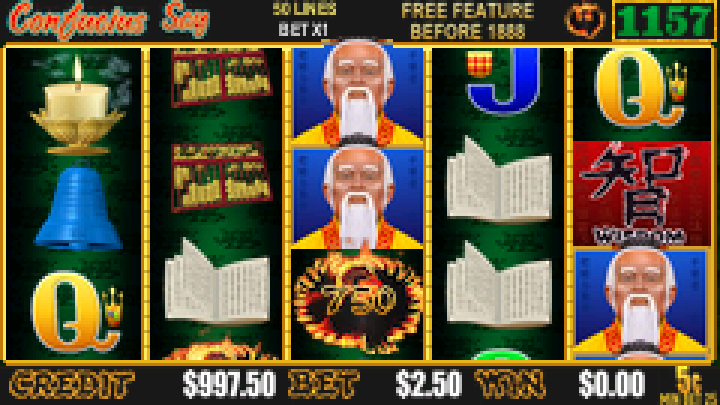

# Confucius Say for StickS3

An offline, play-money reconstruction of Phoenix Link — Confucius Say for M5Stack StickS3. The installed game runs without Wi-Fi, a phone or a server.

**Get a StickS3:** [Official M5Stack shop](https://shop.m5stack.com/products/m5sticks3-esp32s3-mini-iot-dev-kit) · [Amazon](https://www.amazon.com/dp/B0GWHN8HK3)

[**Play in your browser**](https://xberenguer.github.io/phoenix-link-confucius-say/) — no hardware or installation needed.

**Current release: 0.2.104.** Each boot, page reload or flash starts a fresh manual session with **1,000 credits at the default $1 denomination ($1,000)**. Progress is session-only; there is no saved-game import or restore. Changing denomination during play changes the credit units, not the money balance.

Outcomes use AES-256 CTR_DRBG with fresh entropy and fail-closed action handling. The local model is **I (`0x00020012`)**. Its prices, feature probabilities and Simulator Return ranges are implementation references; original casino odds remain unrecovered. See [math and evidence](docs/math-and-evidence.md).

Start with [your first game](docs/getting-started.md), the [full game guide](docs/README.md), or [rules and payouts](docs/payouts.md).

## Game reference

- [Controls and menus](docs/controls.md)
- [Browser play](docs/browser-play.md)
- [Wagers, denominations and lines](docs/wagers.md)
- [Symbols and combinations](docs/symbols-and-combinations.md)
- [Payouts](docs/payouts.md)
- [Free games and Twin Reels](docs/free-games.md)
- [Phoenix Hold & Spin](docs/hold-and-spin.md)
- [The 1888 collection counter](docs/collection-counter.md)
- [Graphics gallery](docs/graphics.md)
- [Sounds and music events](docs/audio.md)
- [Fresh sessions and funding](docs/saving.md)
- [Settings and Simulator Return](docs/settings.md)
- [Build and flash](docs/build-and-flash.md)
- [Troubleshooting](docs/troubleshooting.md)
- [Developer reference](docs/developer-reference.md)
- [Testing](docs/testing.md)
- [Sources and attribution](docs/sources.md)
- [Current release notes](CHANGELOG.md)

The browser compiles the same C++ game, renderer and audio programs. Preview media uses synthetic demonstration credits. Source, build, browser and physical-device checks have separate scopes in [testing](docs/testing.md).

This independent project includes no casino payment service or recovered manufacturer PAR sheet. Artwork, audio and code rights are described in [attribution](docs/attribution.md).
