# Full player guide

[**▶ Play Confucius Say**](https://xberenguer.github.io/phoenix-link-confucius-say/) · [**Browse the Gallery**](graphics.md) · [Back to the project](../README.md)

Everything you need to start playing, recognize the symbols and follow the bonus features. The pictures below are captured from the actual game and its menus. Click a picture to see it at full size; the [Gallery](graphics.md) also has the moving sequences and individual symbol close-ups.

[Your first game](#your-first-game) · [Reading the screen](#reading-the-screen) · [Symbols and wins](#symbols-and-wins) · [Free Games](#wisdom-free-games) · [Hold & Spin](#phoenix-hold--spin) · [Settings](#make-it-your-game) · [Help](#if-you-get-stuck) · [Jackpots](#jackpots)

## Your first game

### 1. Open the game

[Open the browser game](https://xberenguer.github.io/phoenix-link-confucius-say/) and choose **Play with sound**. You do not need an account, an installation or a handheld. All money in the game is pretend money.

| Use | Blue button | Grey button |
|---|---|---|
| Phone or tablet | Tap **SPIN / SELECT** | Tap **BET / NEXT** |
| Computer keyboard | **Space** | **Enter** or **→** |
| In a menu | Select the highlighted choice | Move to the next choice |

Hold blue for autoplay; hold grey for the game menu. On a keyboard, hold the corresponding key. **Escape** also opens or backs out of menus. [Full controls →](controls.md)

### 2. Choose a denomination

The denomination is the value of one credit. Use grey to move through the choices and blue to select one. Start with a small denomination if you want the credit amounts to be easy to follow.

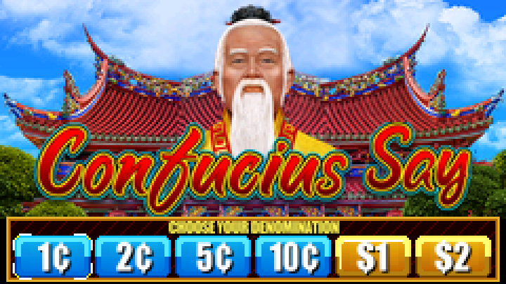

Looking for the larger denominations?

Hold blue on this first screen to switch to **High Limit**. It changes the available denominations; it does not add money to your balance.

### 3. Choose lines and a bet

**What does PLAY LINES mean?** A “reel” is one vertical column. The five columns each show three symbols. A line is a fixed route that picks one position in each column, from left to right. Some routes go straight across a row; others bend between the rows.

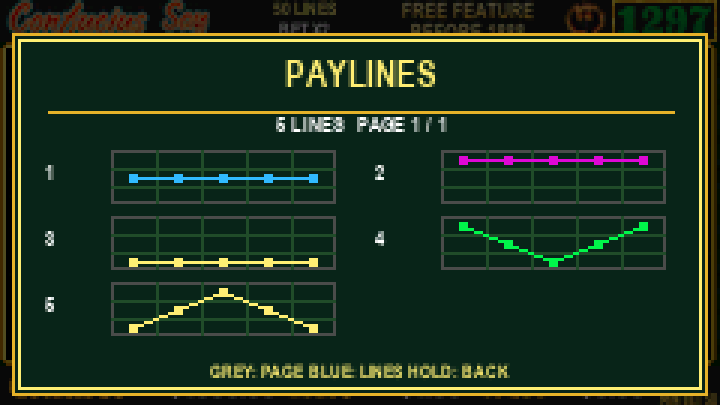

In this chart, **line 1** reads the middle position in every column. **Line 4** reads **top → middle → bottom → middle → top**. Selecting 25 lines means the game checks 25 routes through the **same 15 symbols from one spin**. It still spins once, and you do not need to identify the wins yourself.

Matching regular symbols must start at the leftmost column and continue along a selected route. Confucius can help as a Wild; Wisdom and Phoenix have separate feature rules. [Follow an actual winning line, picture by picture →](paylines.md)

[Browse every numbered line in all six layouts, with enlarged diagrams →](paylines.md#every-line)

Choose a **PLAY LINES** option, then one of the red **BET** buttons. Grey moves the highlight; blue confirms it. The red number is the full bet in credits.

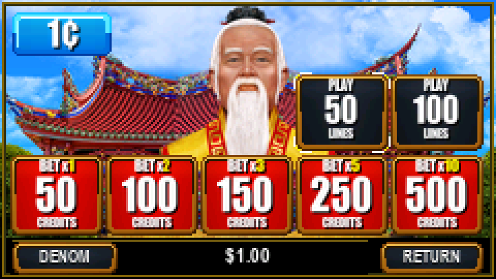

Your total stake is **denomination × number of lines × bet multiplier**. For example, 1¢ × 50 lines × 2 costs $1.00. [Bet choices explained →](wagers.md)

### 4. Add play credits

The reels initially open with **CREDIT $0.00**. The symbols already visible are the opening display; no spin has been bought yet.

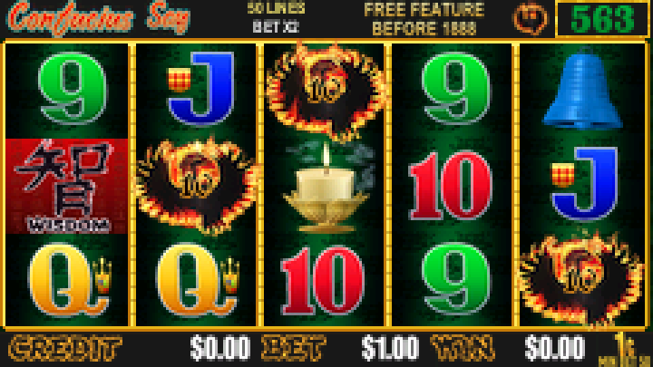

Press blue to open the voucher. Grey moves between digits; blue changes the selected digit. Hold blue to move one digit left. Move to **INSERT CREDITS** and press blue when the amount is ready.

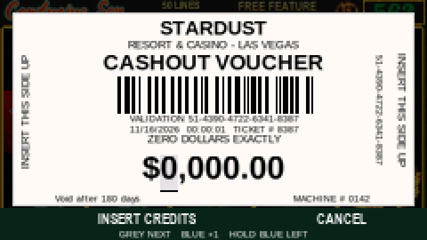

This captured voucher was filled with $1,000.00. You can choose a different play-money amount.

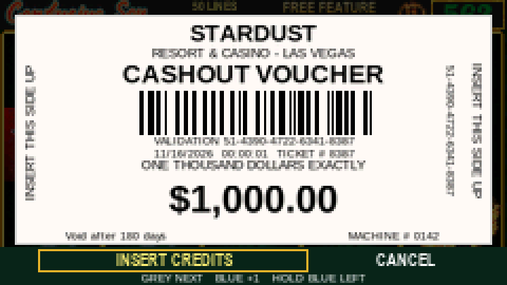

### 5. Press blue to spin

After inserting credits, you return to the reels. Press blue to play. Grey opens the wager choices again; hold grey for the menu.

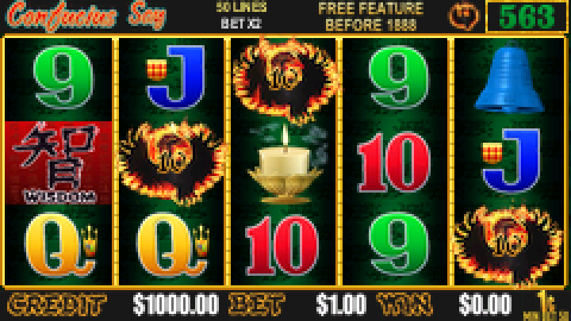

Each new spin uses the selected stake. Hold blue to turn autoplay on; hold it again, or press blue briefly, to stop further automatic play. A feature already in progress still finishes.

**Keep the game page open to keep this session.** Reloading or opening another game starts fresh with no saved balance or feature progress. [Credits and sessions →](saving.md)

## Reading the screen

The game has **five columns and three rows**. The top-right green number is the Phoenix collection counter. The bottom strip shows your credit balance, current bet, win and denomination.

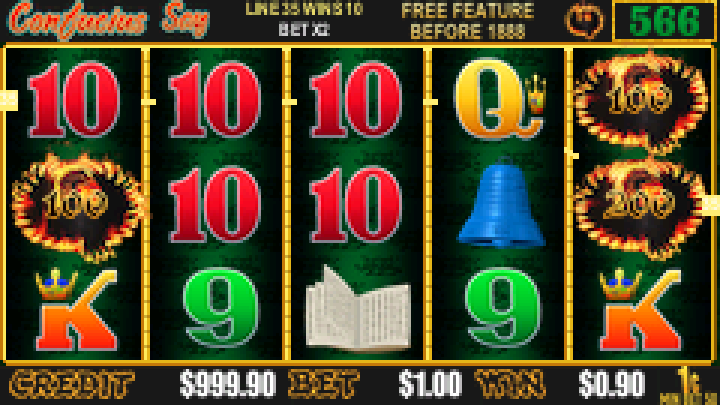

**Watch this captured sequence in motion:**

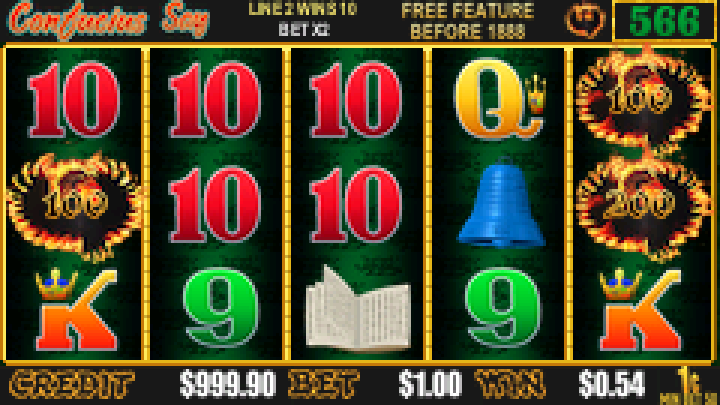

| On the screen | What it tells you |
|---|---|
| **CREDIT** | The play money available in this session |
| **BET** | The total cost of a paid spin |
| **WIN** | The win being shown for the current result or feature |
| **Green number, top right** | The collection counter for your active wager |
| **Top announcement** | A line-win message, feature entry, Free Games progress or remaining respins |
| **Bottom-right coin value** | What one credit is worth |

The reels move, land, show any wins and transfer the result into the balance. A rising WIN number is the same win being counted up, not an extra award each time it changes.

## Symbols and wins

The numbered and picture symbols pay along selected lines, starting from the **leftmost reel**. Confucius is Wild for regular line symbols. Red Wisdom tiles and Phoenixes have their own feature rules.

### Recognize every symbol

Compare each icon with its recorded movement. Jack, Queen and King use static artwork. Click any image to open it separately.

| Symbol | Still | Animation |
|---|---|---|
| **9 — winning blink** |  |  |
| **10 — winning cycle** | <a href="media/gameplay/symbols/primary/ten.png">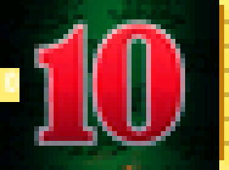</a> | <a href="media/gameplay/symbols/primary/ten-motion.webp">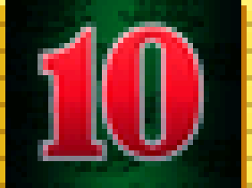</a> |
| **Jack** | <a href="media/gameplay/symbols/primary/jack.png">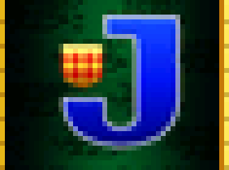</a> | Still artwork |
| **Queen** | <a href="media/gameplay/symbols/primary/queen.png">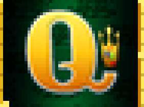</a> | Still artwork |
| **King** | <a href="media/gameplay/symbols/primary/king.png">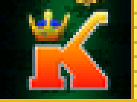</a> | Still artwork |
| **Bell** | <a href="media/gameplay/symbols/primary/bell.png">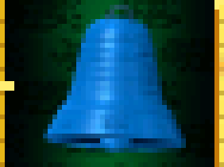</a> | <a href="media/gameplay/symbols/primary/bell-motion.webp">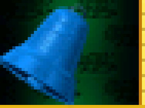</a> |
| **Abacus** | <a href="media/gameplay/symbols/primary/abacus.png">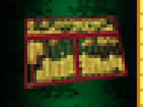</a> | <a href="media/gameplay/symbols/primary/abacus-motion.webp">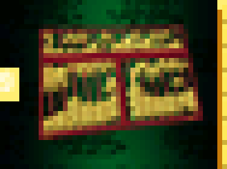</a> |
| **Book** | <a href="media/gameplay/symbols/primary/book.png">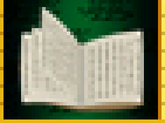</a> | <a href="media/gameplay/symbols/primary/book-motion.webp">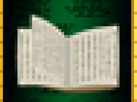</a> |
| **Candle — moving flame** |  |  |
| **Confucius** |  | <a href="media/gameplay/symbols/primary/confucius-motion.webp">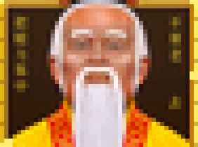</a> |
| **Wisdom** | <a href="media/gameplay/symbols/primary/wisdom.png">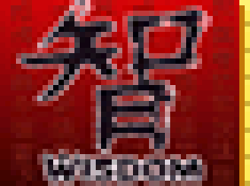</a> | <a href="media/gameplay/symbols/primary/wisdom-motion.webp">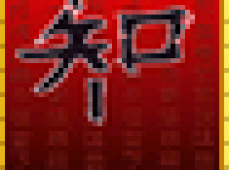</a> |
| **Phoenix** | <a href="media/gameplay/symbols/primary/phoenix-full.png">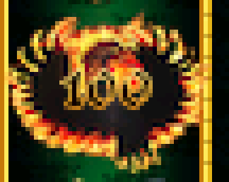</a> | <a href="media/gameplay/symbols/primary/phoenix-motion-full.webp">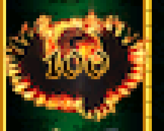</a> |

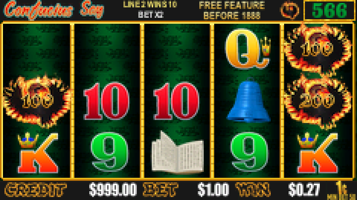

**Watch this captured sequence in motion:**

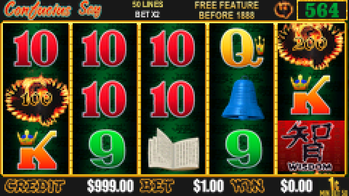

The in-game pay page lists symbol pays for the current configuration. The **Base** and **Free** pages can differ.

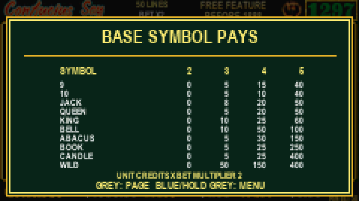

Paylines show which row each active line follows across the five reels. You can browse these diagrams without changing the bet.

[Every symbol and its animation](graphics.md#reel-symbols) · [Line wins and Wilds](symbols-and-combinations.md) · [Payout details](payouts.md) · [All payline pages](paylines.md)

### Gold Confucius merges

When qualifying adjacent Confucius faces in one column are part of an awarded win, they can join into a tall gold figure. The [Gallery](graphics.md#confucius-merges) shows both the two-row and three-row merge moving in their original reel context.

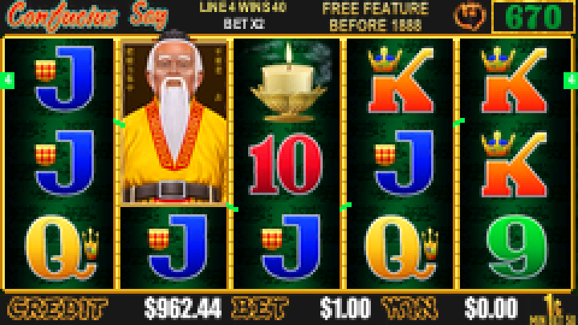

**Watch this captured sequence in motion:**

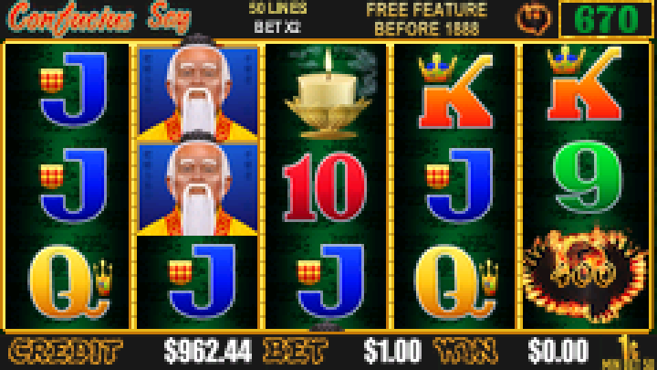

## Wisdom Free Games

**Three or more red Wisdom symbols anywhere on the Base reels award six Free Games.** You do not have to line them up on a payline. This captured trigger has ordinary mixed symbols around the Wisdom tiles.

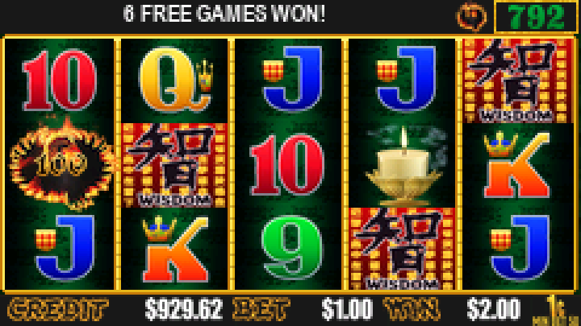

**Watch this captured sequence in motion:**

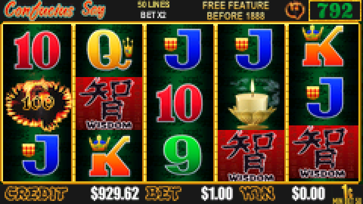

Press blue at **START** to continue. In Twin Free Games, columns **1–2** move as a pair, column **3** stays independent, and columns **4–5** form another pair. Your progress appears above the reels.

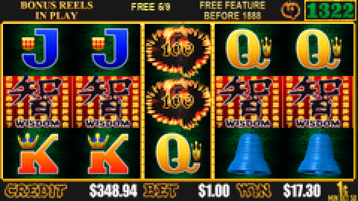

**Watch this captured sequence in motion:**

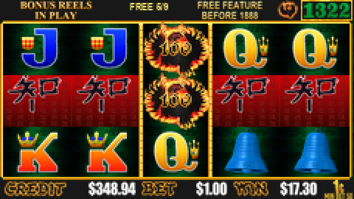

A Free Game can start Hold & Spin too. It pauses the Free Games sequence and returns to the remaining games afterward. [Free Games and retriggers →](free-games.md)

## Phoenix Hold & Spin

**Six through fourteen Phoenixes** start Hold & Spin. The triggering birds lock in place, and the remaining positions respin. Start with three respins; each new Phoenix resets the count to three.

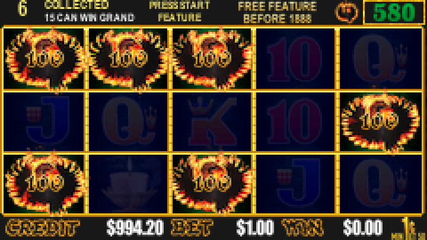

**Watch this captured sequence in motion:**

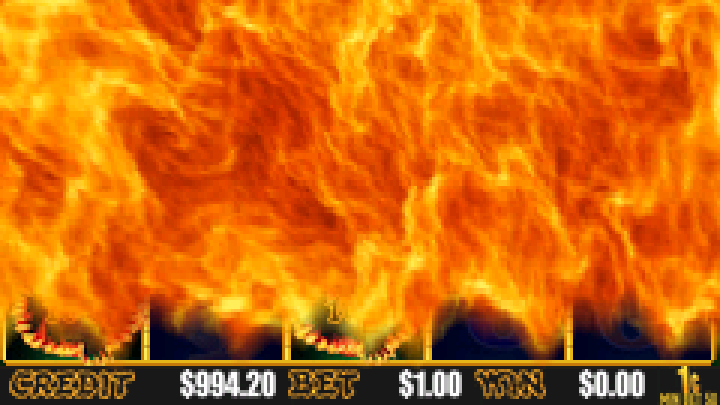

Watch the separate cells while the remaining positions spin. A held Phoenix keeps its displayed value.

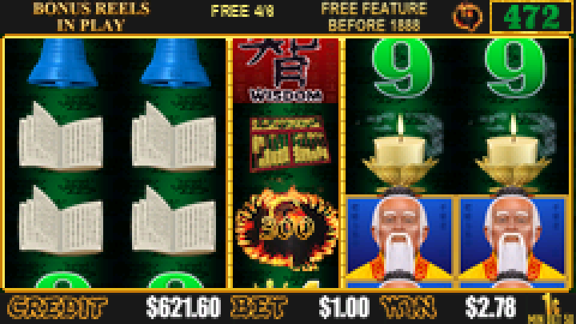

**Watch this captured sequence in motion:**

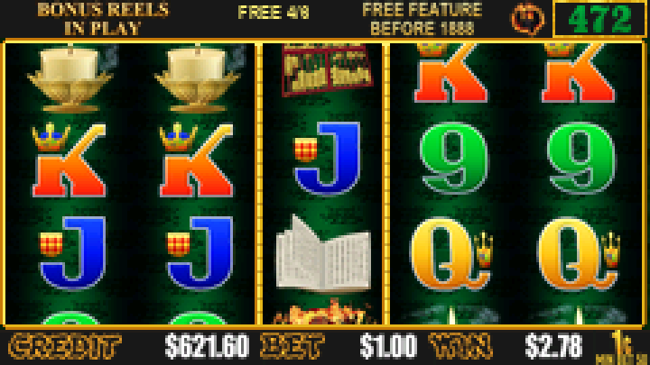

If the initial three respins find no new Phoenixes, the feature can revive. The existing birds remain and three respins return.

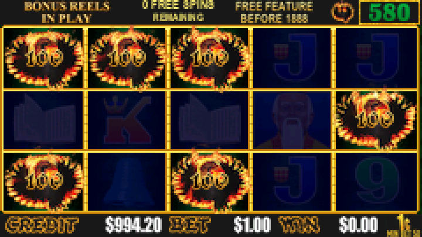

**Watch this captured sequence in motion:**

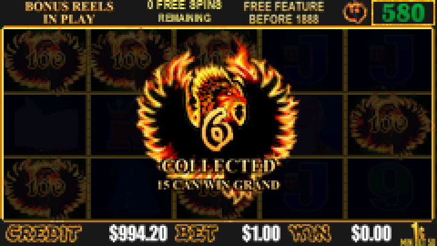

At the end, Phoenix values are collected into the running total. A blue press during the tally finishes collecting the remaining amounts immediately, then lets the ending continue.

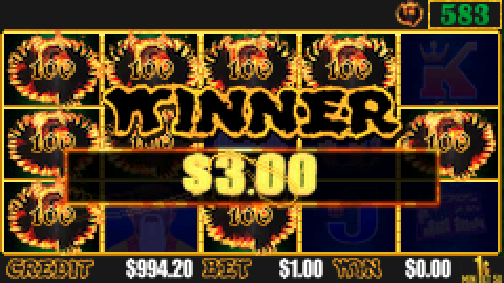

**Watch this captured sequence in motion:**

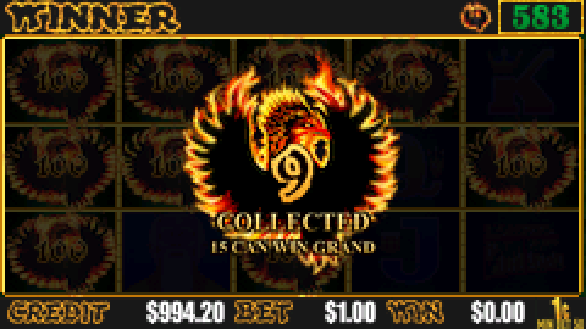

[Hold & Spin, collection and feature endings →](hold-and-spin.md)

## The green collection counter

Phoenixes also advance the green counter for your active wager. It can award a **separate free Hold & Spin** before the displayed 1888 limit. That is a different route from the red Wisdom Free Games feature.

Changing denomination or total-credit stake can select another counter. Adding credits does not reset the counter during the current session. [How the collection counter works →](collection-counter.md)

## Make it your game

Hold grey for **Game Menu**. Grey moves the highlight and blue selects. Hold grey to return to the parent page; return to the game to resume a paused feature.

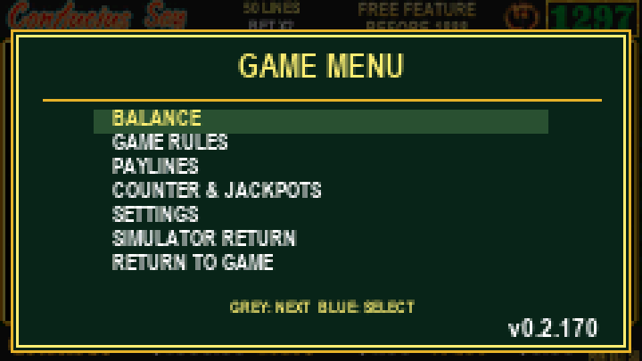

### Add credits

**Balance** offers a custom voucher, fixed play-money additions and automatic refill. Adding money preserves the current session's wager and collection progress.

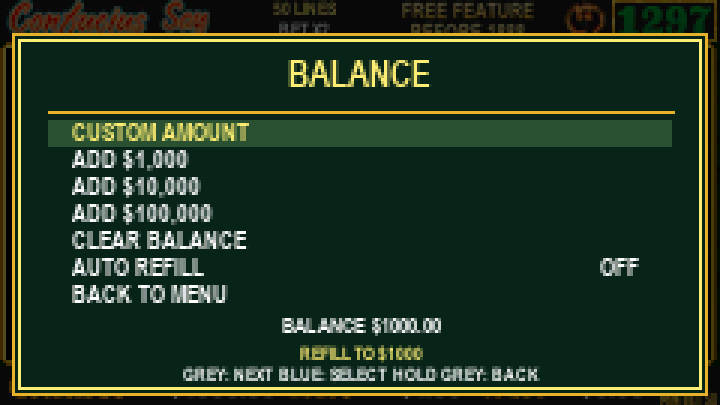

### Sound and volume

Choose **Settings → Sound** for master sound, reel-stop sounds, volume and audio tests. The default volume is 10%. If browser sound is silent, click or tap the game first.

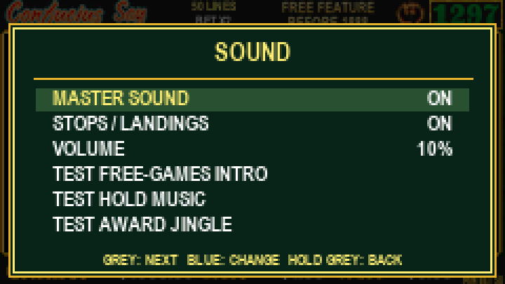

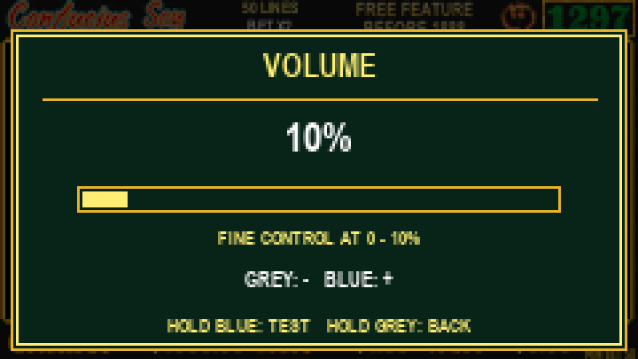

### Display

Choose **Settings → Display** for brightness, cash/credit display and screen flip. These presentation choices do not change the balance or a result.

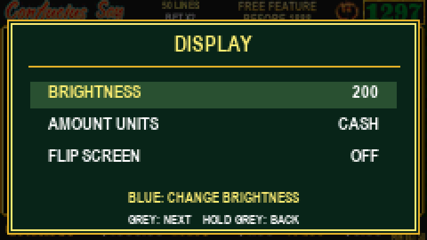

[All settings](settings.md) · [Sound and music guide](audio.md) · [Handheld installation](build-and-flash.md)

## If you get stuck

| What happened? | What to do |
|---|---|
| The game asks for credits | Press blue to open the voucher, or use Game Menu → Balance |
| A feature is waiting | Press blue at START or the continuation prompt |
| Autoplay keeps going | Press blue briefly, or hold blue again |
| Sound is silent | Click/tap the game, then check Settings → Sound and Volume |
| A menu seems to pause a bonus | Return to the game; menus pause the current presentation |
| The balance disappeared after a reload | A reload starts a new session; progress is held only in the open game |

[Browser help](browser-play.md) · [Troubleshooting](troubleshooting.md) · [Complete controls](controls.md) · [Short glossary](glossary.md)

## More detail

The pictures are selected real play and menu captures, not a guide to how often a result will happen. The game is an independent recreation with a local model. [Sources](sources.md), [attribution](attribution.md), [release notes](../CHANGELOG.md) and the [recording notes](gallery-recording.md) explain the project and its captures.

For the technical side: [developer reference](developer-reference.md), [randomness](randomness.md), [math and evidence](math-and-evidence.md) and [testing](testing.md).

## Jackpots

Double-press grey during play to open the jackpot board. It shows the values available for future prizes at the current configuration. Blue or grey closes it without spinning.

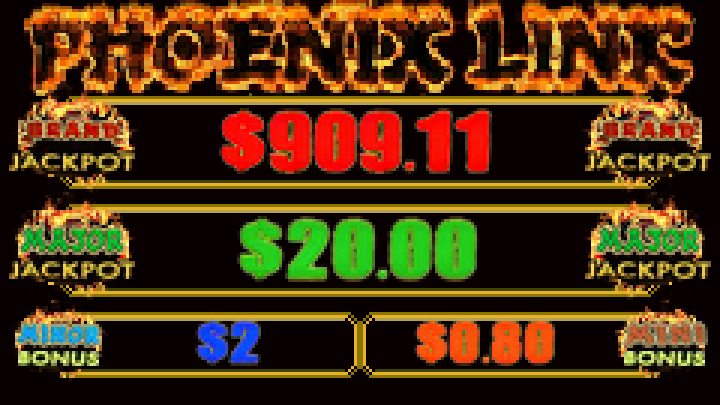

**The prize board in motion:**

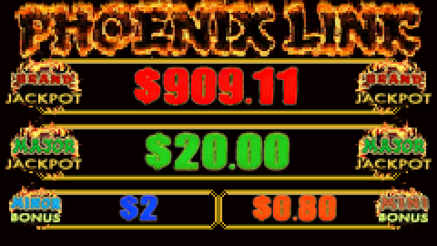

Named Phoenixes can carry **Mini**, **Minor** or **Major** prizes. A repeated name means two or three units of that named prize, rather than multiple occupied cells.

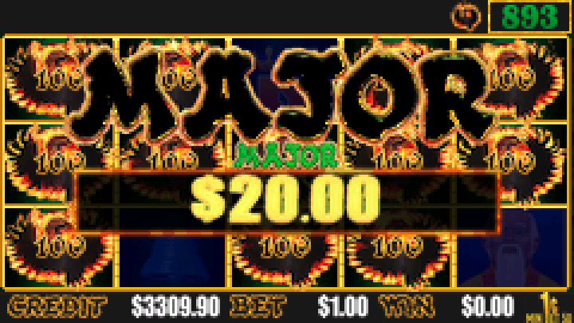

**Watch this captured award in motion:**

A full board of fifteen Phoenixes awards **Grand plus the held values** in this simulator.

**Watch this captured award in motion:**

[All named Phoenix close-ups and their animations](graphics.md#named-phoenix-prizes) · [Jackpot values](jackpot-values.md) · [Full feature rules](hold-and-spin.md)
