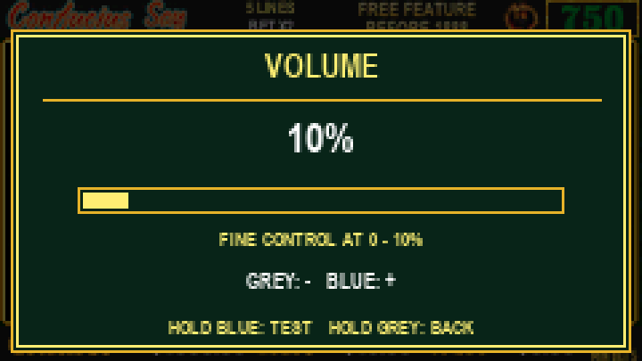

# Sounds, music and event order

Sounds are triggered by reel and feature events. The game includes reconstructed common cues, dedicated feature-entry material, a long Hold/award stream and a separate reconstructed Twin phrase. These are not a recovered original manufacturer soundbank, and acoustic identity has not been established.

The [audio API](../firmware/src/audio.h), [registered cue bank](../firmware/src/audio_cues.cpp), [UI routing](../firmware/src/ui.cpp) and [music worker](../firmware/src/audio_music.cpp) are the implementation authority. A cue enum existing does not mean that it is registered or dispatched in every state.

## Common play sounds

| Event | Current routing |
|---|---|
| Reel motion | No reel-bed effect |
| A reel/group impacts | Finite reel-stop or selected Phoenix-arrival family, with ordered pending tails |
| Phoenix anticipation/arrival | Initial, Follow or Third family where the current landing selector qualifies it |
| Awarded Confucius/Sage win | Scoped win cue; no generic flourish on every winning or stopped reel |
| Cash added | Dedicated cash-in cue |
| A Phoenix amount is collected | Collection/count-up cue tied to the pickup event |
| Three-Wisdom initial entry | Dedicated measured 7.12-second announcement cue |

The Phoenix families are **not** a random rising scale and not simply one note for every Phoenix. Current selection examines which presented reel group contains arrivals, how many Phoenixes have already appeared and whether the natural trigger remains possible. The Third-family branch is limited to separately presented ordinary columns; quick-stop/coalesced, Twin and Hold cases retain their scoped behavior. This logic remains a partial reconstruction, not a recovered original event table. See [landing_cues.h](../firmware/src/landing_cues.h).

The bank includes analytically generated material and fresh-phase spectral reconstructions from repeated machine events. The longer clean-reference feature stream has a different provenance. Clearer reconstructed audio can still have an imperfect timbre, envelope or melody.

## Feature music programs

| Program | Lifecycle |
|---|---|
| Hold | Independent streamed bed during the bonus; first respin can wait for an audible opening lead |
| Twin Free | Full 27.911-second reconstructed phrase, restarting after its loop boundary |
| Collected | A distinct collection/completion portion rather than the Twin bed |
| Major award | Finite named-award program with its own timing and tail |
| Big award | Finite qualifying cash/coin celebration program |
| Off | Stop requesting a feature bed while preserving the worker's applicable finite-tail policy |

Twin uses immutable mono PCM at 22,050 Hz. START requests its phrase before the first free-spin preparation. It remains eligible through the last Free presentation even if the Engine has already switched its next action to Base. Hold, collection and finite awards take priority. Returning from nested Hold starts a fresh Twin phrase during the source-fitted return fire; it does not resume an arbitrary old elapsed phase.

The longer program is stored in [feature_music.mp3](../firmware/data/feature_music.mp3); the Twin bank is compiled in [twin_music42.cpp](../firmware/src/twin_music42.cpp). Source reconstruction and playback streaming are separate from any perceptual claim of exact vendor identity.

## Celebration programs

The [qQ4gPanpkdU recording](https://www.youtube.com/watch?v=qQ4gPanpkdU&t=87s) provides a reference for the celebration program.

In the simulator, ordinary collection, named awards, large-cash preludes and a qualifying final-Free combined result have separate routes. **Visible coins do not automatically request the Big-award phrase.** The short numeric-only 25–49× Hold burst adds no new celebration jingle: the filmed 25× coin event does not supply a qualified same-song match to the 1:27 reference. Existing Hold/Collected audio continues under its existing routing. The longer 50× cash-program gate remains a separate provisional presentation policy. See [Hold endings](hold-and-spin.md#count-up-and-ending-order).

Manual play and autoplay share those event routes. Backend queue acceptance proves software submission, not the speaker's acoustic onset. Software diagnostics cannot alone establish that all audible stops are aligned to a camera frame.

## Menu pause and resume

Opening a menu pauses the current feature and its music. Returning to the game continues from that position. Sound-menu tests have their own playback context, so an audition does not rewind the paused feature tune. Short audio buffers already submitted to the output may finish as the pause begins.

## Settings and auditions

Hold grey → Settings → Sound provides master sound, a stops/landings switch, fine volume and test playback. Master mute covers cues and feature music.

Volume moves in 1% steps through the quiet 0–10% range, then 5% steps. It clamps at either end instead of wrapping a quiet setting to full volume. In the volume page, blue raises and grey lowers it.

TEST FREE-GAMES INTRO auditions the Wisdom entry; TEST HOLD MUSIC auditions the Hold program; TEST AWARD JINGLE auditions the award program. An audition does not stake money or change the counter or outcome generator. Twin music also has a developer audition API.

## Bank and playback checks

The initial Phoenix arrival cues are synthesized from analytic recipes. Backend tests check that landing sounds finish playing. MP3 completion/award music and Twin PCM have separate cache and decoder checks.

Initial three-Wisdom entry uses its dedicated cue. Some retrigger/delayed-Free branches use a separate reconstructed FreeStart; their exact original melody and timing remain under investigation.

## Remaining work

Original cue registers, all landing eligibility cases, recording-room transfer functions, exactly matched envelopes, missing source variants and perceived speaker balance remain incomplete. Some events are intentionally quiet; audible differences do not establish a missing award or a different game result.

For crackle, missing music or battery resets, use [troubleshooting](troubleshooting.md#audio). The official [StickS3 hardware notes](https://docs.m5stack.com/en/core/StickS3) recommend keeping battery-powered speaker volume below 75% to reduce unexpected power-related resets.
