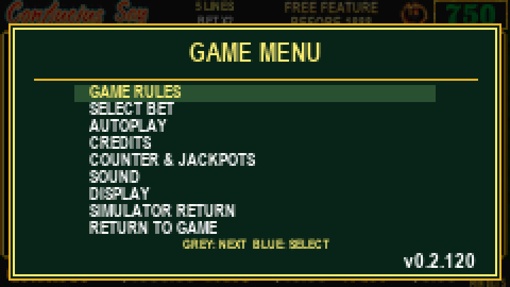

# Controls and menus

## During play

| Input | Action |
|---|---|
| Short blue press | Spin, continue a prompted feature, or advance the current animation where supported; while autoplay is active, turn it off |
| Hold blue | Toggle autoplay on or off |
| Short large grey press | Open the wager-selection screen, or queue it until a running sequence permits entry |
| Hold large grey | Open Game Menu |
| Double-press large grey | Open the live Jackpots board |

There is no on-screen autoplay marker. Each boot, reload or flash starts a fresh game with autoplay off. The small power button is separate from the large grey game-control button.

Stopping autoplay stops further paid automatic play; it does not discard the current result or an already owed Free/Hold session.

The implemented long-press threshold is 850 ms. In normal game view, grey's single-release action waits through a 400 ms double-click window; that delay distinguishes the wager shortcut from the Jackpot shortcut. On menu pages, grey navigation is immediate. Double-grey is a game-view gesture, not a second blue spin command.

## Wager-selection screen

Short grey presses move focus; blue selects the highlighted choice. The screen opens on the current denomination. Selecting a denomination focuses the currently selected line control when available. Selecting lines focuses the current bet multiplier when it is offered; otherwise a valid available choice is used. The red-button credit amounts depend on the selected lines and multiplier. Holding the large grey button on this screen returns directly to the game.

An unavailable row cannot start a paid spin. Owed features protect their existing wager; opening the screen does not change the paid round that is already in progress.

## Game Menu

| Entry | Purpose |
|---|---|
| Game Rules | Inspect the implemented rule and pay pages |
| Select Bet | Open the same wager-selection screen |
| Autoplay | Toggle automatic play |
| Credits | Add money, clear the balance or configure automatic refill |
| Counter & Jackpots | Set the active feature counter and edit or restore jackpot amounts |
| Sound | Configure sound effects, volume and test playback |
| Display | Configure brightness, amount units and orientation |
| Simulator Return | Review and apply six local-model choices affecting future Grand |
| Return to Game | Resume the game view |

On menu pages, grey moves and blue selects. Simulator Return offers six local-model options at a qualified closed Base boundary. Applying a choice changes future Grand only for this live session. Displayed ranges are ideal-model references. See [Simulator Return](settings.md#simulator-return).

Hold grey to return to the parent menu. Credits, Sound, Display and Counter & Jackpots return to their selected Game Menu entry. Editors return to their parent without applying. The wager screen returns directly to play; closing the jackpot board also returns to play without spinning.

The bottom-right version mark appears in Game Menu. See [settings](settings.md) for the full option list and [troubleshooting](troubleshooting.md) for apparent input delays.

## Credit refill

The funding page lists **Add $1,000**, **Add $10,000**, **Add $100,000**, **Clear Balance**, Auto Refill and Back to Menu, in that order. Add choices increase the current balance. Clear Balance sets it to zero. Successful funding or clearing returns to Game with autoplay off; neither resets the live meter buckets, wager or statistics. Clearing leaves the Auto Refill preference in place.

Automatic refill uses the last supported $1,000, $10,000 or $100,000 amount added when another spin is unaffordable. If the selected wager exceeds that amount, it restores enough to fund the wager. Funding changes the money balance without resetting this session’s meter buckets, wager or statistics. Unfinished features and source/capacity faults can block funding. See [session rules](saving.md).

## Jackpot board and value editing

Double-grey during play opens the current Grand, Major, Minor and Mini amounts. Blue or grey closes the board without starting a spin. Opening it stops autoplay; unfinished feature work remains owed.

Under **Game Menu → Counter & Jackpots**, choose the feature counter or a jackpot. Grey moves through digits, Apply and Cancel; blue changes a digit or selects the highlighted action. Hold grey to cancel/back out. Apply returns to normal play with autoplay off. See [the allowed ranges and default restoration](settings.md#feature-counter-and-jackpot-amounts).

Implementation: [button timing/dispatch](../firmware/src/main.cpp), [single/double-grey helper](../firmware/src/game_black_tap.h), [UI control behavior](../firmware/src/ui.cpp).
