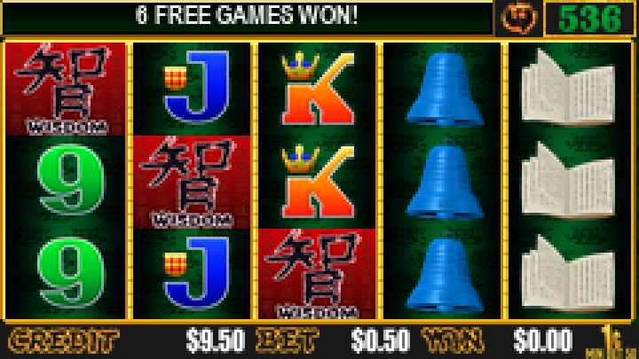

# Wisdom free games and Twin Spins

The initial red-Wisdom feature is distinct from the Phoenix counter's free Hold & Spin. The [manufacturer's Confucius description](https://www.aristocratgaming.com/us/games/us-phoenix-link) identifies Twin Spins; the [regional rulebook, page 3](https://casinos.lotoquebec.com/dam/jcr:4add9be1-336a-4efc-b4c9-e41696b876b2/Phoenix%20Link%20Confucius%20Say.pdf) describes the paired outer reels. The following details describe the current [simulator](../firmware/src/phoenix_engine.h).

## Trigger and entry

Three or more Wisdom scatters in Base award six free games in the current model. The scatter award and any line awards from the triggering spin also count; the free games are an additional result.

The initial three-Wisdom entry uses a dedicated announcement and jingle. The final reel settles, the six-free announcement appears above the board and START continues the feature. Accepting START commits the displayed existing win, exposes the paired reel frames and begins the first free motion after a roughly half-second preparation. This display preparation does not spend a second bet or draw an extra outcome.

The first free-game caption can count from 1 OF 1 to 1 OF 6 as a presentation. The Engine has already awarded six games; the caption does not generate them one at a time. Source-timed entry work is based on identified three-Wisdom sequences, including [5BUJOWxIBN4 near 10:10](https://www.youtube.com/watch?v=5BUJOWxIBN4&t=610s), rather than a universal timer for every scatter count.

## What Twin means

| Columns | Behavior during these free games |
|---|---|
| 1 and 2 | Share matching symbol stops and one paired opening |
| 3 | Independent center reel |
| 4 and 5 | Share matching symbol stops and one paired opening |

Matching Phoenix symbol positions do **not** require identical Phoenix amounts or named prizes. The Engine generates the second Phoenix's prize separately. A filmed example at [hmyKdYjMjAQ around 25:40](https://www.youtube.com/watch?v=hmyKdYjMjAQ&t=1540s) shows matching outer symbols with differing prizes.

Free spins use their own paytable. Confucius may occur only on columns 3–5 in the current model, compared with columns 2–5 in Base. The selected line count, denomination and multiplier remain those of the triggering paid round.

## Retriggers and nested Hold features

The simulator awards **three additional free games** for three or more Wisdoms during Free. This follows the targeted US observations. The Québec document instead specifies six extra games: that regional difference is retained in the evidence, not silently merged into the US target.

A free result can also enter Hold & Spin. The free-game session and its remaining games stay owed while the Hold runs. On return, Twin music starts a new phrase at the source-fitted fire-return event and the remaining free games continue without another paid stake. Meter-generated Holds can also queue during either part of the sequence.

Feature WIN is cumulative across the session. A Hold's values and a line/scatter award are not meant to be counted twice when their animations transfer to CREDIT. The [session guide](saving.md) explains live action safety and the fresh-game behavior on restart.

## Completion and approximations

The final settled Twin board keeps its paired frames and the completion caption until the next paid spin. Completion, credit transfer, named-prize celebrations and ordinary small endings have different presentation paths.

The Twin background phrase is reconstructed, not an extracted manufacturer soundbank. Entry clocks and selected lower-WIN count prefixes are fitted to qualified footage; unobserved configurations retain local display timing. The separate Free paytable and most feature frequencies remain incomplete original-data matches. See [audio](audio.md), [graphics](graphics.md) and [math](math-and-evidence.md).

Code: [entry controller](../firmware/src/wisdom_entry_controller30.h), [entry artwork](../firmware/src/wisdom_entry29.inc), [lower-WIN profiles](../firmware/src/wisdom_lower_win88.h), [music lifecycle](../firmware/src/twin_free_scope89.inc), [UI phase flow](../firmware/src/ui.cpp).
