# Gameplay gallery

[▶ Play the game](https://xberenguer.github.io/phoenix-link-confucius-say/) · [Symbols and animations](symbol-gallery.md) · [Menus and every line chart](menu-gallery.md)

Follow the game from choosing a wager to spins, wins, Free Games and Hold & Spin. **Jackpots are at the bottom.** Every picture and clip comes from the unchanged game actually being played. Tap a picture to open it full size; expand a **▶** row to watch its recorded sequence.

Close-ups in the [symbol gallery](symbol-gallery.md) show all twelve symbols, their implemented motion, both Confucius merges, visible cabinet artwork and all nine named Phoenix prizes. [How these recordings were made](gallery-recording.md).

## 1. Choose a denomination and a wager

The game opens with play credits at zero. Choose a coin value, a PLAY LINES option and a red BET button.

<a href="media/gameplay/screens/primary/startup-denomination.png">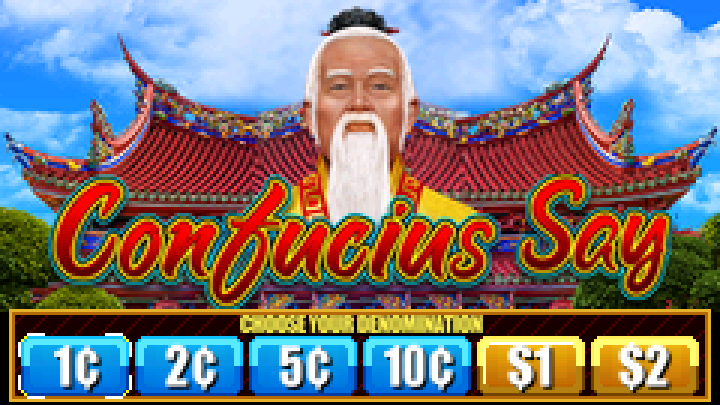</a>

<a href="media/gameplay/screens/primary/startup-lines-and-bet.png">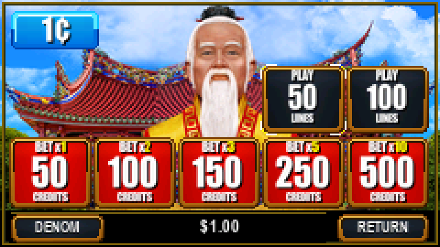</a>

## 2. Insert play credits

Open the voucher, enter an amount and select INSERT CREDITS. The screen then shows the funded game.

<a href="media/gameplay/screens/primary/credit-voucher.png">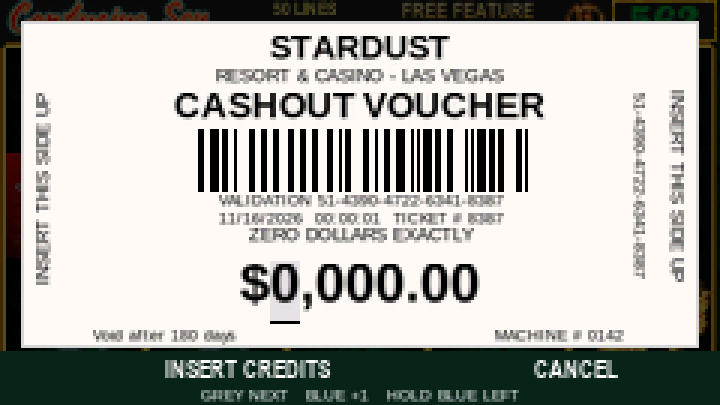</a>

<a href="media/gameplay/screens/primary/credit-voucher-filled.png">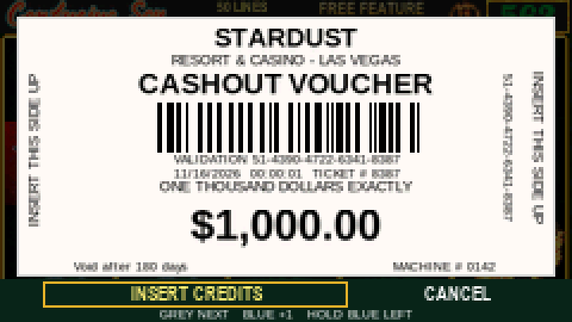</a>

<a href="media/gameplay/screens/primary/funded-reels.png">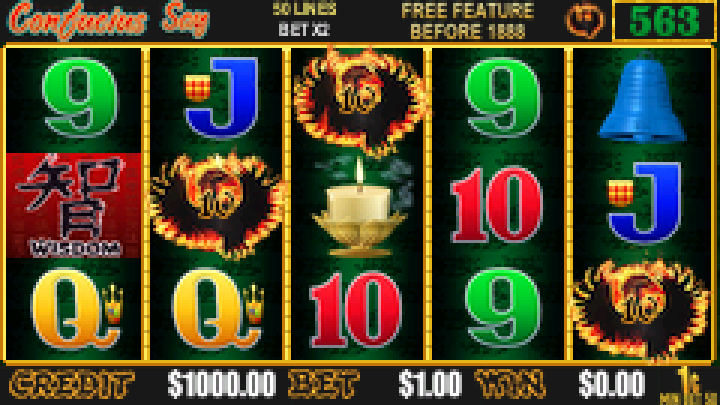</a>

## 3. Spin, land and see a win

These are results reached during play, with the symbols that actually landed. Reels move, settle and highlight their winning positions.

<a href="media/gameplay/screens/primary/base-spinning.png">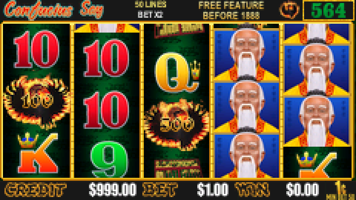</a>

<a href="media/gameplay/screens/primary/base-landing.png">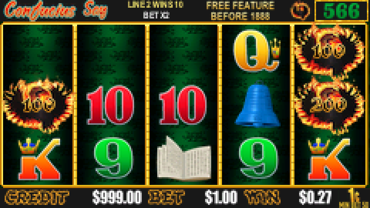</a>

<a href="media/gameplay/screens/primary/base-ready.png">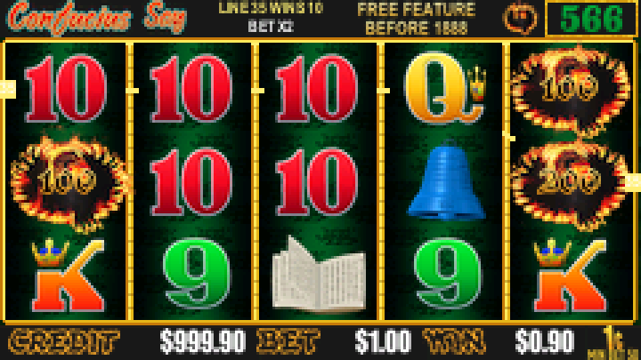</a>

▶ A complete opening spin — 1 continuous clip

**Part 1 of 1**

<a href="media/gameplay/sessions/primary/action-000002-clip-001-part01.webp">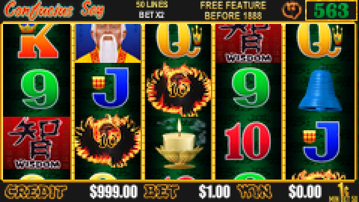</a>

## 4. Confucius joins into gold

Qualifying adjacent faces join into a two-row or three-row gold Confucius. Watch the original faces, the joining effect and the resulting figure in the same recorded sequence. Separate close-ups are in the [symbol gallery](symbol-gallery.md#confucius-merges).

▶ Two-row Confucius merge — 2 continuous clips

**Part 1 of 2**

<a href="media/gameplay/sessions/primary/action-000064-clip-010-part01.webp">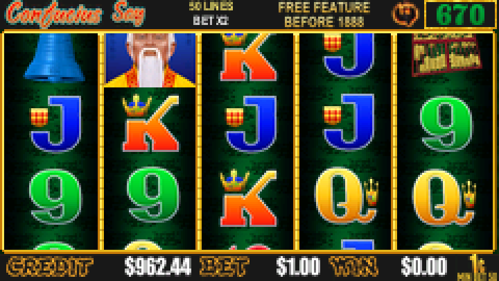</a>

Continue: part 2 of 2

<a href="media/gameplay/sessions/primary/action-000064-clip-010-part02.webp">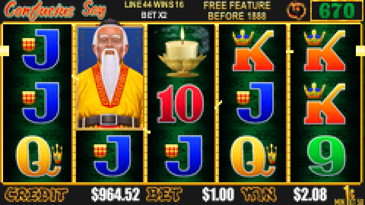</a>

▶ Three-row Confucius merge — 2 continuous clips

**Part 1 of 2**

<a href="media/gameplay/sessions/primary/action-000090-clip-012-part01.webp">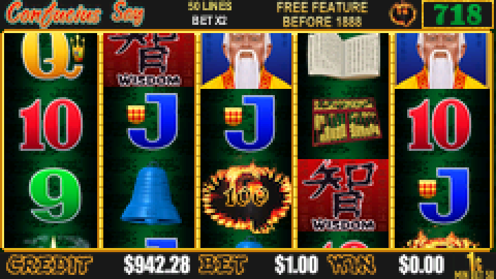</a>

Continue: part 2 of 2

<a href="media/gameplay/sessions/primary/action-000090-clip-012-part02.webp">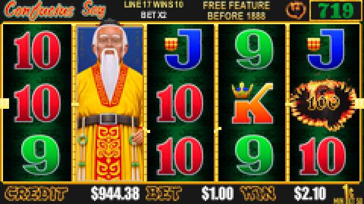</a>

## 5. Wisdom starts Twin Free Games

The first picture shows three red Wisdom symbols that landed in a real spin. The second shows a later Free Game with the paired outer reels. Expand the sequence to follow the trigger and entry continuously.

<a href="media/gameplay/screens/primary/free-ready.png">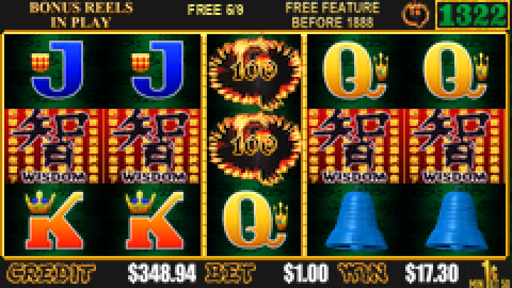</a>

▶ Wisdom trigger and entry into Free Games — 2 continuous clips

**Part 1 of 2**

<a href="media/gameplay/sessions/primary/action-000139-clip-013-part01.webp">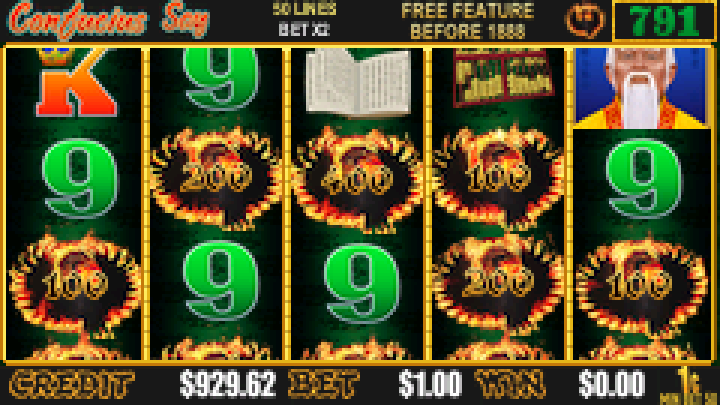</a>

Continue: part 2 of 2

<a href="media/gameplay/sessions/primary/action-000139-clip-013-part02.webp">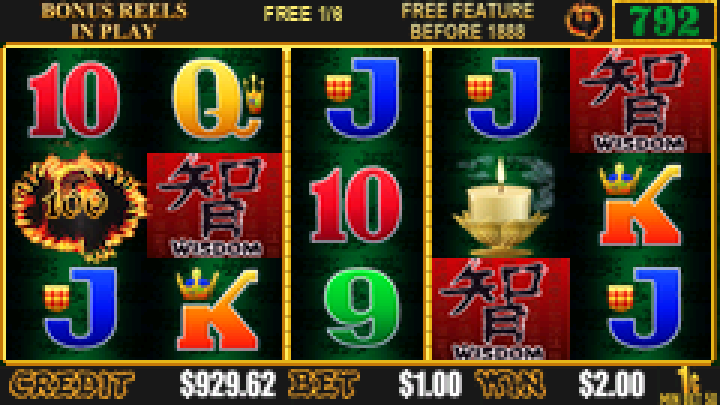</a>

## 6. Phoenix Hold & Spin begins

The fire transition introduces Hold & Spin. Phoenix symbols lock in place while the remaining positions respin.

<a href="media/gameplay/screens/primary/hold-hold-intro.png">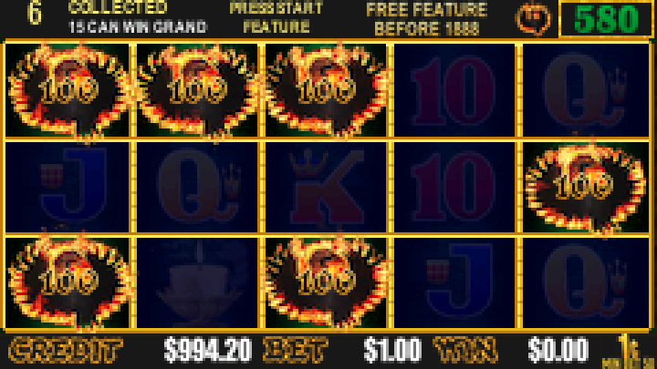</a>

<a href="media/gameplay/screens/primary/hold-ready.png">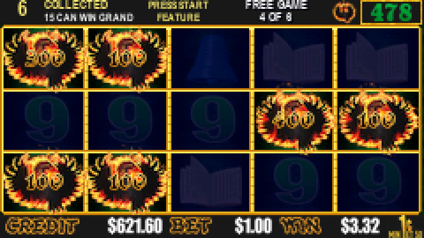</a>

▶ Hold & Spin entry and respins — 2 continuous clips

**Part 1 of 2**

<a href="media/gameplay/sessions/primary/action-000010-clip-005-part01.webp">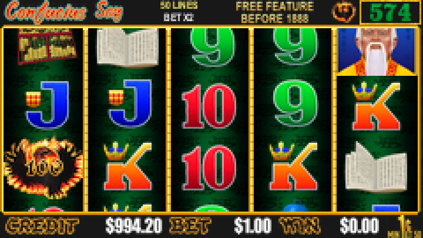</a>

Continue: part 2 of 2

<a href="media/gameplay/sessions/primary/action-000010-clip-005-part02.webp">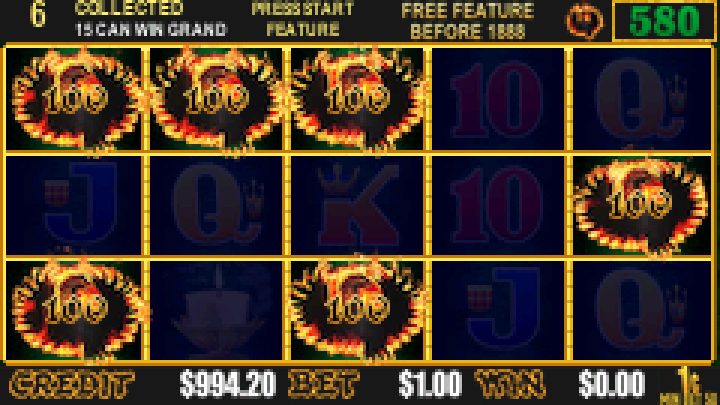</a>

## 7. Revival brings more respins

This recording reached a revival during Hold & Spin. The effect plays before the feature continues.

<a href="media/gameplay/screens/primary/hold-phoenix-revival.png">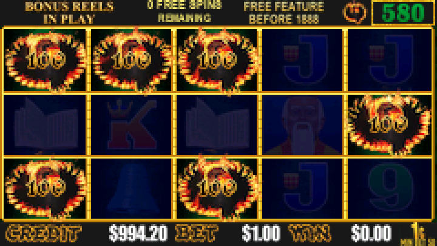</a>

▶ Revival and the following respins — 3 continuous clips

**Part 1 of 3**

<a href="media/gameplay/sessions/primary/action-000013-clip-006-part01.webp">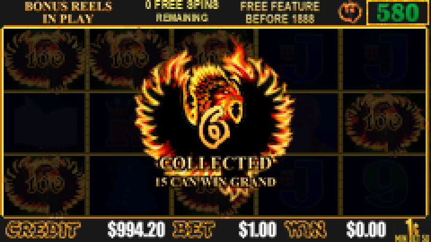</a>

Continue: part 2 of 3

<a href="media/gameplay/sessions/primary/action-000013-clip-006-part02.webp">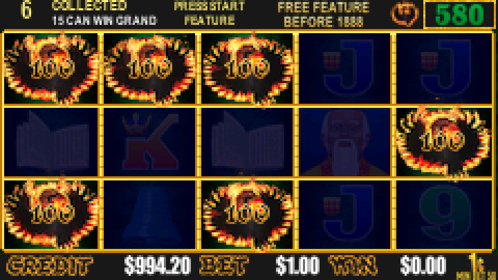</a>

Continue: part 3 of 3

<a href="media/gameplay/sessions/primary/action-000013-clip-006-part03.webp">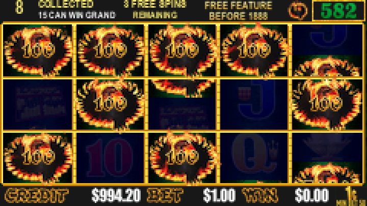</a>

## 8. Collect the Phoenix values and return

Follow the flying Phoenix, running total and return fire in a recorded collection.

<a href="media/gameplay/screens/primary/ordinary-win-transfer.png">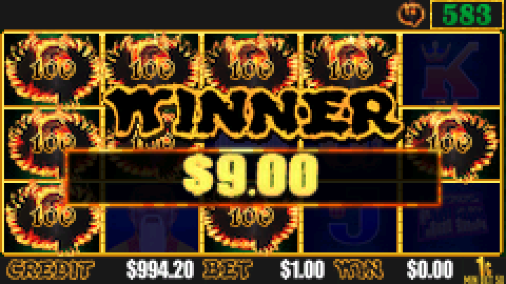</a>

▶ Phoenix collection, transfer and return — 3 continuous clips

**Part 1 of 3**

<a href="media/gameplay/sessions/primary/action-000019-clip-007-part01.webp">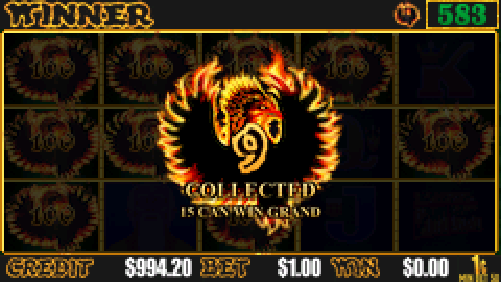</a>

Continue: part 2 of 3

<a href="media/gameplay/sessions/primary/action-000019-clip-007-part02.webp">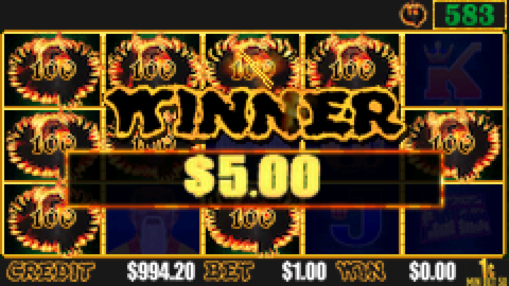</a>

Continue: part 3 of 3

<a href="media/gameplay/sessions/primary/action-000019-clip-007-part03.webp">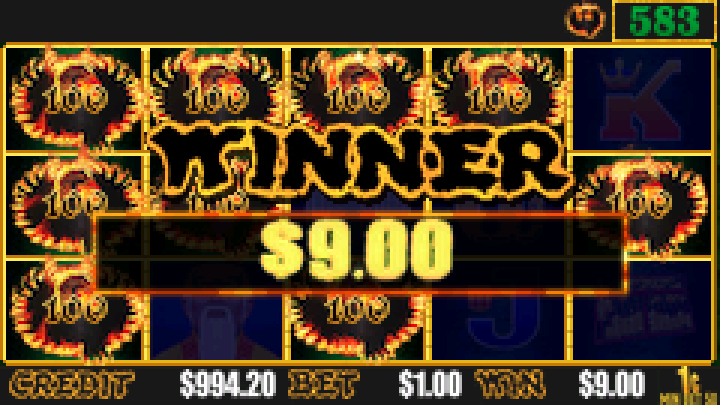</a>

## 9. A Hold feature inside Free Games

The ongoing Free Games session remains visible while Hold & Spin runs.

▶ Hold & Spin during Free Games — 2 continuous clips

**Part 1 of 2**

<a href="media/gameplay/sessions/primary/action-000714-clip-019-part01.webp">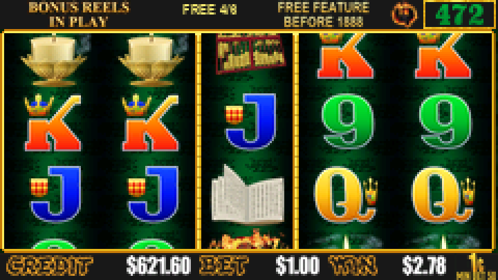</a>

Continue: part 2 of 2

<a href="media/gameplay/sessions/primary/action-000714-clip-019-part02.webp">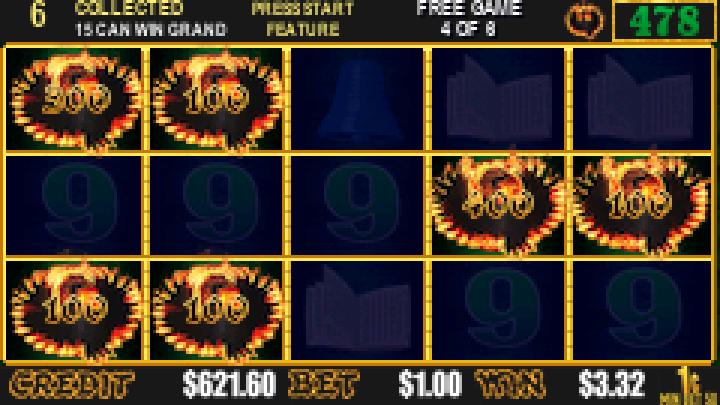</a>

## 10. Free-game counters, wins and coin effects

These sequences show the game continuing through its feature counters, win presentations, coin celebration and feature ending.

<a href="media/gameplay/screens/primary/free-free-counter.png">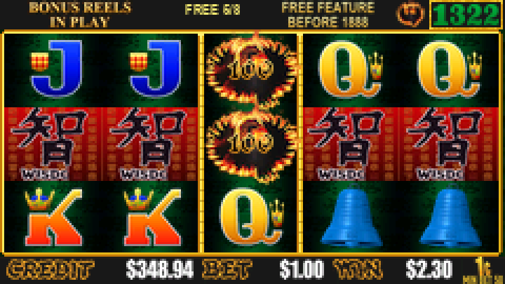</a>

<a href="media/gameplay/screens/primary/free-spin-award.png">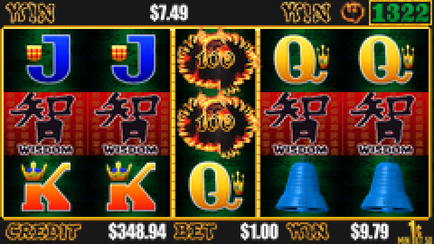</a>

<a href="media/gameplay/screens/primary/free-spin-award-settle.png">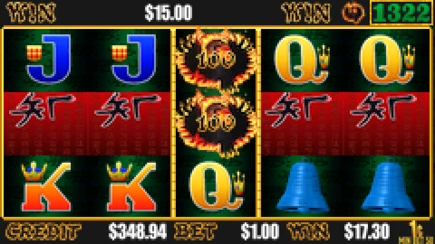</a>

▶ Free-game counter and win presentations — 6 continuous clips

**Part 1 of 6**

<a href="media/gameplay/sessions/primary/action-001159-clip-020-part01.webp">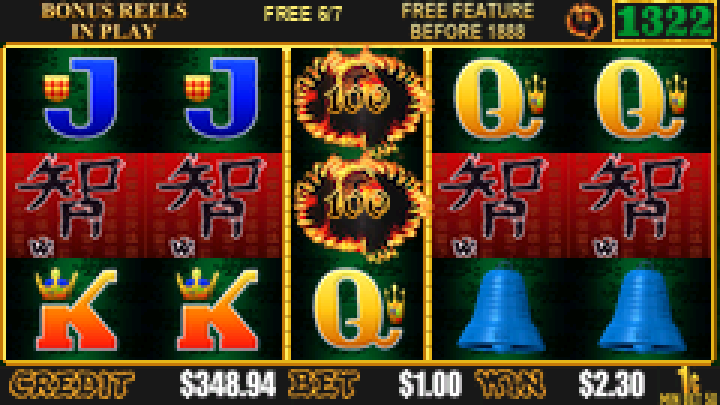</a>

Continue: part 2 of 6

Continue: part 3 of 6

<a href="media/gameplay/sessions/primary/action-001159-clip-020-part03.webp">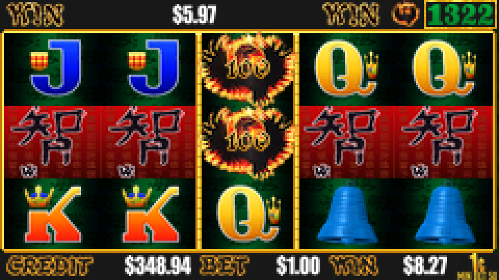</a>

Continue: part 4 of 6

<a href="media/gameplay/sessions/primary/action-001159-clip-020-part04.webp">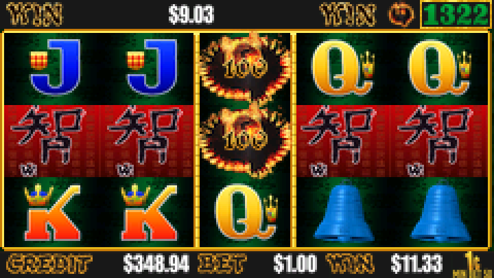</a>

Continue: part 5 of 6

Continue: part 6 of 6

▶ Coin celebration — 2 continuous clips

**Part 1 of 2**

<a href="media/gameplay/sessions/primary/action-000552-clip-018-part01.webp">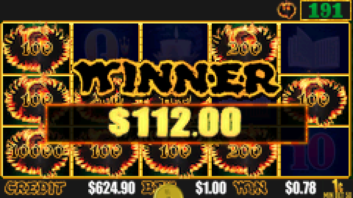</a>

Continue: part 2 of 2

<a href="media/gameplay/sessions/primary/action-000552-clip-018-part02.webp">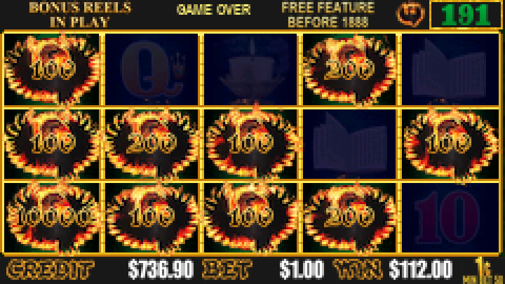</a>

▶ Feature ending — 1 continuous clip

**Part 1 of 1**

<a href="media/gameplay/sessions/primary/action-000145-clip-014-part01.webp">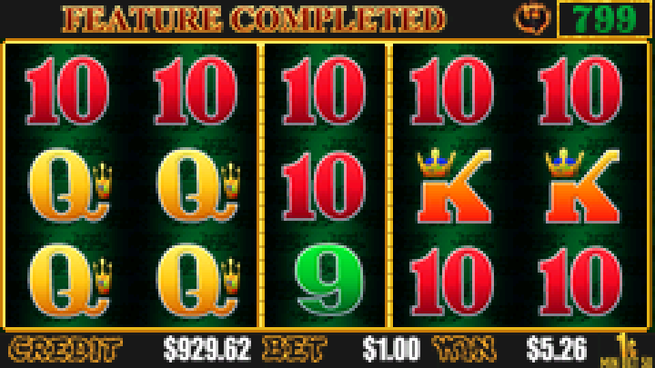</a>

## 11. Explore the menus and artwork

Browse the actual [menu screens, rules, settings and every payline chart](menu-gallery.md). The [artwork close-ups](symbol-gallery.md#visible-cabinet-artwork) show the temple scene, game header, footer and collection meter separately.

<a href="media/gameplay/screens/primary/game-menu.png">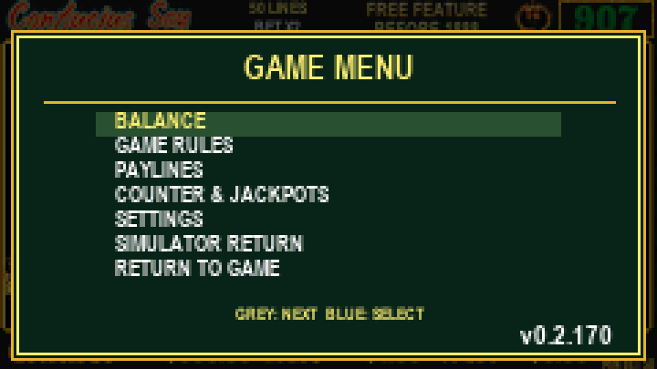</a>

## 12. Jackpots

All jackpot pictures and award sequences are collected here at the end. The information board shows the configured prizes; the award clips below show prizes actually reached through play.

<a href="media/gameplay/screens/primary/jackpot-board.png">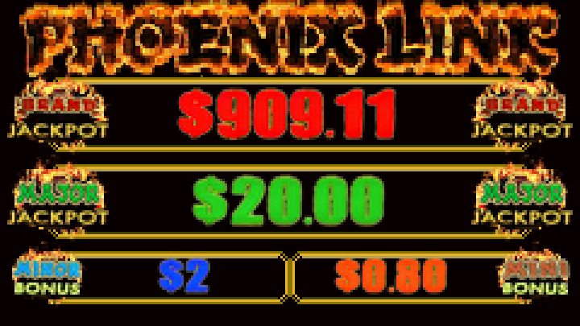</a>

▶ Animated jackpot information board — 1 continuous clip

**Part 1 of 1**

<a href="media/gameplay/sessions/primary/action-010000-clip-024-part01.webp">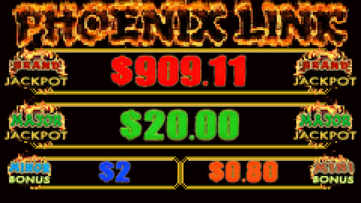</a>

### Single, double and triple Phoenix prizes

Every Mini, Minor and Major variant has now appeared during the recorded sessions. Open the [individual prize gallery](symbol-gallery.md#named-phoenix-prizes) for separate pictures, motion and the full board behind each close-up.

| 1× Mini  | 2× Mini <a href="media/gameplay/symbols/prizes/prize-mini-2x-full.png">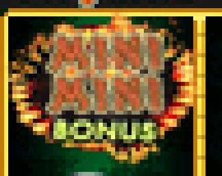</a> | 3× Mini  |
|---|---|---|

| 1× Minor <a href="media/gameplay/symbols/prizes/prize-minor-1x-full.png">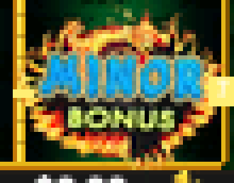</a> | 2× Minor <a href="media/gameplay/symbols/prizes/prize-minor-2x-full.png">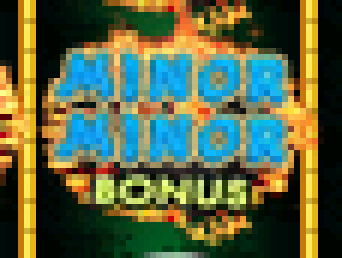</a> | 3× Minor <a href="media/gameplay/symbols/prizes/prize-minor-3x-full.png">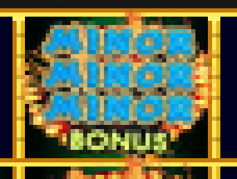</a> |
|---|---|---|

| 1× Major <a href="media/gameplay/symbols/prizes/prize-major-1x-full.png">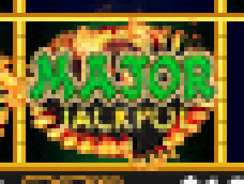</a> | 2× Major  | 3× Major <a href="media/gameplay/symbols/prizes/prize-major-3x-full.png">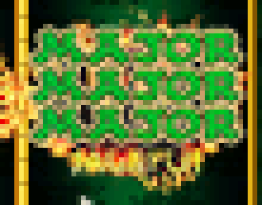</a> |
|---|---|---|

### Mini and Minor collection

▶ Mini award and collection — 3 continuous clips

**Part 1 of 3**

<a href="media/gameplay/sessions/primary/action-005453-clip-023-part01.webp">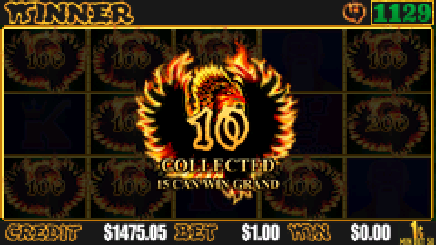</a>

Continue: part 2 of 3

<a href="media/gameplay/sessions/primary/action-005453-clip-023-part02.webp">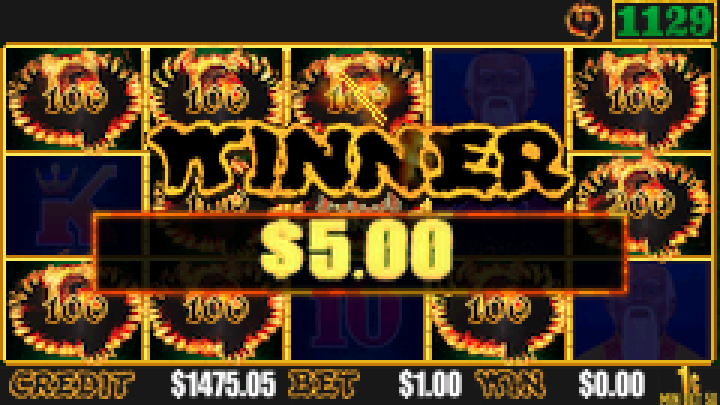</a>

Continue: part 3 of 3

▶ Minor award and collection — 3 continuous clips

**Part 1 of 3**

Continue: part 2 of 3

Continue: part 3 of 3

### Major award

This Major award occurred during the longer recorded session.

▶ Major award and collection — 5 continuous clips

**Part 1 of 5**

Continue: part 2 of 5

Continue: part 3 of 5

Continue: part 4 of 5

Continue: part 5 of 5

### Full-board Grand

The game reached the full-board Grand during play. Watch its award and collection through to the return.

▶ Grand award, collection and return — 6 continuous clips

**Part 1 of 6**

Continue: part 2 of 6

Continue: part 3 of 6

Continue: part 4 of 6

Continue: part 5 of 6

Continue: part 6 of 6

