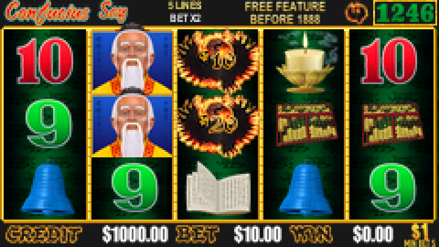
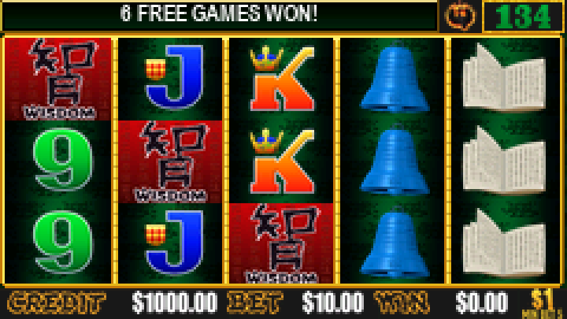
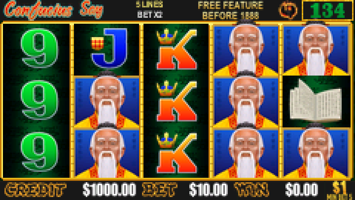
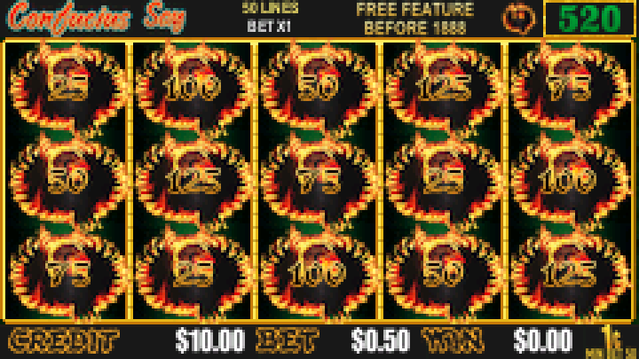
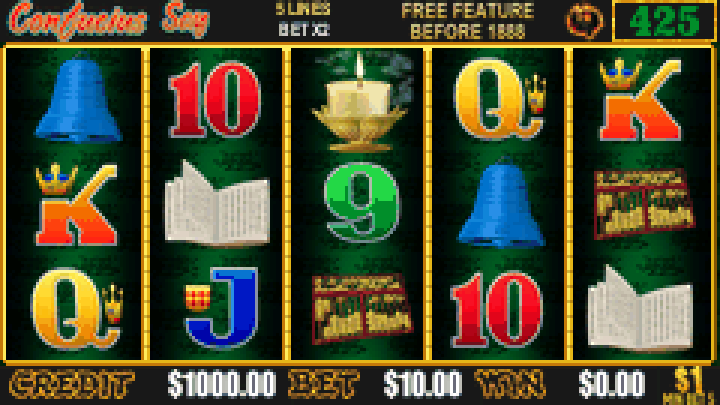

# Graphics, animation and native gallery

Gallery of the **current game**. The native display is 240 × 135 pixels. Images and animations are enlarged to 720 × 405 with nearest-neighbor scaling, preserving the pixel grid.

## Screen layout

The reel area uses five 47 × 35 symbol cells across three rows. A compact top strip carries title/feature information and the aligned meter; the footer carries CREDIT, BET, WIN and denomination. The side LEDs and cabinet surround are intentionally omitted. Larger second-display events are retargeted over the reels.

The cabinet wager menu combines observed denomination, line and red BET controls on one screen. Its digital portrait and button artwork adapt the recorded cabinet layout. The [wager guide](wagers.md) distinguishes actual observed choices from internal compatibility settings.

## Every symbol's implemented motion

| Symbol | Current animation path |
|---|---|
| 9 | Ten-frame whole-glyph win blink |
| 10 | Eight-frame win cycle, including uniform fade/blank states |
| J, Q, K | Static symbol sprites with the surrounding win/highlight presentation |
| Bell | Dedicated winning-frame sequence |
| Abacus | 32-frame winning cycle |
| Book | 102-frame winning sequence |
| Candle | Continuous 16-frame flame cycle |
| Confucius | Winning-face treatment and separate two-/three-row gold joining sequence |
| Wisdom | Initial hold followed by a 100-frame erase/write/gold cycle |
| Phoenix | 60-frame animated asset, independently phased for visible positions |

Animation frames are selected by [generated assets](../firmware/src/generated_assets.cpp) and [Phoenix artwork](../firmware/src/phoenix_art.cpp).

A joined Sage fills the qualifying two- or three-position region, including its internal seams. It does not stretch a non-Wild into a Wild. Unawarded or separated faces stay separate under the current [joining policy](symbols-and-combinations.md#the-tall-gold-confucius).

## Reel movement and landings

Base, Twin and individual Hold strips move downward, overrun their final position, then recoil upward into rest. That recoil is not a second random result. The target cells are fixed for the action, so the final moving icon should be the same one that settles.

Ordinary artwork stays clipped to its reel viewport. Phoenix flame/wing effects can cross cell edges where their oversized treatment requires it; the grid is drawn with its own layer priority. Twin pairs share a larger opening during the feature and keep it on the completed board. Hold restores the individual-cell grid.

Reel recoil and stagger are reconstructed from footage. Code: [reel motion](../firmware/src/reel_motion.h), [UI draw/phase flow](../firmware/src/ui.cpp).

## Feature effects

| Effect | Implementation and purpose |
|---|---|
| Three-Wisdom entry | Clean text/art above the reels, source-timed announcement and first-game caption |
| 1888 entry | Bird/ribbon trajectory from the meter followed by a full-playfield fire reveal |
| Hold revival | Visible revival state before the respin count resumes |
| Collected announcement | Center adaptation of information shown on the cabinet's larger display |
| Phoenix collection | A flying bird/trail visits values and targets the centered running amount |
| Center WINNER | Larger clean wordmark and outlined collection currency, only in its intended collection phase |
| Major/Grand | Separate title/amount sequence; full-board Grand adds to the values |
| Coins | Deterministic upward fountain, spreading and falling through the screen |
| Return fire | Separate exit/reveal geometry returning to Free or Base |
| Counter border | Calm four-second moving gold rim around the small number box; green digits and padding are independent |

Particle paths and visual phase offsets do not draw from the game’s outcome service. Replaying a display frame cannot change the next financial outcome.

Confucius topknots extend into the grey header during reel motion, landings and joined wins. Hold keeps its individual-cell presentation.

## What remains approximate

The original complete artwork, font and animation banks are unrecovered. The current game mixes authored shapes, vector rerenders, reconstructed/restored symbol material, deterministic effects and a compact digital portrait treatment. Its [Sage crown](../firmware/src/sage_crown122.h) and [Major artwork](../firmware/src/authored_major112.h) are separate current-renderer assets.

Camera-fitted timings, flame geometry, wing contours, exact symbol placement, palette, source-dependent screen lighting and unobserved transition branches remain areas for comparison.

The [gallery manifest](gallery-manifest.json) records dimensions, fixture identity, source version, generator and content hashes. See [testing](testing.md) for pixel comparisons versus source-fidelity evidence, and [attribution](attribution.md) for third-party material.

## Repeated named-prize flights

The outgoing flight and sampled ribbon finish behind the next same-cell flight. The animation loops after 4.88 seconds. Each named unit belongs to the Engine’s single settlement; its visual pickups are separate presentation steps.
