# Graphics, animation and native gallery

Gallery of the **current game**. The native display is 240 × 135 pixels. Images and animations are enlarged to 720 × 405 with nearest-neighbor scaling, preserving the pixel grid.

Jump to [all nine jackpot symbols](#single-double-and-triple-jackpot-symbols), [rare award screens](#rare-award-and-feature-screens), [symbol motion](#every-symbols-implemented-motion) or [feature effects](#feature-effects). Detail sheets combine enlarged crops from the rendered screens. Demonstration boards show the artwork without requiring a rare natural outcome; they are not probability samples.

## Screen layout

The reel area uses five 47 × 35 symbol cells across three rows. A compact top strip carries title/feature information and the aligned meter; the footer carries CREDIT, BET, WIN and denomination. The side LEDs and cabinet surround are intentionally omitted. Larger second-display events are retargeted over the reels.

The cabinet wager menu combines observed denomination, line and red BET controls on one screen. Its digital portrait and button artwork adapt the recorded cabinet layout. The [wager guide](wagers.md) distinguishes actual observed choices from internal compatibility settings.

Double-press the large grey button to open the jackpot board. The Phoenix Link wordmark, animated Phoenix tier badges and separate red, green, blue and orange amount panels adapt the cabinet's upper display to the Stick screen. Cash amounts are grouped for readability and retain their exact cents.

## Single, double and triple jackpot symbols

Mini, Minor and Major each have single, double and triple versions. Repeated names on one symbol mean **1×, 2× or 3× that prize**. A Triple Major is one Phoenix carrying three Major units, not three separate occupied cells. These labels can appear on the Base reels, in Free Games or during Hold & Spin; payment follows the feature's collection rules.

Columns below are **Mini, Minor, Major**. Rows are **single, double, triple**. These are magnified crops of the actual current renderer, with no smoothing or replacement lettering.

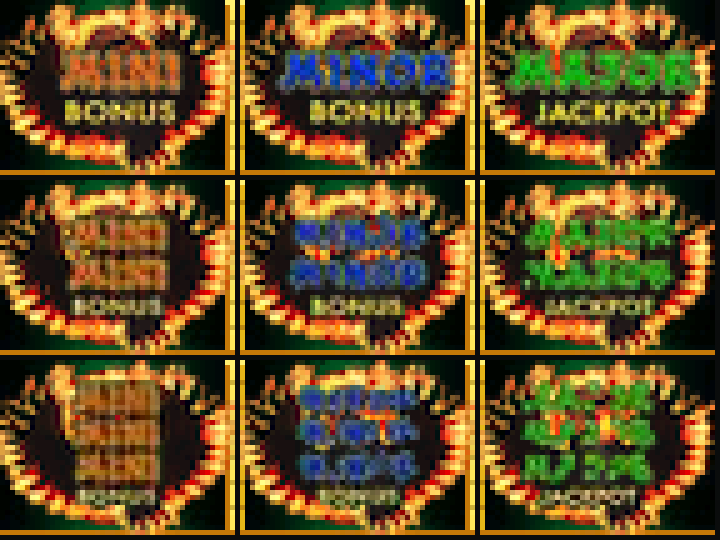

### Single prizes in the reel grid

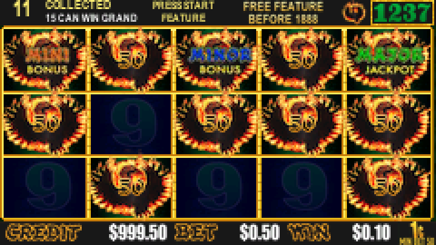

### Double prizes in the reel grid

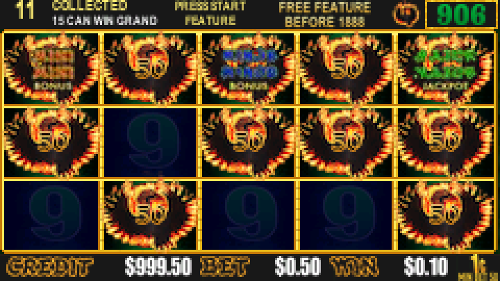

### Triple prizes in the reel grid

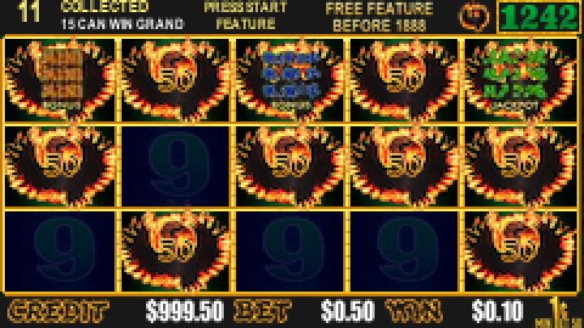

The three boards are separate presentation examples. Each contains one Major symbol, matching the current model's single-Major restriction. Their appearance does not establish original cabinet frequencies. See [prizes and collection](hold-and-spin.md#phoenix-values-and-named-prizes).

## Rare award and feature screens

The Major title, full-board Grand, running collection amount and revival use different presentation paths.

**Major award:** its named title and locked award amount, before the other values collect.

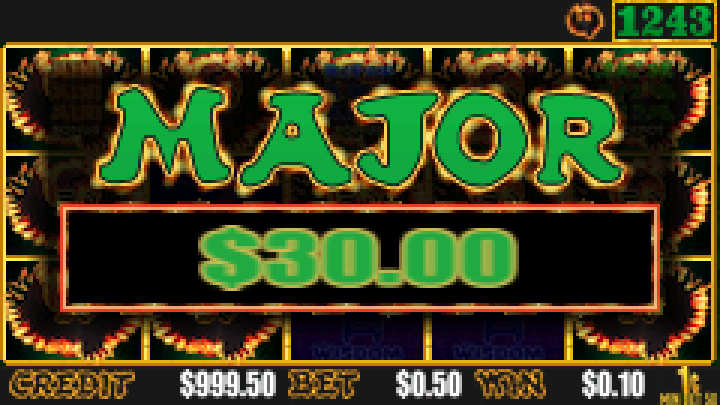

**Full-board Grand:** the continuous WINNER display includes the Grand contribution; it does not add a second plain Grand popup.

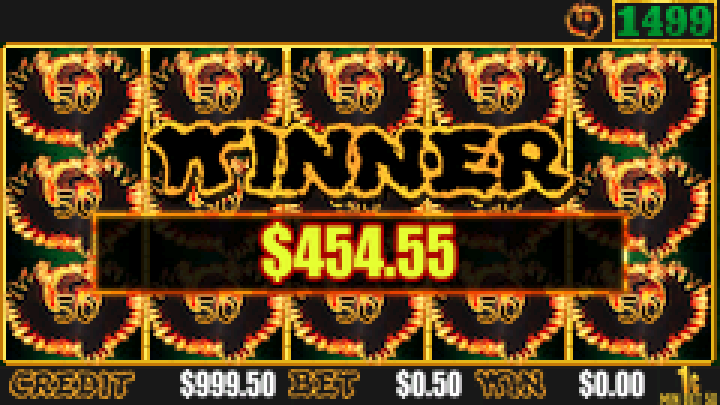

**Named-prize collection:** the running amount and flying Phoenix continue after the named-award stage.

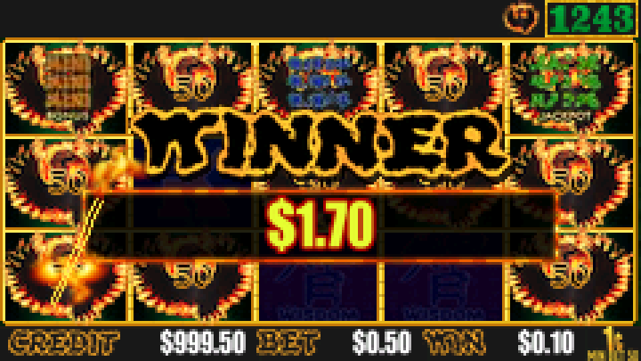

**Hold entry and revival:** the feature prompt is distinct from a renewed set of respins after an initial drought.

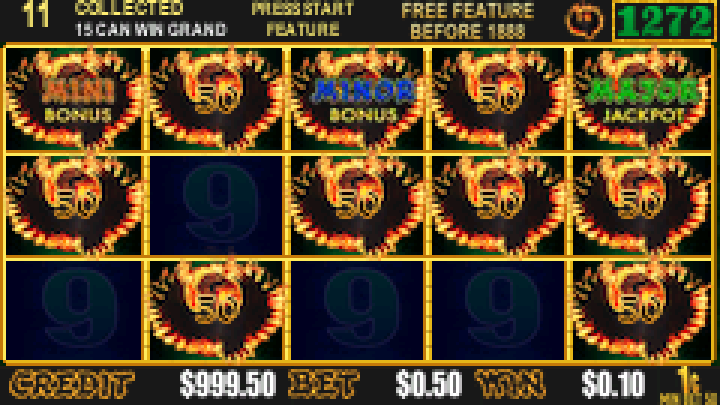

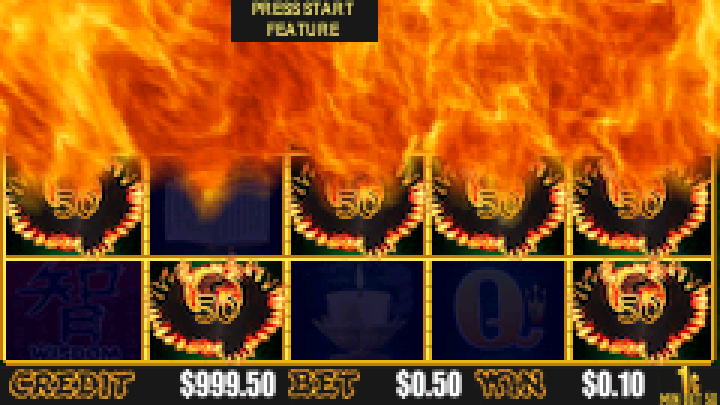

**Wisdom Free Games entry:** the announcement uses the current game's actual transition artwork.

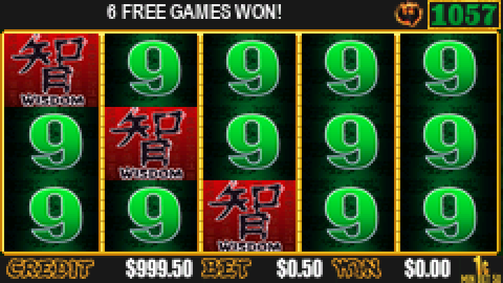

**A Hold inside Free Games:** the Free-game progress stays visible both during the fire transition and on the held board.

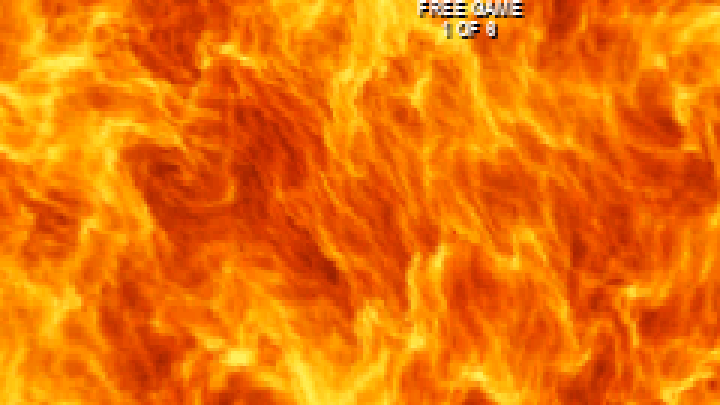

**Three-row gold Confucius:** awarded adjacent faces join into the tall figure.

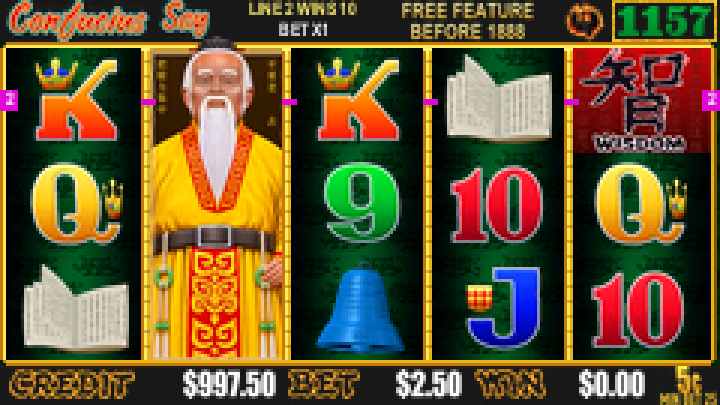

## Every symbol's implemented motion

| Symbol | Current animation path |
|---|---|
| 9 | Ten-frame whole-glyph win blink |
| 10 | Eight-frame win cycle, including uniform fade/blank states |
| J, Q, K | Static symbol sprites with the surrounding win/highlight presentation |
| Bell | Dedicated winning-frame sequence |
| Abacus | 32-frame winning cycle |
| Book | 102-frame winning sequence |
| Candle | Continuous 16-frame flame cycle |
| Confucius | Winning-face treatment and separate two-/three-row gold joining sequence |
| Wisdom | Initial hold followed by a 100-frame erase/write/gold cycle |
| Phoenix | 60-frame animated asset, independently phased for visible positions |

Animation frames are selected by [generated assets](../firmware/src/generated_assets.cpp) and [Phoenix artwork](../firmware/src/phoenix_art.cpp).

A joined Sage fills the qualifying two- or three-position region, including its internal seams. It does not stretch a non-Wild into a Wild. Unawarded or separated faces stay separate under the current [joining policy](symbols-and-combinations.md#the-tall-gold-confucius).

## Reel movement and landings

Base, Twin and individual Hold strips move downward, overrun their final position, then recoil upward into rest. That recoil is not a second random result. The target cells are fixed for the action, so the final moving icon should be the same one that settles.

Ordinary artwork stays clipped to its reel viewport. Phoenix flame/wing effects can cross cell edges where their oversized treatment requires it; the grid is drawn with its own layer priority. Twin pairs share a larger opening during the feature and keep it on the completed board. Hold restores the individual-cell grid.

Reel recoil and stagger are reconstructed from footage. Code: [reel motion](../firmware/src/reel_motion.h), [UI draw/phase flow](../firmware/src/ui.cpp).

## Feature effects

| Effect | Implementation and purpose |
|---|---|
| Three-Wisdom entry | Clean text/art above the reels, source-timed announcement and first-game caption |
| 1888 entry | Bird/ribbon trajectory from the meter followed by a full-playfield fire reveal |
| Hold revival | Visible revival state before the respin count resumes |
| Collected announcement | Center adaptation of information shown on the cabinet's larger display |
| Phoenix collection | A flying bird/trail visits values and targets the centered running amount |
| Center WINNER | Larger clean wordmark and outlined collection currency, only in its intended collection phase |
| Major/Grand | Winner/amount presentation; Grand uses one continuous WINNER total combining Grand, Major base and cash |
| Coins | Deterministic upward fountain; a separate short numeric-only 25–49× Hold burst precedes the return crest |
| Return fire | Separate exit/reveal geometry returning to Free or Base |
| Nested Free progress | Actual Free game/total in the condition-text slot, visible during Hold and over fire |
| Counter border | Calm four-second moving gold rim around the small number box; green digits and padding are independent |

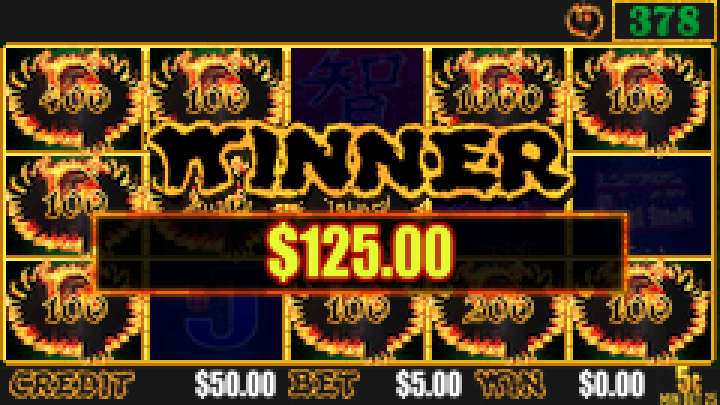

The short burst and return crest use the actual presentation clocks. The 25× recording supports visible coins for that event; the broader 25–49× display band is a local policy, not recovered casino odds or a universal trigger threshold. Individual particle artwork and timing remain approximations.

Particle paths and visual phase offsets do not draw from the game’s outcome service. Replaying a display frame cannot change the next financial outcome.

Confucius topknots extend into the grey header during reel motion, landings and joined wins. Hold keeps its individual-cell presentation.

The Grand sequence keeps one continuous WINNER display for its combined amount. It is adapted to a single LCD; the original multi-screen sequence and pixel geometry are not claimed as exact matches.

## What remains approximate

The original complete artwork, font and animation banks are unrecovered. The current game mixes authored shapes, vector rerenders, reconstructed/restored symbol material, deterministic effects and a compact digital portrait treatment. Its [Sage crown](../firmware/src/sage_crown122.h) and [Major artwork](../firmware/src/authored_major112.h) are separate current-renderer assets.

Camera-fitted timings, flame geometry, wing contours, exact symbol placement, palette, source-dependent screen lighting and unobserved transition branches remain areas for comparison.

The [gallery manifest](gallery-manifest.json) records dimensions, fixture identity, source version, generator and content hashes. See [testing](testing.md) for pixel comparisons versus source-fidelity evidence, and [attribution](attribution.md) for third-party material.

## Repeated named-prize flights

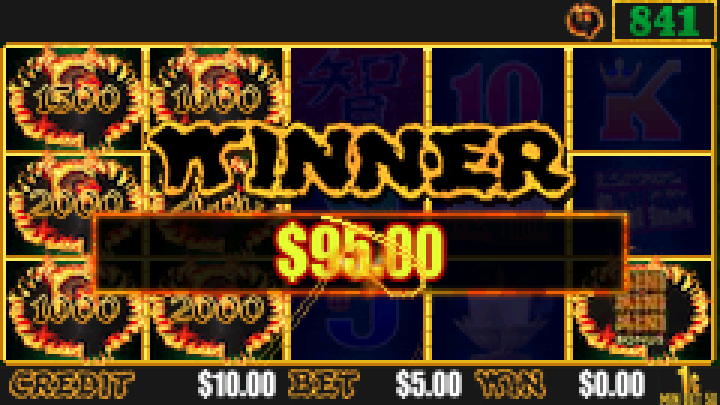

The outgoing flight and ribbon finish behind the next same-cell flight. Each named unit belongs to the Engine’s single settlement; its visual pickups are separate presentation steps.

## Collection-flight visibility

Middle and bottom Phoenix pickups keep their broad reconstructed ribbon curl inside the playfield while approaching the centered amount. Their destination offset is applied during the last 200 ms of the existing 700 ms approach. Top-row and original upper-HUD routes retain their existing motion. The amount commit, fading body, sibling pickup overlaps, audio and game result use the same clocks.

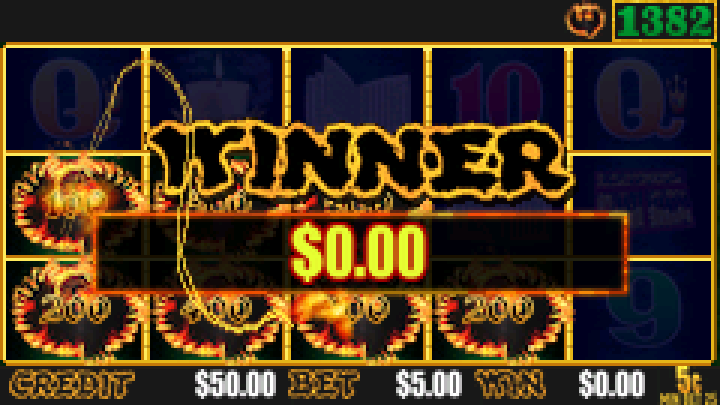

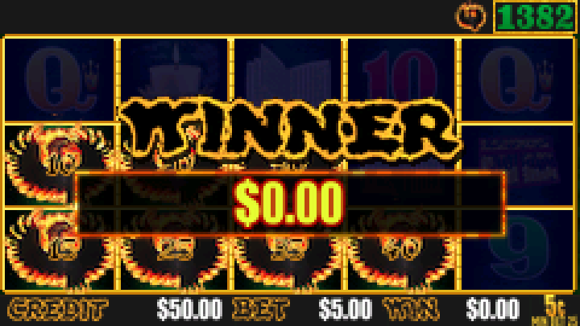

This is a small-screen viewport adaptation. It does not recover the original factory trajectory, feather artwork or pose bank. The bird and ribbons can pass in front of the amount during arrival; that foreground layering is intentional.

## Jackpot board and credit voucher

The jackpot board uses flat dark amount fields and animated fire attached to the stationary Phoenix Link title. The title fringe is a local reconstruction of the filmed effect; original animation frames remain unavailable.

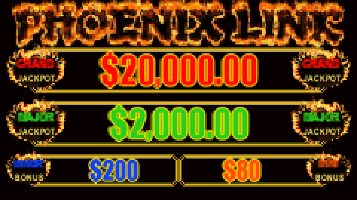

Custom credit funding uses a code-rendered Stardust voucher with amount words, matching decorative validation numbers and insertion text.

## Denomination and wager views

The denomination view gives the character, temple and title more room. Selecting a coin opens the separate line and bet controls.

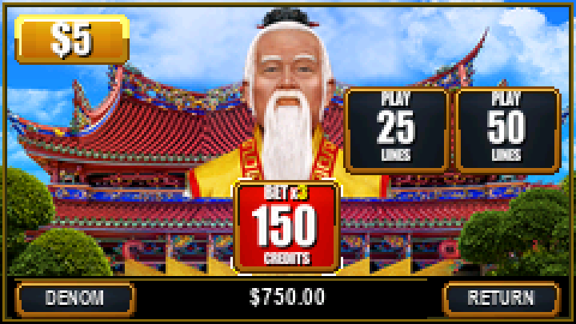
