# Gallery

These recorded images come from **0.2.170**. Version **0.2.171** corrects the counter ceiling to **1887** and labels return estimates as pending recalculation; the recordings retain their original source provenance.

[▶ Play the game](https://xberenguer.github.io/phoenix-link-confucius-say/) · [Full player guide](README.md)

Explore the game in playing order: choose a wager, spin the reels, meet every symbol, and follow the bonus features. **Jackpots come last, with Grand at the very bottom.** Click any still or animation to open it separately.

Every image is a frame or rectangular crop from actual play or actual menu navigation. The animations show the motion recorded in the game. Screens from different spins are separate examples, rather than one continuous round. [About the recordings](gallery-recording.md).

[Spins](#3-spin-land-and-see-a-win) · [Reel symbols](#reel-symbols) · [Confucius merges](#confucius-merges) · [Free Games](#6-wisdom-and-twin-free-games) · [Hold & Spin](#7-phoenix-hold--spin-begins) · [Menus and artwork](#menus-and-artwork) · [Jackpots](#12-jackpots)

## 1. Choose a denomination and a wager

Choose a coin value, a PLAY LINES option and a red BET button.

### Choose the denomination

### The High Limit selection

### Choose the lines and bet

### What does PLAY LINES mean?

A **line** is a fixed path across the five reel columns, using one symbol from each column. Some paths go straight across; others move between the top, middle and bottom rows. The picture below shows five different paths. **5 lines means the game checks all five paths on the same spin.**

[Follow a line step by step, with real examples](paylines.md).

## 2. Add play credits

Open the voucher, enter an amount and select INSERT CREDITS. All credits are pretend money.

### Before inserting credits

<a href="media/gameplay/screens/primary/unfunded-reels.png">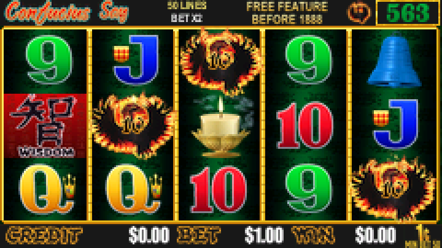</a>

### Open the voucher

### Enter the credit amount

### Ready to play

## 3. Spin, land and see a win

The reels move, settle, then highlight the positions that won. The symbols shown are the ones that actually landed.

### The reels in motion

**Animation**

<a href="media/gameplay/previews/primary/base-spinning.webp">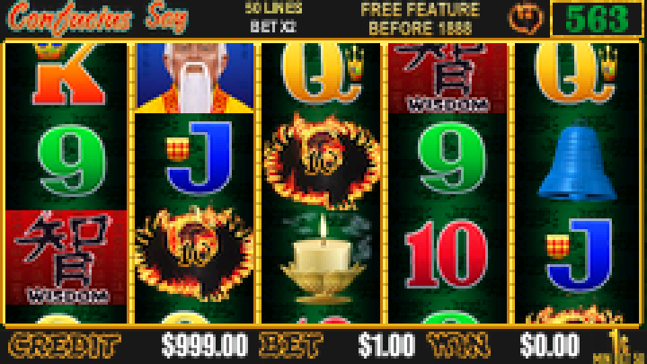</a>

Watch the complete recorded action — 12.04 seconds

### The reels land

**Animation**

<a href="media/gameplay/previews/primary/base-landing.webp">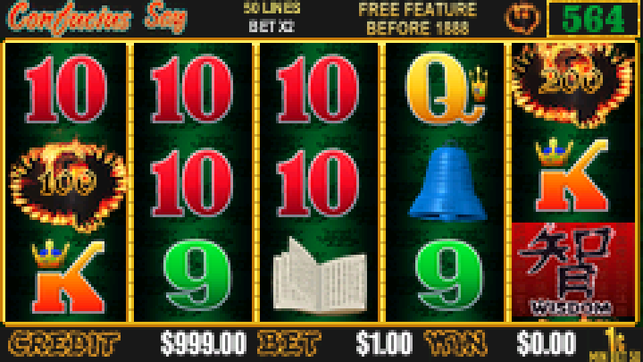</a>

### A complete spin and its result

The animation follows the spin through its win presentation and back to the ready screen.

<a href="media/gameplay/screens/loops/spin-result.png">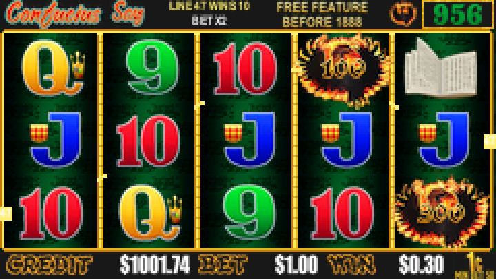</a>

**Animation**

<a href="media/gameplay/session.webp">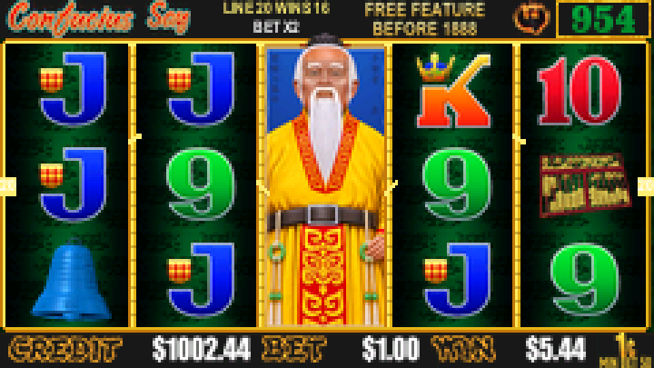</a>

The 9 and 10 symbols deliberately blink during their winning cycle. Their brief disappearance in the animation is part of the game’s win effect.

## 4. Every reel symbol

All twelve symbols can be opened on their own. Close-ups retain the actual reel background. Jack, Queen and King use still artwork; the animated symbols show their recorded movement.

| Symbol | Still | Animation |
|---|---|---|
| **9 — winning blink** |  |  |
| **10 — winning cycle** |  |  |
| **Jack** |  | Still artwork |
| **Queen** |  | Still artwork |
| **King** | <a href="media/gameplay/symbols/primary/king.png">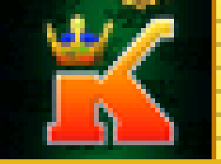</a> | Still artwork |
| **Bell** |  |  |
| **Abacus** |  |  |
| **Book** |  |  |
| **Candle — moving flame** |  |  |
| **Confucius** |  |  |
| **Wisdom** |  | <a href="media/gameplay/symbols/primary/wisdom-motion.webp">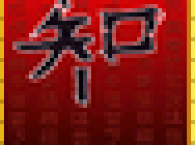</a> |
| **Phoenix** |  |  |

## 5. Confucius joins into gold

Qualifying adjacent faces join into a two- or three-row figure. Compare the finished figure with its joining animation and the surrounding reels.

### 2-row gold Confucius

| Joined figure | Animation |
|---|---|
| <a href="media/gameplay/symbols/primary/confucius-2-row.png">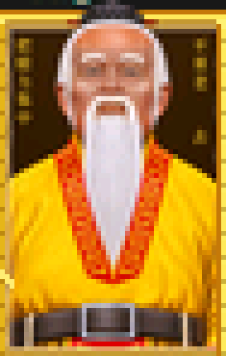</a> |  |

**The merge in the full game**

<a href="media/gameplay/sessions/primary/action-000064-clip-010.webp">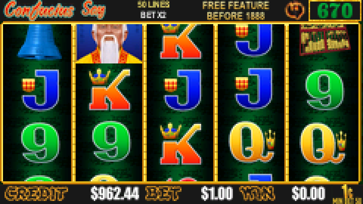</a>

### 3-row gold Confucius

| Joined figure | Animation |
|---|---|
| <a href="media/gameplay/symbols/primary/confucius-3-row.png">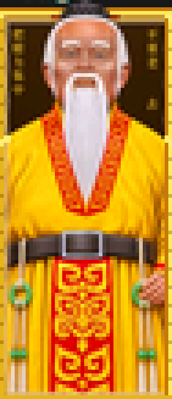</a> |  |

**The merge in the full game**

<a href="media/gameplay/sessions/primary/action-000090-clip-012.webp">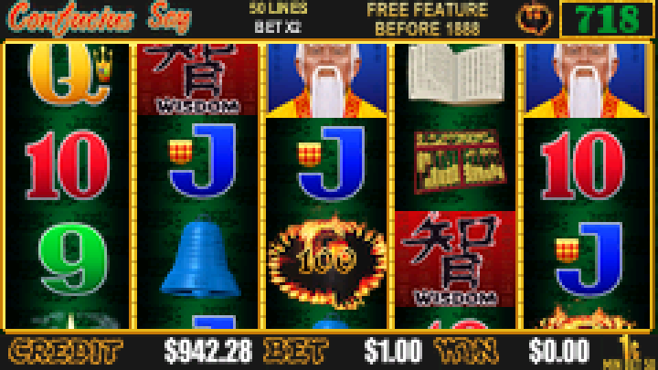</a>

## 6. Wisdom and Twin Free Games

Three or more red Wisdom symbols start six Twin Free Games. The examples below follow the trigger, paired reels, counters and win effects reached during play.

### Three Wisdom symbols start the feature

A real trigger with the other symbols that landed alongside the Wisdom symbols.

<a href="media/gameplay/screens/primary/free-free-intro.png">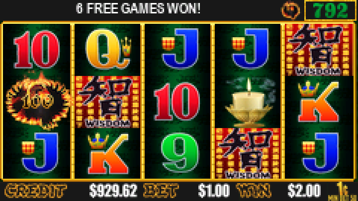</a>

**Animation**

Watch the complete recorded action — 25.4 seconds

<a href="media/gameplay/sessions/primary/action-000139-clip-013.webp">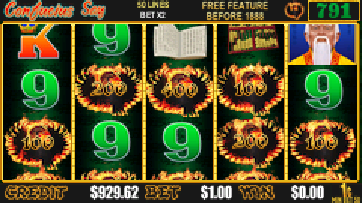</a>

### The free reels spin

<a href="media/gameplay/screens/primary/free-spinning.png">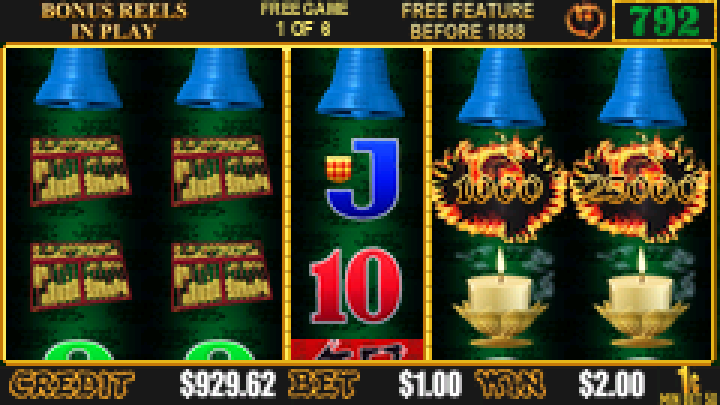</a>

**Animation**

### A Free Game lands

<a href="media/gameplay/screens/primary/free-landing.png">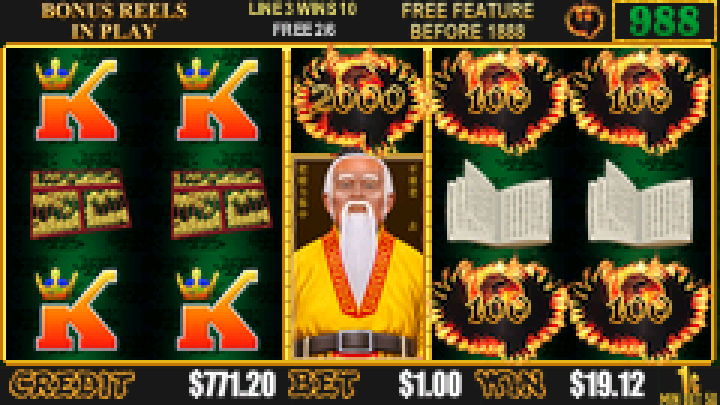</a>

**Animation**

<a href="media/gameplay/previews/primary/free-landing.webp">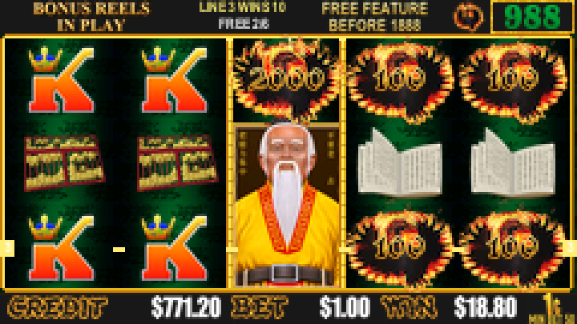</a>

Watch the complete recorded action — 36.72 seconds

<a href="media/gameplay/sessions/primary/action-004325-clip-021.webp">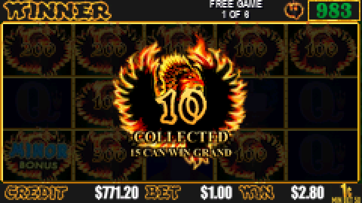</a>

### The paired outer reels

A later Free Game, shown after its reels have settled.

**Animation**

Watch the complete recorded action — 68.08 seconds

<a href="media/gameplay/sessions/primary/action-001159-clip-020.webp">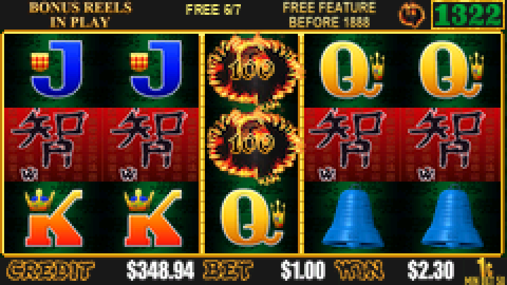</a>

### Confucius expands during Free Games

<a href="media/gameplay/screens/primary/free-sage-expansion.png">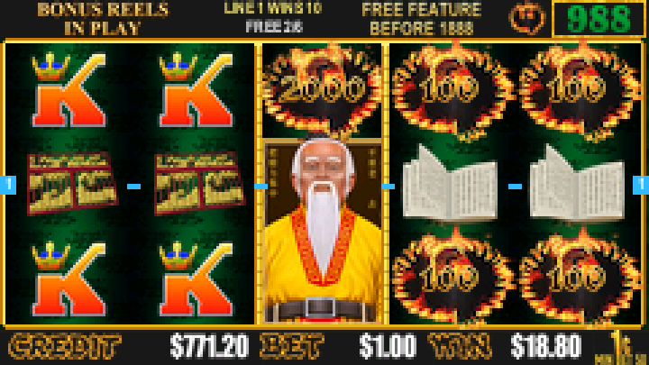</a>

**Animation**

<a href="media/gameplay/previews/primary/free-sage-expansion.webp">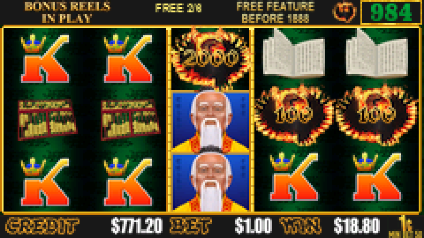</a>

### The Free Game award appears

**Animation**

### The award settles

**Animation**

### The Free Games counter

**Animation**

### Collecting within the feature

<a href="media/gameplay/screens/primary/free-collect.png">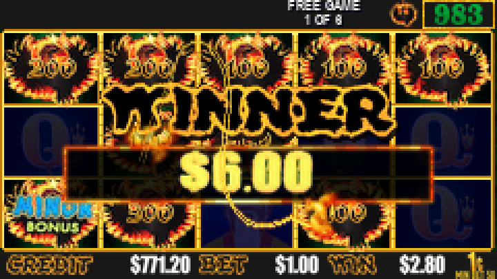</a>

**Animation**

### The win transfers

<a href="media/gameplay/screens/primary/free-win-transfer.png">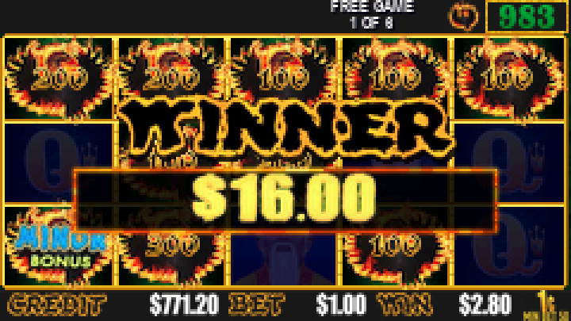</a>

**Animation**

<a href="media/gameplay/previews/primary/free-win-transfer.webp">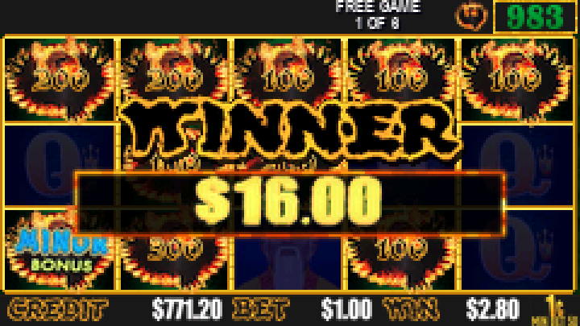</a>

### The return transition

<a href="media/gameplay/screens/primary/free-return-fire.png">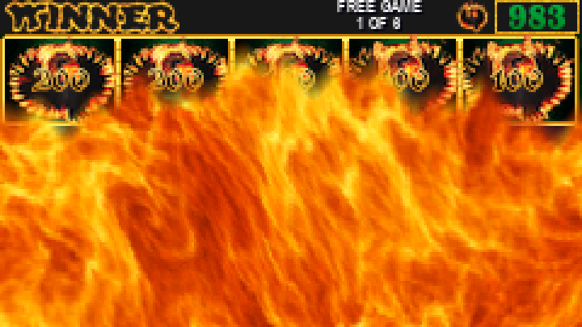</a>

**Animation**

## 7. Phoenix Hold & Spin begins

Phoenix symbols stay in place while the remaining positions respin. The full-screen fire leads into the feature.

### The full-screen fire transition

<a href="media/gameplay/screens/primary/hold-hold-fire.png">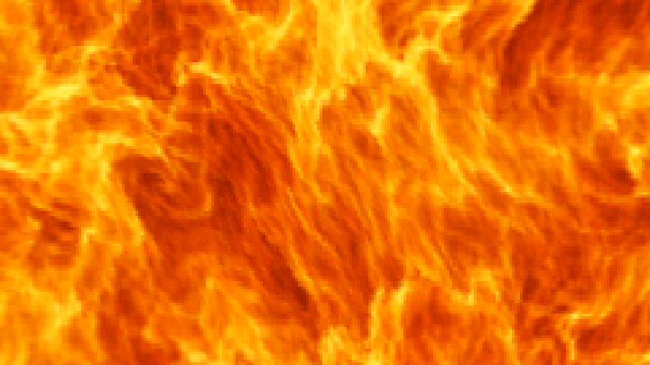</a>

**Animation**

<a href="media/gameplay/previews/primary/hold-hold-fire.webp">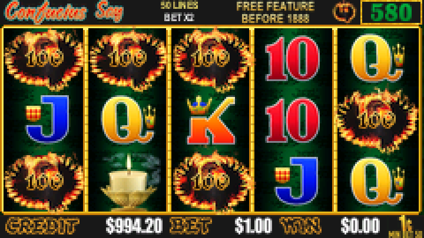</a>

Watch the complete recorded action — 24.08 seconds

<a href="media/gameplay/sessions/primary/action-000010-clip-005.webp">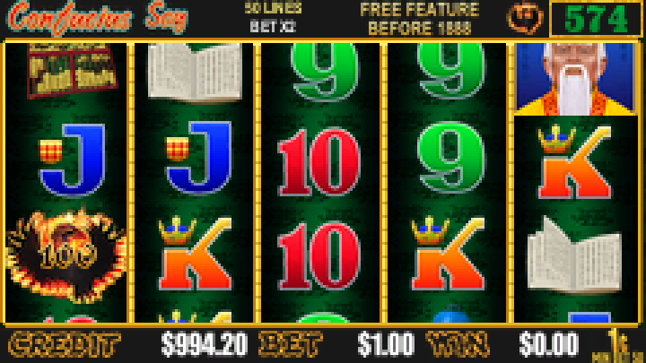</a>

### Entering Hold & Spin

**Animation**

Watch an entire Hold & Spin round, from the triggering spin to the final review

<a href="media/gameplay/sessions/loops/action-000011-clip-011.webp">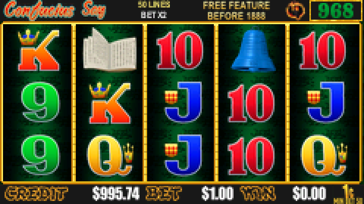</a>

## 8. Revival brings more respins

A revival appeared during the recorded feature. Watch the effect and the play that follows it.

### Phoenix revival

**Animation**

<a href="media/gameplay/previews/primary/hold-phoenix-revival.webp">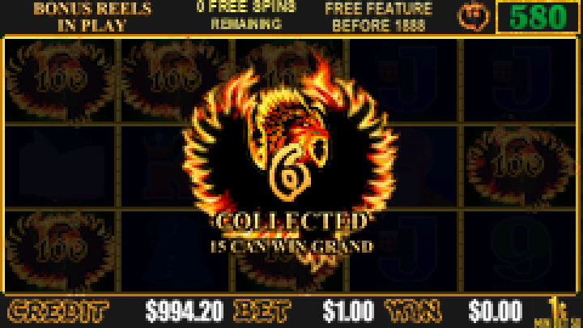</a>

Watch the complete recorded action — 27.32 seconds

## 9. Collect the Phoenix values and return

The Phoenix collection, running total and return fire are separate stages of the same recorded collection.

### Collecting the Phoenix values

<a href="media/gameplay/screens/primary/ordinary-collect.png">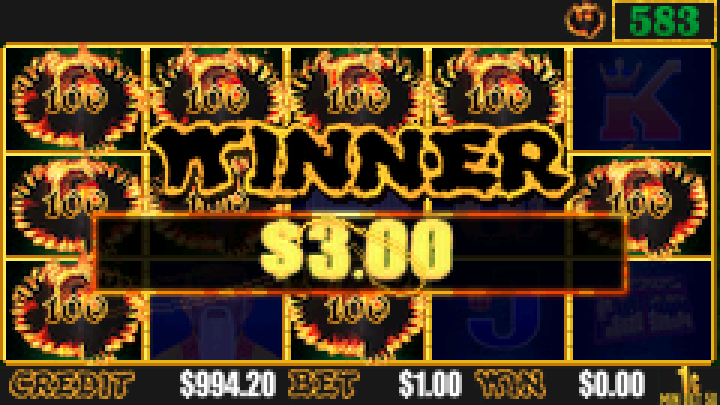</a>

**Animation**

Watch the complete recorded action — 34.2 seconds

<a href="media/gameplay/sessions/primary/action-000019-clip-007.webp">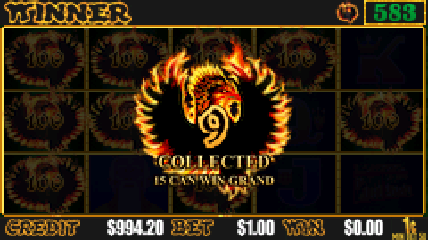</a>

### Moving the win into the total

**Animation**

<a href="media/gameplay/previews/primary/ordinary-win-transfer.webp">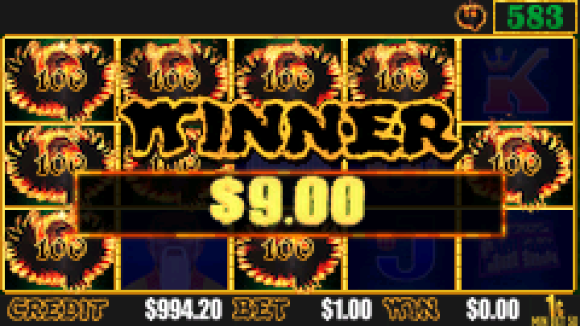</a>

### The return fire

<a href="media/gameplay/screens/primary/ordinary-return-fire.png">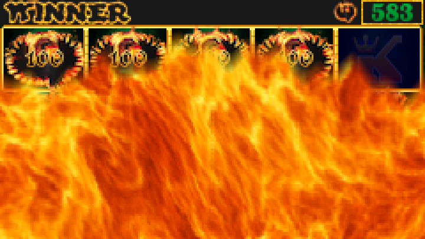</a>

**Animation**

<a href="media/gameplay/previews/primary/ordinary-return-fire.webp">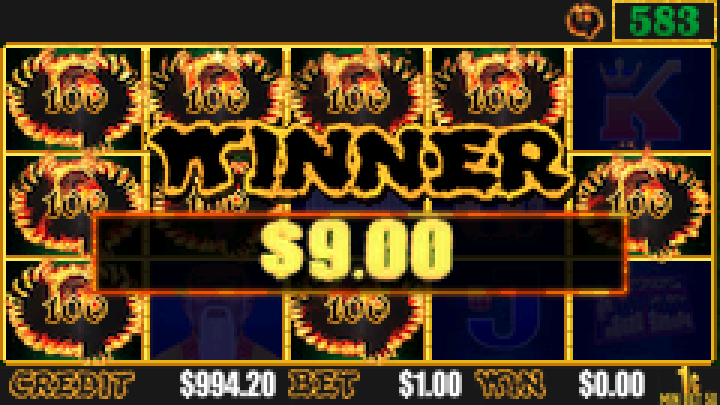</a>

## 10. Features within features, and the finish

Hold & Spin can occur while Free Games are in progress. These captures also show the collection, coin effects and end of a feature reached in other recorded rounds.

### Respins during Free Games

<a href="media/gameplay/screens/primary/hold-spinning.png">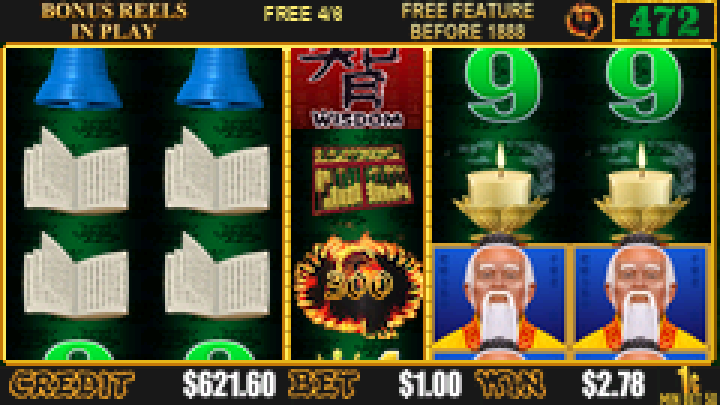</a>

**Animation**

Watch the complete recorded action — 25.08 seconds

<a href="media/gameplay/sessions/primary/action-000714-clip-019.webp">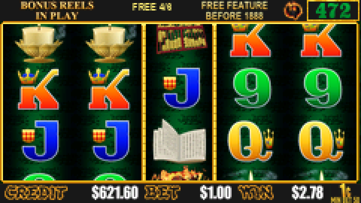</a>

### More Phoenix symbols land

<a href="media/gameplay/screens/primary/hold-landing.png">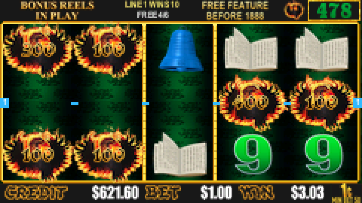</a>

**Animation**

<a href="media/gameplay/previews/primary/hold-landing.webp">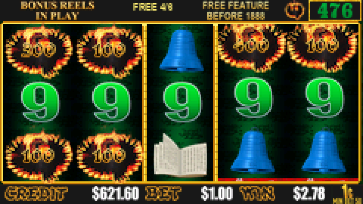</a>

### The settled Hold & Spin board

**Animation**

<a href="media/gameplay/previews/primary/hold-ready.webp">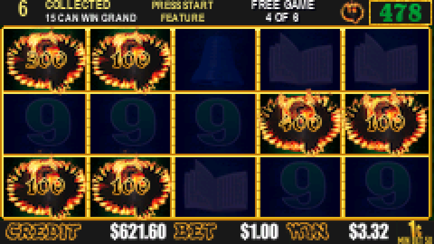</a>

### Another recorded collection

<a href="media/gameplay/screens/primary/base-collect.png">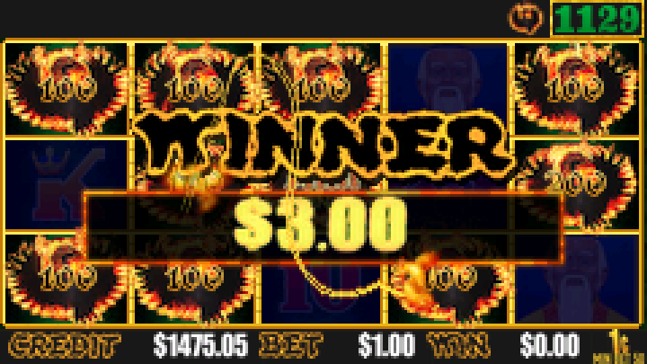</a>

**Animation**

<a href="media/gameplay/previews/primary/base-collect.webp">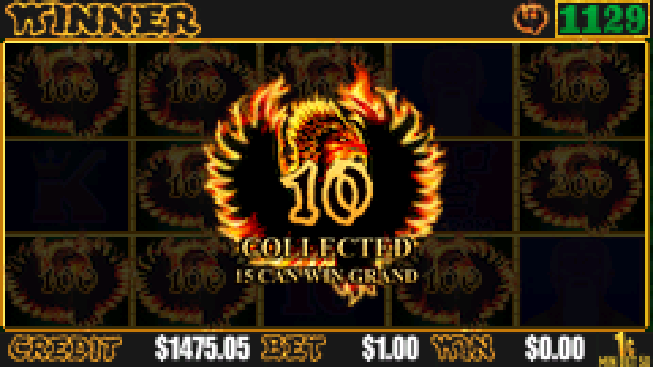</a>

Watch the complete recorded action — 35.52 seconds

### The win celebration

<a href="media/gameplay/screens/primary/base-win-transfer.png">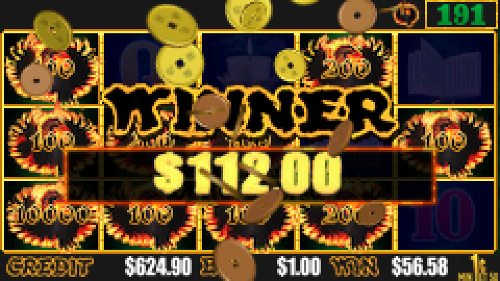</a>

**Animation**

<a href="media/gameplay/previews/primary/base-win-transfer.webp">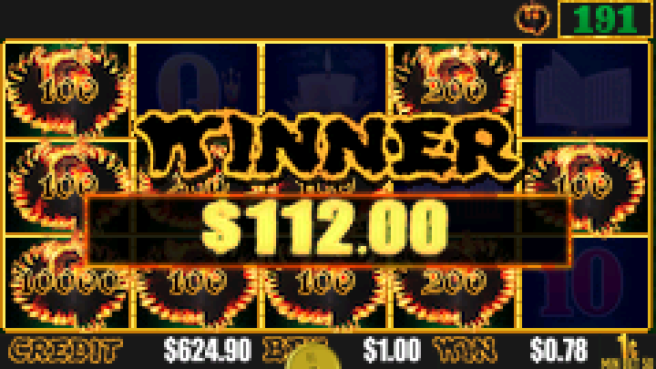</a>

Watch the complete recorded action — 15.44 seconds

### The feature ends

**Animation**

<a href="media/gameplay/previews/primary/base-feature-end.webp">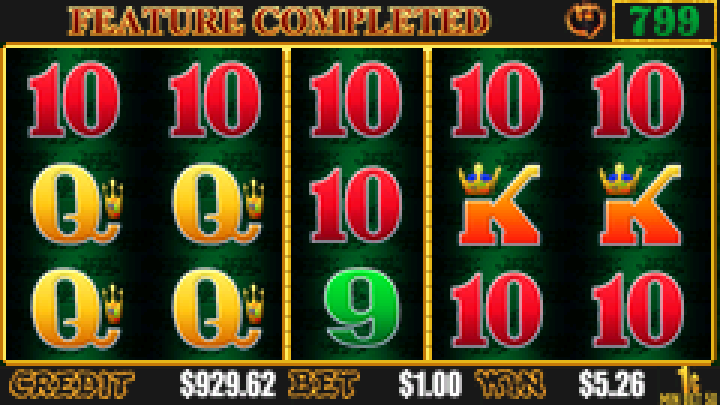</a>

Watch the complete recorded action — 8.64 seconds

## 11. Menus and artwork

The menus are shown as they appeared during actual navigation. Editor screens retain their existing values; viewing them did not change those values.

### The game menu

### Balance and credits

### Settings

<a href="media/gameplay/screens/menus/settings.png">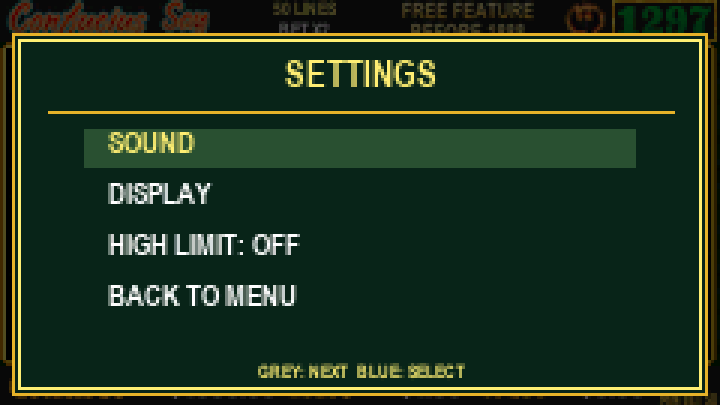</a>

### Sound options

<a href="media/gameplay/screens/menus/sound.png">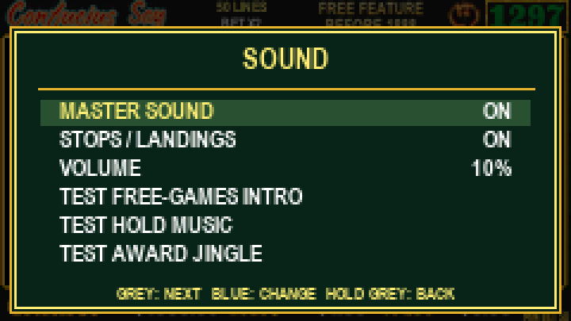</a>

### Volume

<a href="media/gameplay/screens/menus/volume.png">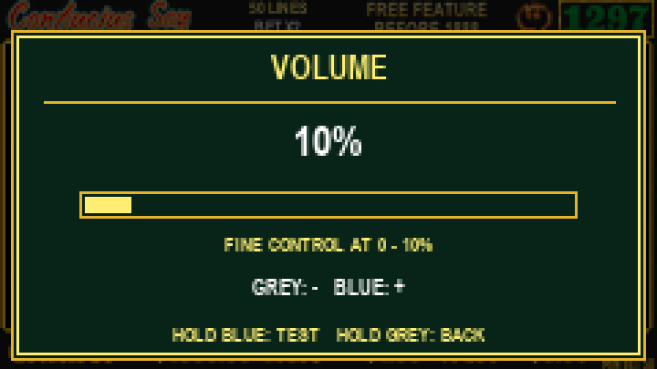</a>

### Display options

### Game values

### Collection counter editor, unchanged

<a href="media/gameplay/screens/menus/counter-editor-unmodified.png">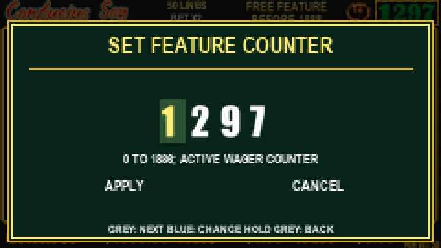</a>

### The six in-game rules pages

**Rules page 1**

<a href="media/gameplay/screens/menus/rules-1.png">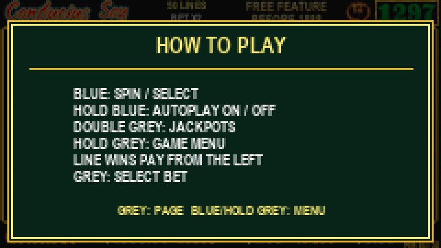</a>

**Rules page 2**

<a href="media/gameplay/screens/menus/rules-2.png">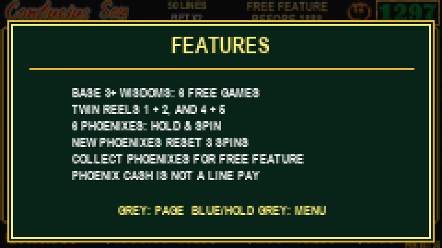</a>

**Rules page 3**

**Rules page 4**

**Rules page 5**

**Rules page 6**

### Every payline chart

All 37 chart pages are grouped by line setting. [See all 205 numbered lines, individually enlarged and explained](paylines.md#every-line), or [start with how paylines work](paylines.md).

5 lines — 1 chart page

**Page 1**

10 lines — 2 chart pages

**Page 1**

**Page 2**

15 lines — 3 chart pages

**Page 1**

**Page 2**

**Page 3**

25 lines — 5 chart pages

**Page 1**

**Page 2**

**Page 3**

**Page 4**

**Page 5**

50 lines — 9 chart pages

**Page 1**

**Page 2**

**Page 3**

**Page 4**

**Page 5**

**Page 6**

**Page 7**

**Page 8**

**Page 9**

100 lines — 17 chart pages

**Page 1**

**Page 2**

**Page 3**

**Page 4**

**Page 5**

**Page 6**

**Page 7**

**Page 8**

**Page 9**

**Page 10**

**Page 11**

**Page 12**

**Page 13**

**Page 14**

**Page 15**

**Page 16**

**Page 17**

The simulator return screens and their six detail pages

### Simulator return list

### Return-screen help

### Return detail 1

### Return detail 2

### Return detail 3

### Return detail 4

### Return detail 5

### Return detail 6

### Artwork around the reels

These close-ups are cropped from the actual starting screen and funded game.

### Confucius and the temple

### The game header

**Animation**

### The credit and win displays

### The collection meter

**Animation**

## 12. Jackpots

The named Phoenix prizes and recorded jackpot awards are collected here, after the ordinary game and menus. Grand is the final sequence.

### The jackpot board

**Animation**

Jackpot value menus, viewed without changing their values

### Choose a jackpot value to view

### Mini value editor, unchanged

### Minor value editor, unchanged

### Major value editor, unchanged

### Grand value editor, unchanged

### Every named Phoenix prize

All nine Mini, Minor and Major variants were found during actual play. The still and animation in each row show that named prize with its surrounding reel pixels.

| Prize | Still | Animation |
|---|---|---|
| **Mini 1×** |  |  |
| **Mini 2×** |  |  |
| **Mini 3×** |  |  |
| **Minor 1×** |  |  |
| **Minor 2×** |  |  |
| **Minor 3×** |  |  |
| **Major 1×** |  |  |
| **Major 2×** |  |  |
| **Major 3×** |  |  |

Open the original full-screen boards for these nine prizes

### Mini 1× in the full game

**Animation**

### Mini 2× in the full game

**Animation**

### Mini 3× in the full game

**Animation**

### Minor 1× in the full game

**Animation**

### Minor 2× in the full game

**Animation**

### Minor 3× in the full game

**Animation**

### Major 1× in the full game

**Animation**

### Major 2× in the full game

**Animation**

### Major 3× in the full game

**Animation**

### A Major award, from presentation to return

### The Major award begins

**Animation**

Watch the complete recorded action — 56.96 seconds

### Major award presentation

**Animation**

### Collecting after Major

**Animation**

### The Major win transfers

**Animation**

### Returning after Major

**Animation**

### The final Major result

**Animation**

### Grand — the final award sequence

This Grand was reached through continued play. Follow its presentation, collection, total and return.

### The Grand award begins

**Animation**

Watch the complete recorded action — 62.28 seconds

### Grand award presentation

**Animation**

### Collecting after Grand

**Animation**

### The Grand win transfers

**Animation**

### Returning after Grand

**Animation**

### The final Grand result

**Animation**

