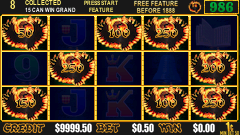
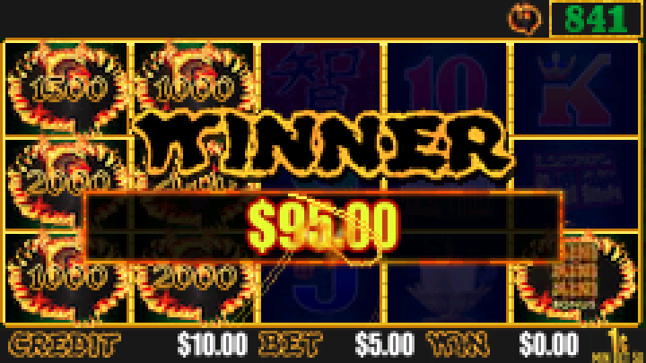
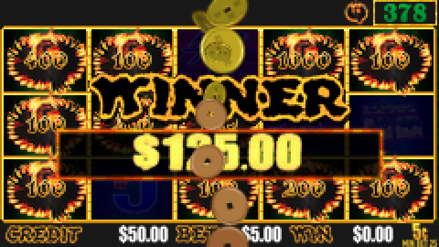

# Phoenix Hold & Spin, revival and jackpots

The simulator can enter this feature from a natural Phoenix result or the session’s collection meter. Those routes can occur together, so more than one Hold may be owed. The official [US description](https://www.aristocratgaming.com/us/games/us-phoenix-link) identifies Hold & Spin and the separate mystery counter; the [operator rules, pages 1–3](https://casinos.lotoquebec.com/dam/jcr:4add9be1-336a-4efc-b4c9-e41696b876b2/Phoenix%20Link%20Confucius%20Say.pdf) supply the regional lock/reset/revival rules. Current financial behavior is in the [Engine](../firmware/src/phoenix_engine.h).

## Natural entry and respins

Six through fourteen Phoenixes on a Base or Free result enter Hold & Spin. Their positions and displayed values lock. Each empty position becomes an individual bonus cell; the feature begins with three respins.

Each action consumes one remaining respin. Any new Phoenix locks and resets the remaining count to three. Already locked Phoenixes keep their prizes and do not count as new arrivals on every spin. Empty cells do not earn ordinary line awards during Hold.

The simulator generates a fresh result for **each initiated respin**, then animates that result landing. It does not choose the entire feature's final board or total at entry. Manual play and autoplay use the same outcome path. This describes the included implementation; it does not establish the original cabinet's internal draw timing. See [how randomness works](randomness.md).

The large top-of-cabinet information is adapted to the small screen: a live collected count appears above the reels, and collection WINNER/currency announcements can occupy the center. The count includes existing locks and new symbols whose visual impact has occurred, rather than revealing every precommitted landing at the start of motion.

If the Hold is inside Wisdom Free Games, the header also retains the current Free game and total. That caption persists through the fire; it does not replace the remaining-respins or collected-count fields.

## Revival

If the initial three respins produce **zero new Phoenixes**, the simulator restores three respins. The initial locked symbols do not satisfy this condition. Once at least one new Phoenix has arrived, a later three-spin drought ends the feature normally.

Revival has no fixed repeat limit in this model. The numeric storage/capacity protections are engineering limits, not an assertion that a casino feature uses the same bounds. Revival changes the remaining respin count; it does not remove existing locked values or charge another paid bet.

## Local six-seed completion distribution

For **one Hold beginning with exactly six locked Phoenixes**, the local model gives each empty cell a 950/10,000 arrival chance per respin. New arrivals reset the count to three; an initial drought with no new arrivals revives. Under ideal independent uniform draws, the completed count is:

| Phoenixes at completion | Local ideal probability |
|---|---:|
| 7 | 5.91334% |
| 8 | 8.33143% |
| 9 | 10.73996% |
| 10 | 13.26012% |
| 11 | 15.42323% |
| 12 | 16.35869% |
| 13 | 14.96834% |
| 14 | 10.60235% |
| 15 | 4.40254% |

The minimum is **seven**, the mean is **11.123**, and the chance of finishing with ten or more is **75.0153%**. The 15-cell row is the conditional full-board/Grand probability for this six-seed Hold, not a Grand rate per paid spin.

These are exact-law calculations rounded for display, **not a natural-video sample or factory-calibrated odds**. They exclude separate queued Holds and features that start with another seed count, and use the ideal-draw abstraction rather than modeling source failures or restarts. The [Engine constants and Hold step](../firmware/src/phoenix_engine.h) define this local process.

## Phoenix values and named prizes

| Displayed prize | Settlement treatment |
|---|---|
| Ordinary credit or cash value | Pay that shown amount when collected |
| Mini | Pay the locked Mini value |
| Minor | Pay the locked Minor value |
| Major | Use its separate named-award presentation and pay its locked value |
| Double / Triple named prize | Apply 2× / 3× to that named Mini, Minor or Major |
| Grand from a full board | Add Grand to all Phoenix prizes; it does not replace them |

See [all nine named-prize labels and their reel screenshots](graphics.md#single-double-and-triple-jackpot-symbols), including Double and Triple Major.

Do not multiply a shown Phoenix cash value by the stake again. Internally generated ordinary prizes use total-bet multiples, but the displayed number already represents the prize. Ordinary credit prizes do not receive the named-prize 2×/3× multiplier in this model.

At **1¢ / 50 lines / 10×**, the simulator uses a **1,000-credit ($10) Mini**: Double Mini pays $20 and Triple Mini pays $30. The direct [US recording near 12:11](https://www.youtube.com/watch?v=3pfZnZUWGhI&t=731s) shows a Base-origin Triple Mini collected in three $10 increments. Using that fixed tier in Free and later queued Holds at the same profile is a shared-tier model assumption, not a separate mode-specific observation.

Mini/Minor values and restrictions on named/high-cash combinations are configuration-dependent. The Engine contains two prize-cap contexts and scoped filmed Mini/Minor corrections. The two prize-cap contexts are internal model settings and are not exposed in the cabinet menu. The original complete prize-frequency and progressive-contribution schedules remain unknown.

## Multiplied Mini and Minor collection

Double and Triple Mini/Minor prizes collect in separate visible increments, with a new Phoenix flight from the same physical cell for each unit. The stacked label stays intact. The payout is already settled once; these graphical steps add no extra Engine payment. Audio plays once per physical cell. The fitted interval between units is 1067 ms; normal between-cell timing remains 1333 ms. Those are local presentation fits, not recovered universal manufacturer timing or named-prize audio.

## Fifteen Phoenixes and Grand

All fifteen occupied positions award Grand **plus** all fifteen values. A full fifteen-Phoenix ordinary result settles directly; a Hold settles when it becomes full or exhausts its respins after the revival condition has been satisfied.

The Grand sequence uses one continuous **WINNER** count combining Grand, the Major base component and collected cash values. The announcement remains WINNER throughout. This is an adaptation for one LCD, rather than an exact reproduction of the original multi-screen Grand sequence. Animation adds no extra payment. A full board being possible does not establish its casino probability: the model's landing chance and prize weights are local assumptions.

## Count-up and ending order

The collection bird follows a broad reconstructed curl to the centered amount. Middle/bottom routes delay the destination offset until the final approach so their body stays visible in the reel viewport. This display adaptation changes no award, pickup commit, respin, music or phase clock. [See the current flight](graphics.md#collection-flight-visibility).

The source-inspired sequence includes a collected announcement, fire/bird effects, collection of eligible individual values, a WIN transfer and return fire. Major/Grand, ordinary cash and large cash can take different branches. The centered WINNER field reads the existing collection amount; it does not add earlier line wins or a separate named award again.

Coins launch upward from below the screen, spread, then fall. Numeric-only Hold cash from **25× to below 50× the stake** uses a short visual burst before the returning crest. This is a local display policy, separate from the existing longer 50× celebration, named/Grand cases and qualifying final-Free combined-round route.

The positive reference is [3pfZnZUWGhI near 23:12](https://www.youtube.com/watch?v=3pfZnZUWGhI&t=1392s): eleven numeric Phoenixes pay $125 on a $5 stake at 5¢/50 lines/2×, following a two-seed meter feature. Its visible VENETIAN REWARDS cabinet branding supports a Las Vegas property inference; the [property's own description](https://www.venetianlasvegas.com/venetian-rewards.html) identifies that loyalty program. The exact software program remains unknown. One positive 25× event does not establish a universal casino cutoff or prove all settings share that threshold.

The short route adds no new Big-award jingle. Coin visibility and music eligibility are separate; existing collection audio remains. Particle shapes, count-up timing and the original event table remain reconstructed. The animation below is a synthetic current-renderer example, not footage or a frequency sample.

Autoplay and manual play use the same award-event routing. Muting, a skipped presentation or a different award branch can affect what is heard; autoplay is not intended to remove an otherwise eligible jingle. See [audio](audio.md) for cue order and outstanding limits.

## Counter awards and chained features

If the meter triggers with fewer than six Phoenixes, the currently visible Phoenixes lock for its free Hold. If a natural Hold already takes priority, the extra meter award queues. A later queued Hold starts with a new empty bonus board, rather than copying the first Hold's prizes into a second payment. Multiple owed meter awards are counted separately.

This order is supported by [hmyKdYjMjAQ around 8:29](https://www.youtube.com/watch?v=hmyKdYjMjAQ&t=509s) and the regional queueing description. Read [the collection counter](collection-counter.md) for the session’s meter and queue behavior.

Code: [award director](../firmware/src/feature_award_director.h), [collection flight](../firmware/src/collection_motion.h), [center treatment](../firmware/src/center_render49.inc), [opening music gate](../firmware/src/hold_opening31.h), [coin motion](../firmware/src/coin_motion.h).
