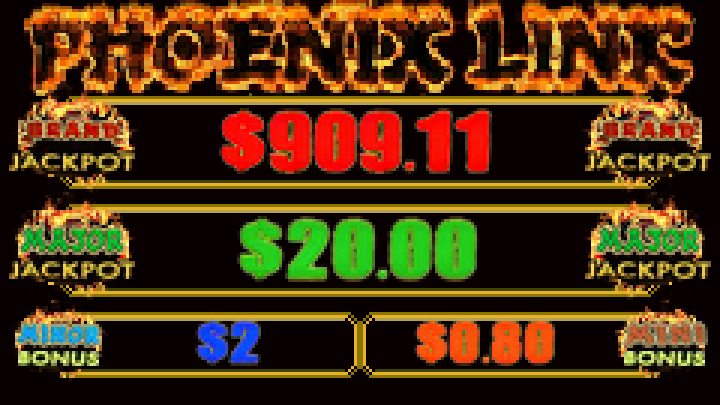
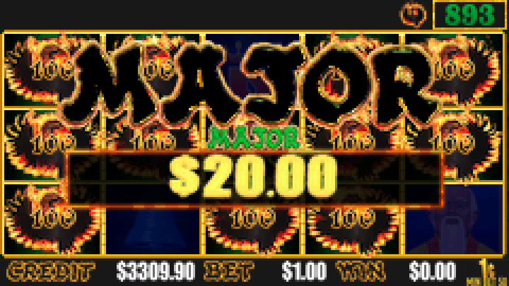
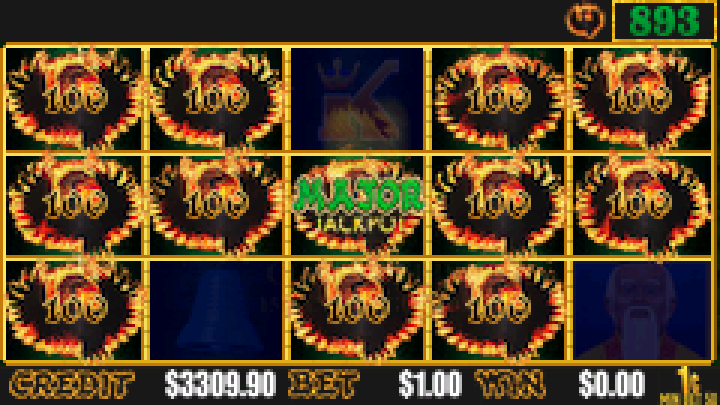

# Jackpot values and configurations

[← Full player guide](README.md) · [Gallery](graphics.md)

Double-grey opens the jackpot board. It reads the same future-prize amounts used by the Engine; it does not maintain a second display-only jackpot bank. Already landed prizes retain their committed values.

## Casino configurations

[Aristocrat](https://www.aristocratgaming.com/us/games/us-confucius-say) describes scaling Grand and Major jackpots. The available amount depends on the installed configuration and denomination. Million-dollar configurations are not a universal reset amount. [The Cosmopolitan](https://cosmopolitanlasvegas.mgmresorts.com/en/casino/slots.html) explicitly lists a $5 million link pairing Phoenix Link with Lightning Link 10 Year Storm. This establishes that shared top-jackpot installations exist; it does not identify the linking topology of every tier at every casino.

## Current simulator

| Tier | Default rule | Evidence scope |
|---|---|---|
| Mini | 40 credits × bet multiplier × denomination, with the scoped exceptions below | Local fallback, not a recovered casino ladder |
| Minor | 100 credits × bet multiplier × denomination, with scoped exceptions | Local fallback, not a recovered casino ladder |
| Major | 1,000 credits × bet multiplier × denomination | Local assumption; no network growth |
| Grand | Current profile's local return-reference table | Engineering schedule keyed by denomination, lines, multiplier, cap profile and return option; not a factory progressive |

Observed exceptions are kept narrow: 1¢/50 lines/5× Mini $10 and Minor $50; 1¢/50 lines/10× Mini $10; 25¢/15 lines Mini $175 and Minor $875 in the recorded cabinet; 50¢/25 lines/1× Mini $500 and Minor $2,500 in that recorded cabinet. The 25¢ amounts were observed at multipliers 1 and 5; using them at other multipliers in that profile is an architectural assumption. These observations do not identify a universal denomination ladder or original arrival probabilities.

At the sourced 1¢/50-line/5× wager, Major still uses the unverified local $50 fallback, equal to the observed Minor. The remaining fallback can produce unrealistic relationships. For example, at 1¢/50 lines/10×, the corrected Mini is $10 while the unverified Minor fallback is also $10. That is a known fidelity gap, not a validated casino relationship. Correcting a price needs scoped source evidence and fresh return calculations.

Default amounts are fixed-session values; play on other cabinets is not emulated. Their local expected-return checks do not certify original casino probabilities or progressive contributions. Simply substituting a million-dollar Grand at the same hit frequency changes the return.

## Matching a cabinet for practice

Counter & Jackpots lets you enter exact cash amounts. They remain fixed across wager changes until restored or the session restarts. Editing a jackpot does not change its hit probability; the preset return display is consequently locked until defaults are restored. Credit funding is separate and does not change jackpot values or the random generator.

See [settings](settings.md#feature-counter-and-jackpot-amounts), [Hold & Spin](hold-and-spin.md) and [math and evidence](math-and-evidence.md).

## The board and a captured award

**Watch the captured sequence:**

[Every captured named Phoenix and its animation →](graphics.md#named-phoenix-prizes)
