# Menus, rules and controls

[Full graphics gallery](graphics.md) · [Individual symbols and fusions](symbol-gallery.md)

## Game rules

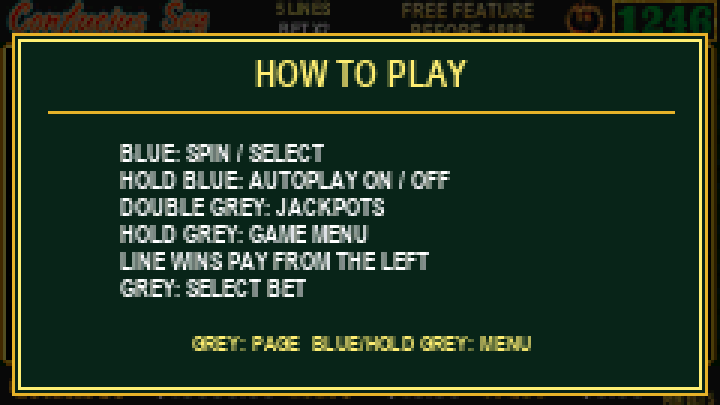

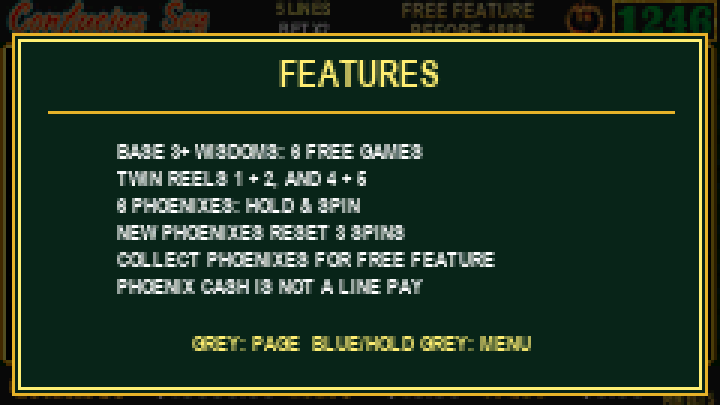

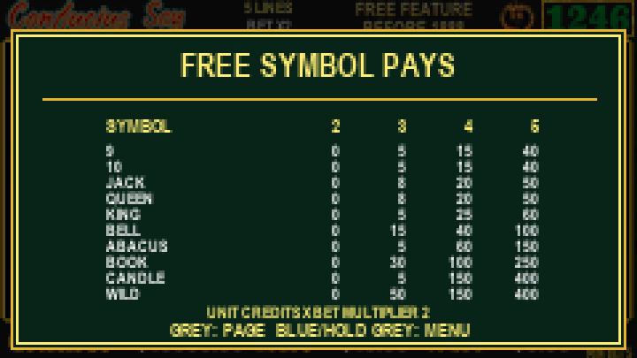

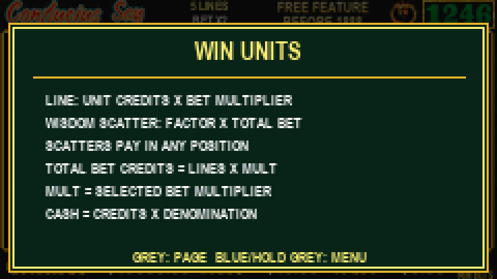

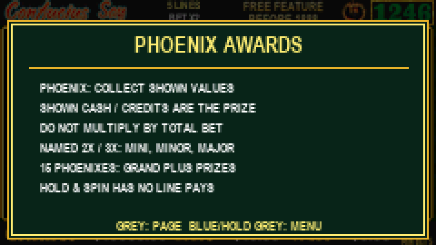

## Display settings

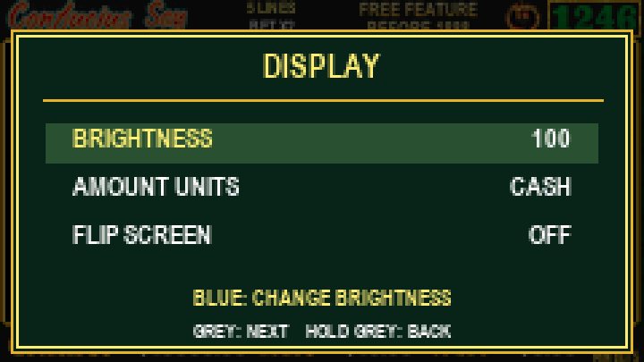

## Simulator Return

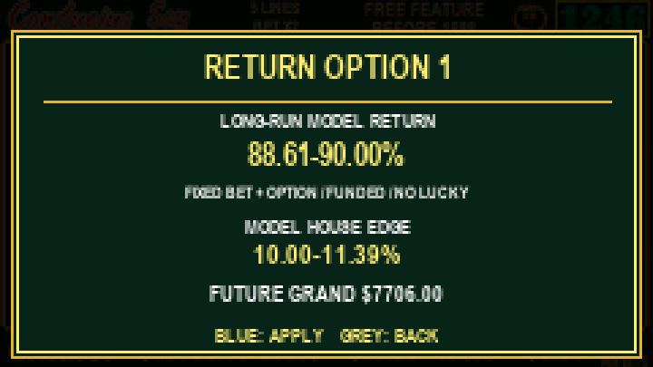

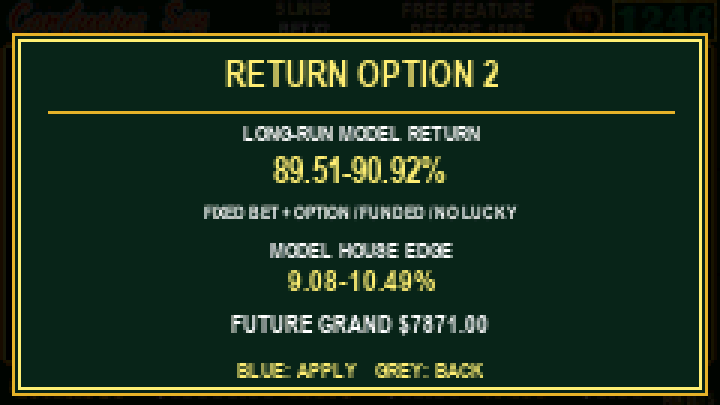

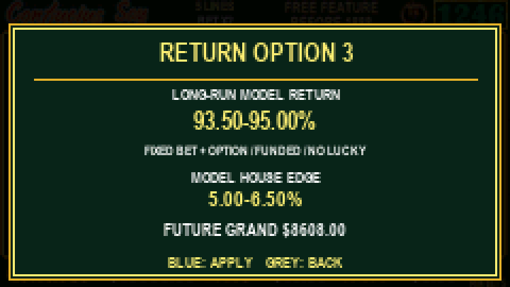

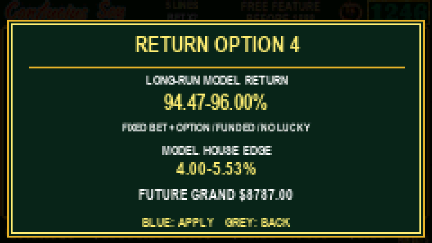

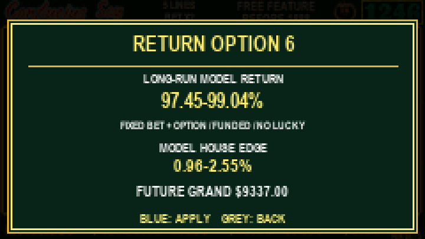

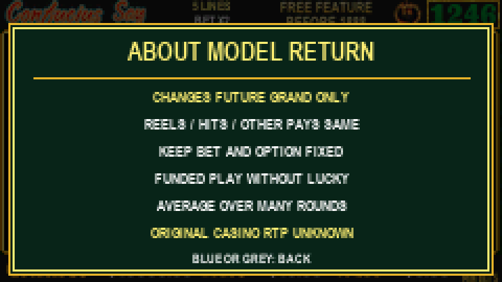

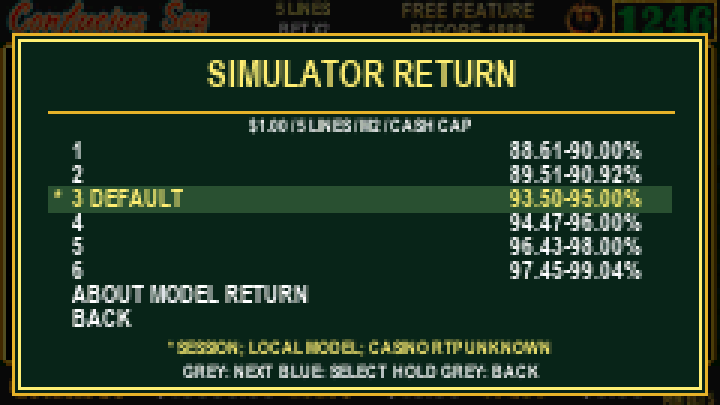

## Denomination and bet panels

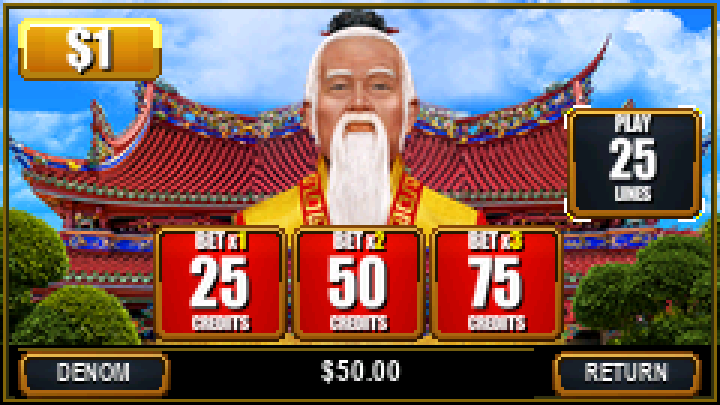

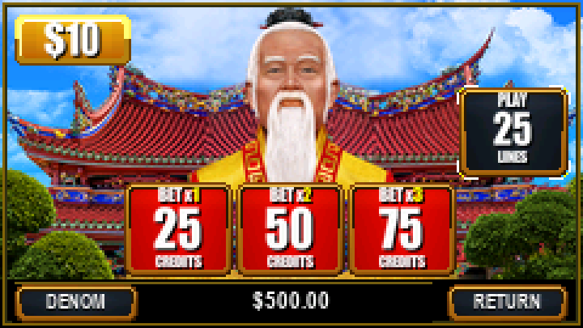

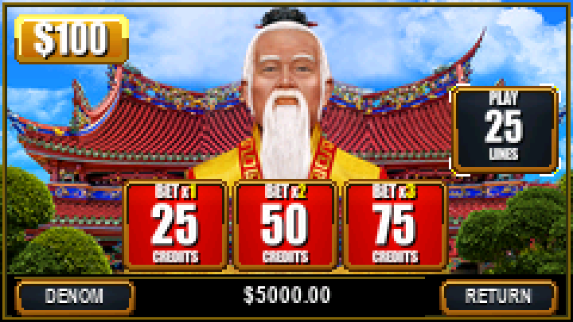

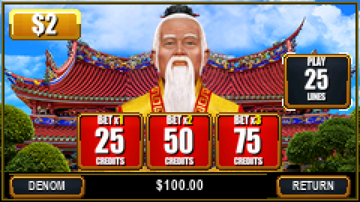

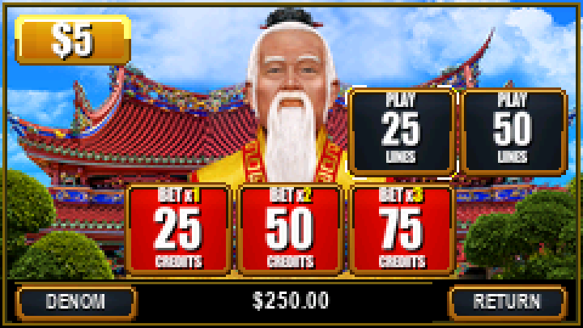

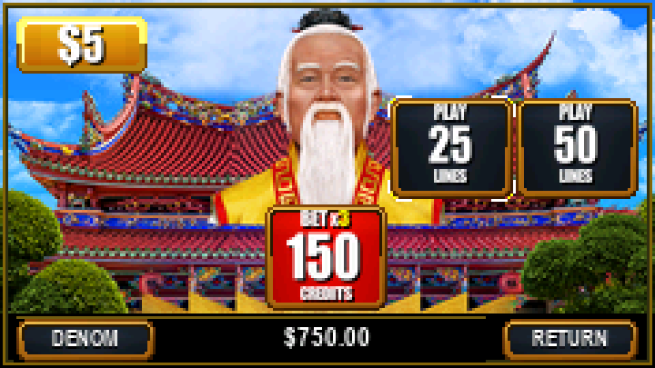

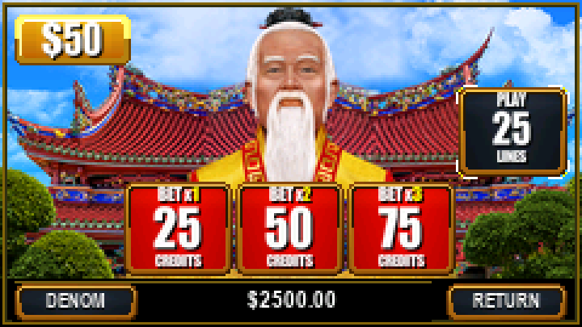

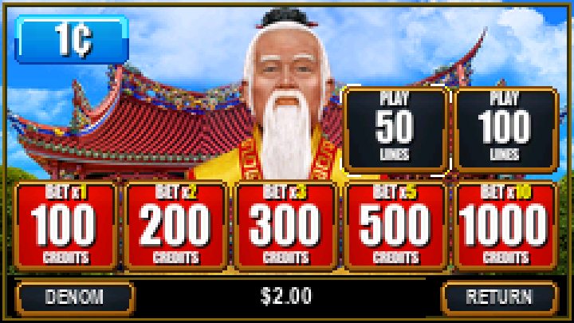

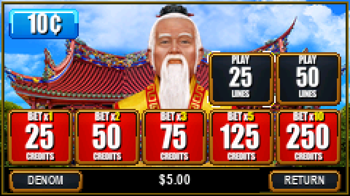

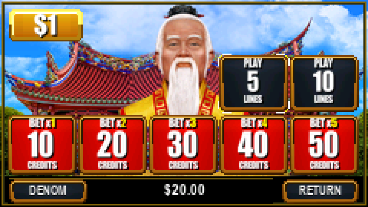

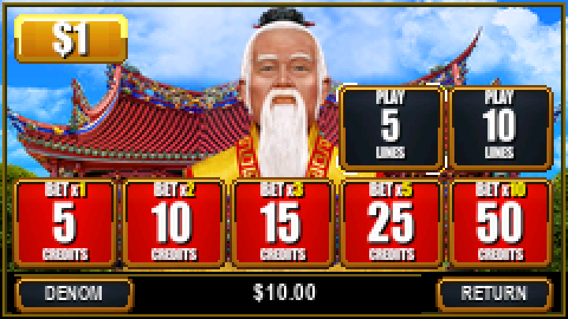

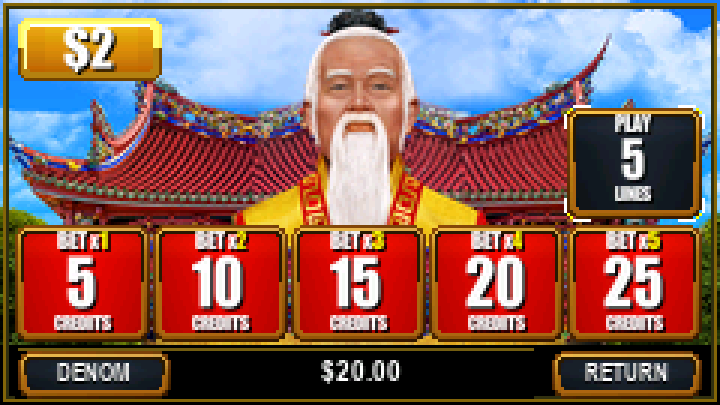

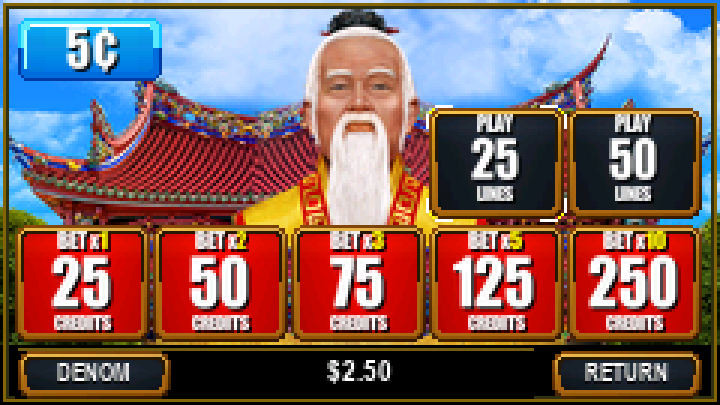

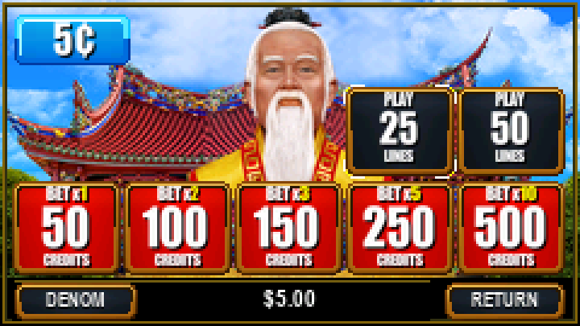

## Safety messages

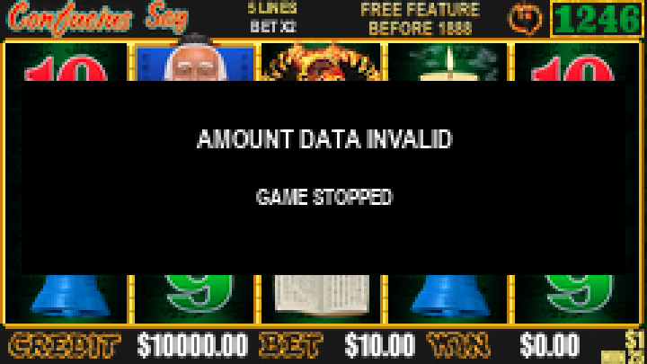

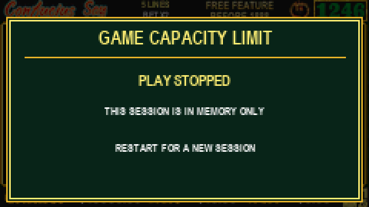

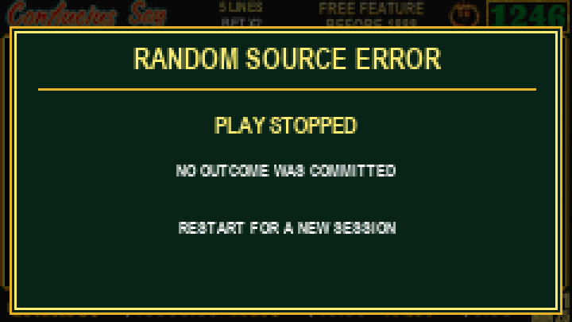

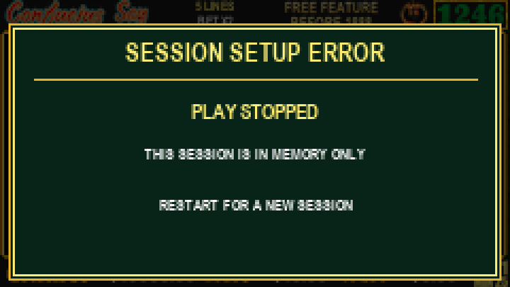

