# What “PLAY LINES” means

[← Full player guide](README.md) · [Bet choices and cost](wagers.md) · [Gallery](graphics.md)

**A line is a fixed route through the symbols from one spin.** It tells the game which positions to read across the screen when checking for a win. You choose how many routes to play; the game checks them for you.

<!-- COMPLETE PAYLINE NAVIGATION -->

**[See every line](#every-line):** [5 lines](#layout-5) · [10 lines](#layout-10) · [15 lines](#layout-15) · [25 lines](#layout-25) · [50 lines](#layout-50) · [100 lines](#layout-100) — 205 numbered entries, all enlarged below.

## Start with the screen: five columns, three rows

Each vertical column is called a **reel**. There are five reels, each showing three symbols: one at the **top**, one in the **middle** and one at the **bottom**. That gives you 15 visible symbols after a spin.

Read the columns from left to right: **reel 1 → reel 2 → reel 3 → reel 4 → reel 5**.

A line picks **one position in each column**. It can go straight across a row, or move between rows as it travels across the screen.

## Read this actual five-line chart

The game’s chart makes the routes visible. Each little rectangle represents the same five-column, three-row screen. The coloured dots show which five positions belong to that numbered line. Their colour identifies the route; it does not tell you which symbol to collect.

Here is that exact chart written out. Each column below tells you which row to read on that reel.

| Line number | Reel 1 | Reel 2 | Reel 3 | Reel 4 | Reel 5 |
|---|---|---|---|---|---|
| **1** | Middle | Middle | Middle | Middle | Middle |
| **2** | Top | Top | Top | Top | Top |
| **3** | Bottom | Bottom | Bottom | Bottom | Bottom |
| **4** | Top | Middle | Bottom | Middle | Top |
| **5** | Bottom | Middle | Top | Middle | Bottom |

Open an individual route diagram: [Line 1](media/gameplay/artwork/paylines/line-1.png) · [Line 2](media/gameplay/artwork/paylines/line-2.png) · [Line 3](media/gameplay/artwork/paylines/line-3.png) · [Line 4](media/gameplay/artwork/paylines/line-4.png) · [Line 5](media/gameplay/artwork/paylines/line-5.png).

### Example 1: a straight line

Here is **line 1** enlarged from that actual chart. Its blue dots stay in the middle row all the way across.

Read the **middle symbol in reel 1**, then the **middle symbol in reel 2**, and keep going along the middle row through reels 3, 4 and 5. The top and bottom symbols are outside this particular route.

### Example 2: a line that changes rows

Here is **line 4** enlarged from the same chart. Follow its green dots; the route forms a V.

| Follow line 4 | First column | Second column | Third column | Fourth column | Fifth column |
|---|---|---|---|---|---|
| Read this symbol | **Top** | **Middle** | **Bottom** | **Middle** | **Top** |

Start at the **top** of the first column, move to the **middle** of the second, then the **bottom** of the third, the **middle** of the fourth and the **top** of the fifth. Those five positions are line 4.

Only the marked position in each column counts for that route. A diagonal connecting two dots does not add extra symbols along the way. The route stays the same on later spins; the symbols landing in its five positions change.

## So what does “25 lines” mean?

**One spin produces one screen of 15 symbols. With 25 lines selected, the game reads 25 different routes through that same screen.** Several routes can use the same symbol position.

The picture below is the first page of the actual 25-line chart. It shows six of those routes; the other pages show the rest.

The screen still has five columns and three rows. Selecting 25 lines gives you 25 checks on **one spin**, rather than extra rows or extra spins. You do not need to draw a route, tap its symbols or work out the wins yourself.

With 50 lines selected, the game checks 50 routes. This chart has more pages because there are more routes to show.

The numbers identify routes **within the displayed line setting**. To look up a particular line, open the chart for the number of lines you are playing.

## Follow a real winning line

This is a result from actual play with 50 lines selected. Look at the **top row**: it is line **2** in both the five-line and 50-line charts shown above.

| Line 2, read left to right | Reel 1 | Reel 2 | Reel 3 | Reel 4 | Reel 5 |
|---|---|---|---|---|---|
| Symbols that actually landed | **10** | **10** | **10** | Queen | Phoenix |

The first three positions match: **10 → 10 → 10**. The Queen on reel 4 ends that run, so this route pays for **three 10s**. You do not need matching symbols on all five reels for every win.

At the captured bet, **LINE 2 WINS 10** means that this one route pays **10 credits**, worth **$0.10** at the selected 1¢ denomination. The bottom **WIN $0.90** includes the other winning routes from the same spin. The game adds their awards together.

**Watch the game point out the winning routes:**

<a href="media/gameplay/previews/primary/base-ready.webp">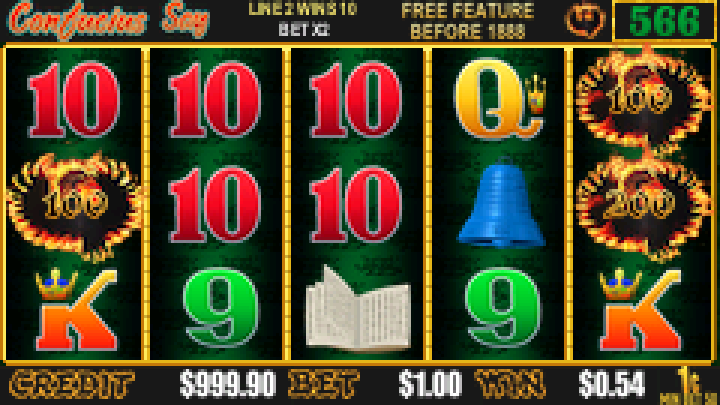</a>

The top caption names the line being shown. Small numbered tabs at the edges and short coloured marks between the reels indicate its route; the game cycles through the winning lines. It does not draw the full chart line over the symbols. The 10s briefly blink off during their win animation.

### Where a match starts and stops

For ordinary line wins with the numbers, letters, bell, abacus, book or candle, the matching run must start on **reel 1, the leftmost column**, and continue through neighbouring columns along a selected route.

- A different symbol ends the matching run. A matching symbol farther along cannot bridge the gap.
- Three matching symbols only on reels 3, 4 and 5 do not make a three-symbol line win.
- Matching symbols scattered around the screen do not make an ordinary line win unless they follow one of the selected routes from the left.
- The required number of matches depends on the symbol and current **pay table**, the list of awards in Game Rules. Three matching regular symbols can pay; some configurations also have selected two-symbol pays. The game checks the exact rule automatically.

**Confucius is Wild:** it can stand in for a regular line symbol along a route. It cannot replace red Wisdom tiles or Phoenixes. The game pays the highest qualifying combination on each line, then adds awards from different winning lines. [Symbols and payouts →](payouts.md)

### Wisdom and Phoenix use separate rules

The red **Wisdom** tiles are counted anywhere on the screen for their own award and Free Games trigger. This is called a **scatter** because they can be scattered across different positions. **Phoenixes** have their own values, collection meter and Hold & Spin feature. They do not need to form one of these ordinary line routes. Confucius does not substitute for either feature symbol.

[Wisdom and Twin Free Games](free-games.md) · [Phoenix Hold & Spin](hold-and-spin.md) · [The collection meter](collection-counter.md)

## How lines change the cost of a spin

The bet multiplier is the number of credits staked **on each line**. A credit’s money value is the denomination you selected.

**Cost of one paid spin = lines × bet multiplier × denomination.**

| Selectable example | Calculation | Cost of one spin |
|---|---|---:|
| 1¢, 50 lines, multiplier 2 | 50 × 2 × $0.01 | **$1.00** |
| 1¢, 100 lines, multiplier 2 | 100 × 2 × $0.01 | **$2.00** |

When the denomination and multiplier stay the same, selecting more lines increases the total stake. The red BET button shows that total **in credits**: 100 credits in the first example, 200 in the second. Check it before selecting the bet.

More routes can qualify for line awards, and they cost more when the per-line stake stays fixed. A larger line count does not guarantee a win or a profit. [All offered bet choices and denominations →](wagers.md)

<!-- BEGIN COMPLETE PAYLINE REFERENCE -->

## Every line, individually

**All 205 numbered entries across the six implemented layouts are shown below.** Each enlarged diagram is cropped from the actual in-game chart, with its route written out from left to right. Some routes repeat between layouts; use the numbers for the layout you are playing.

[5 lines](#layout-5) · [10 lines](#layout-10) · [15 lines](#layout-15) · [25 lines](#layout-25) · [50 lines](#layout-50) · [100 lines](#layout-100)

[Download the complete row-by-row route list](data/implemented-paylines.csv). The original full-screen chart photos follow this reference.

### 5-line layout — every line from 1 to 5

5 routes, shown on 1 original chart pages. Every diagram below is visible directly on this page.

Jump to line: [1](#layout-5-line-1) · [5](#layout-5-line-5)

#### Line 1

**Middle → Middle → Middle → Middle → Middle**

[View the original chart, page 1 of 1](media/gameplay/screens/menus/paylines-5-1.png).

#### Line 2

**Top → Top → Top → Top → Top**

<a href="media/gameplay/artwork/paylines/5-lines/line-002.png">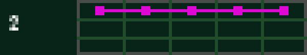</a>

[View the original chart, page 1 of 1](media/gameplay/screens/menus/paylines-5-1.png).

#### Line 3

**Bottom → Bottom → Bottom → Bottom → Bottom**

[View the original chart, page 1 of 1](media/gameplay/screens/menus/paylines-5-1.png).

#### Line 4

**Top → Middle → Bottom → Middle → Top**

[View the original chart, page 1 of 1](media/gameplay/screens/menus/paylines-5-1.png).

#### Line 5

**Bottom → Middle → Top → Middle → Bottom**

[View the original chart, page 1 of 1](media/gameplay/screens/menus/paylines-5-1.png).

[Back to the layout list](#every-line)

### 10-line layout — every line from 1 to 10

10 routes, shown on 2 original chart pages. Every diagram below is visible directly on this page.

Jump to line: [1](#layout-10-line-1) · [5](#layout-10-line-5) · [10](#layout-10-line-10)

#### Line 1

**Middle → Middle → Middle → Middle → Middle**

[View the original chart, page 1 of 2](media/gameplay/screens/menus/paylines-10-1.png).

#### Line 2

**Top → Top → Top → Top → Top**

[View the original chart, page 1 of 2](media/gameplay/screens/menus/paylines-10-1.png).

#### Line 3

**Bottom → Bottom → Bottom → Bottom → Bottom**

[View the original chart, page 1 of 2](media/gameplay/screens/menus/paylines-10-1.png).

#### Line 4

**Top → Middle → Bottom → Middle → Top**

[View the original chart, page 1 of 2](media/gameplay/screens/menus/paylines-10-1.png).

#### Line 5

**Bottom → Middle → Top → Middle → Bottom**

[View the original chart, page 1 of 2](media/gameplay/screens/menus/paylines-10-1.png).

#### Line 6

**Top → Top → Middle → Bottom → Bottom**

<a href="media/gameplay/artwork/paylines/10-lines/line-006.png">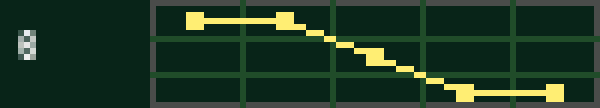</a>

[View the original chart, page 1 of 2](media/gameplay/screens/menus/paylines-10-1.png).

#### Line 7

**Bottom → Bottom → Middle → Top → Top**

<a href="media/gameplay/artwork/paylines/10-lines/line-007.png">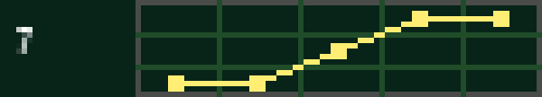</a>

[View the original chart, page 2 of 2](media/gameplay/screens/menus/paylines-10-2.png).

#### Line 8

**Middle → Top → Top → Top → Middle**

<a href="media/gameplay/artwork/paylines/10-lines/line-008.png">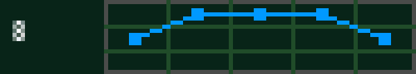</a>

[View the original chart, page 2 of 2](media/gameplay/screens/menus/paylines-10-2.png).

#### Line 9

**Middle → Bottom → Bottom → Bottom → Middle**

<a href="media/gameplay/artwork/paylines/10-lines/line-009.png">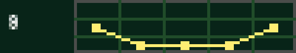</a>

[View the original chart, page 2 of 2](media/gameplay/screens/menus/paylines-10-2.png).

#### Line 10

**Top → Middle → Middle → Middle → Top**

[View the original chart, page 2 of 2](media/gameplay/screens/menus/paylines-10-2.png).

[Back to the layout list](#every-line)

### 15-line layout — every line from 1 to 15

15 routes, shown on 3 original chart pages. Every diagram below is visible directly on this page.

Jump to line: [1](#layout-15-line-1) · [5](#layout-15-line-5) · [10](#layout-15-line-10) · [15](#layout-15-line-15)

#### Line 1

**Middle → Middle → Middle → Middle → Middle**

[View the original chart, page 1 of 3](media/gameplay/screens/menus/paylines-15-1.png).

#### Line 2

**Top → Top → Top → Top → Top**

[View the original chart, page 1 of 3](media/gameplay/screens/menus/paylines-15-1.png).

#### Line 3

**Bottom → Bottom → Bottom → Bottom → Bottom**

<a href="media/gameplay/artwork/paylines/15-lines/line-003.png">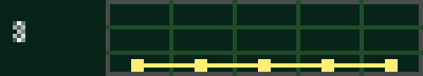</a>

[View the original chart, page 1 of 3](media/gameplay/screens/menus/paylines-15-1.png).

#### Line 4

**Top → Middle → Bottom → Middle → Top**

[View the original chart, page 1 of 3](media/gameplay/screens/menus/paylines-15-1.png).

#### Line 5

**Bottom → Middle → Top → Middle → Bottom**

[View the original chart, page 1 of 3](media/gameplay/screens/menus/paylines-15-1.png).

#### Line 6

**Top → Top → Middle → Top → Top**

[View the original chart, page 1 of 3](media/gameplay/screens/menus/paylines-15-1.png).

#### Line 7

**Bottom → Bottom → Middle → Top → Top**

[View the original chart, page 2 of 3](media/gameplay/screens/menus/paylines-15-2.png).

#### Line 8

**Middle → Bottom → Bottom → Bottom → Middle**

<a href="media/gameplay/artwork/paylines/15-lines/line-008.png">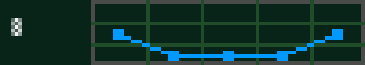</a>

[View the original chart, page 2 of 3](media/gameplay/screens/menus/paylines-15-2.png).

#### Line 9

**Middle → Top → Top → Top → Middle**

<a href="media/gameplay/artwork/paylines/15-lines/line-009.png">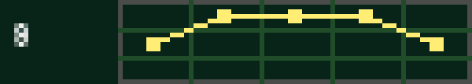</a>

[View the original chart, page 2 of 3](media/gameplay/screens/menus/paylines-15-2.png).

#### Line 10

**Top → Middle → Middle → Middle → Top**

[View the original chart, page 2 of 3](media/gameplay/screens/menus/paylines-15-2.png).

#### Line 11

**Bottom → Middle → Middle → Middle → Bottom**

[View the original chart, page 2 of 3](media/gameplay/screens/menus/paylines-15-2.png).

#### Line 12

**Middle → Top → Middle → Bottom → Middle**

[View the original chart, page 2 of 3](media/gameplay/screens/menus/paylines-15-2.png).

#### Line 13

**Middle → Bottom → Middle → Top → Middle**

<a href="media/gameplay/artwork/paylines/15-lines/line-013.png">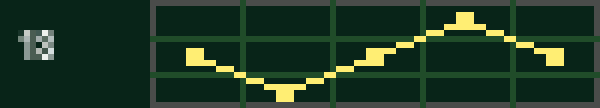</a>

[View the original chart, page 3 of 3](media/gameplay/screens/menus/paylines-15-3.png).

#### Line 14

**Top → Middle → Top → Middle → Top**

<a href="media/gameplay/artwork/paylines/15-lines/line-014.png">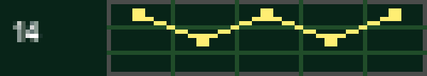</a>

[View the original chart, page 3 of 3](media/gameplay/screens/menus/paylines-15-3.png).

#### Line 15

**Bottom → Middle → Bottom → Middle → Bottom**

[View the original chart, page 3 of 3](media/gameplay/screens/menus/paylines-15-3.png).

[Back to the layout list](#every-line)

### 25-line layout — every line from 1 to 25

25 routes, shown on 5 original chart pages. Every diagram below is visible directly on this page.

Jump to line: [1](#layout-25-line-1) · [5](#layout-25-line-5) · [10](#layout-25-line-10) · [15](#layout-25-line-15) · [20](#layout-25-line-20) · [25](#layout-25-line-25)

#### Line 1

**Middle → Middle → Middle → Middle → Middle**

[View the original chart, page 1 of 5](media/gameplay/screens/menus/paylines-25-1.png).

#### Line 2

**Top → Top → Top → Top → Top**

[View the original chart, page 1 of 5](media/gameplay/screens/menus/paylines-25-1.png).

#### Line 3

**Bottom → Bottom → Bottom → Bottom → Bottom**

[View the original chart, page 1 of 5](media/gameplay/screens/menus/paylines-25-1.png).

#### Line 4

**Top → Middle → Bottom → Middle → Top**

[View the original chart, page 1 of 5](media/gameplay/screens/menus/paylines-25-1.png).

#### Line 5

**Bottom → Middle → Top → Middle → Bottom**

[View the original chart, page 1 of 5](media/gameplay/screens/menus/paylines-25-1.png).

#### Line 6

**Top → Top → Middle → Top → Top**

<a href="media/gameplay/artwork/paylines/25-lines/line-006.png">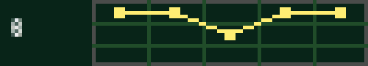</a>

[View the original chart, page 1 of 5](media/gameplay/screens/menus/paylines-25-1.png).

#### Line 7

**Bottom → Bottom → Middle → Bottom → Bottom**

[View the original chart, page 2 of 5](media/gameplay/screens/menus/paylines-25-2.png).

#### Line 8

**Middle → Bottom → Bottom → Bottom → Middle**

[View the original chart, page 2 of 5](media/gameplay/screens/menus/paylines-25-2.png).

#### Line 9

**Middle → Top → Top → Top → Middle**

[View the original chart, page 2 of 5](media/gameplay/screens/menus/paylines-25-2.png).

#### Line 10

**Top → Middle → Middle → Middle → Top**

[View the original chart, page 2 of 5](media/gameplay/screens/menus/paylines-25-2.png).

#### Line 11

**Bottom → Middle → Middle → Middle → Bottom**

[View the original chart, page 2 of 5](media/gameplay/screens/menus/paylines-25-2.png).

#### Line 12

**Top → Middle → Top → Middle → Top**

[View the original chart, page 2 of 5](media/gameplay/screens/menus/paylines-25-2.png).

#### Line 13

**Bottom → Middle → Bottom → Middle → Bottom**

[View the original chart, page 3 of 5](media/gameplay/screens/menus/paylines-25-3.png).

#### Line 14

**Middle → Top → Middle → Top → Middle**

[View the original chart, page 3 of 5](media/gameplay/screens/menus/paylines-25-3.png).

#### Line 15

**Middle → Bottom → Middle → Bottom → Middle**

[View the original chart, page 3 of 5](media/gameplay/screens/menus/paylines-25-3.png).

#### Line 16

**Middle → Middle → Top → Middle → Middle**

[View the original chart, page 3 of 5](media/gameplay/screens/menus/paylines-25-3.png).

#### Line 17

**Middle → Middle → Bottom → Middle → Middle**

[View the original chart, page 3 of 5](media/gameplay/screens/menus/paylines-25-3.png).

#### Line 18

**Top → Bottom → Top → Bottom → Top**

[View the original chart, page 3 of 5](media/gameplay/screens/menus/paylines-25-3.png).

#### Line 19

**Bottom → Top → Bottom → Top → Bottom**

[View the original chart, page 4 of 5](media/gameplay/screens/menus/paylines-25-4.png).

#### Line 20

**Middle → Top → Bottom → Top → Middle**

[View the original chart, page 4 of 5](media/gameplay/screens/menus/paylines-25-4.png).

#### Line 21

**Middle → Bottom → Top → Bottom → Middle**

[View the original chart, page 4 of 5](media/gameplay/screens/menus/paylines-25-4.png).

#### Line 22

**Top → Top → Bottom → Top → Top**

[View the original chart, page 4 of 5](media/gameplay/screens/menus/paylines-25-4.png).

#### Line 23

**Bottom → Bottom → Top → Bottom → Bottom**

[View the original chart, page 4 of 5](media/gameplay/screens/menus/paylines-25-4.png).

#### Line 24

**Top → Bottom → Bottom → Bottom → Top**

[View the original chart, page 4 of 5](media/gameplay/screens/menus/paylines-25-4.png).

#### Line 25

**Bottom → Top → Top → Top → Bottom**

<a href="media/gameplay/artwork/paylines/25-lines/line-025.png">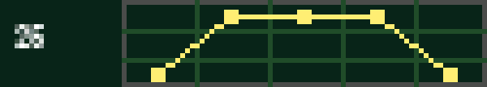</a>

[View the original chart, page 5 of 5](media/gameplay/screens/menus/paylines-25-5.png).

[Back to the layout list](#every-line)

### 50-line layout — every line from 1 to 50

50 routes, shown on 9 original chart pages. Every diagram below is visible directly on this page.

Jump to line: [1](#layout-50-line-1) · [10](#layout-50-line-10) · [20](#layout-50-line-20) · [30](#layout-50-line-30) · [40](#layout-50-line-40) · [50](#layout-50-line-50)

#### Line 1

**Middle → Middle → Middle → Middle → Middle**

<a href="media/gameplay/artwork/paylines/50-lines/line-001.png">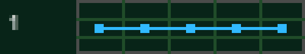</a>

[View the original chart, page 1 of 9](media/gameplay/screens/menus/paylines-50-1.png).

#### Line 2

**Top → Top → Top → Top → Top**

[View the original chart, page 1 of 9](media/gameplay/screens/menus/paylines-50-1.png).

#### Line 3

**Bottom → Bottom → Bottom → Bottom → Bottom**

[View the original chart, page 1 of 9](media/gameplay/screens/menus/paylines-50-1.png).

#### Line 4

**Top → Middle → Bottom → Middle → Top**

[View the original chart, page 1 of 9](media/gameplay/screens/menus/paylines-50-1.png).

#### Line 5

**Bottom → Middle → Top → Middle → Bottom**

[View the original chart, page 1 of 9](media/gameplay/screens/menus/paylines-50-1.png).

#### Line 6

**Top → Top → Middle → Top → Top**

[View the original chart, page 1 of 9](media/gameplay/screens/menus/paylines-50-1.png).

#### Line 7

**Bottom → Bottom → Middle → Bottom → Bottom**

<a href="media/gameplay/artwork/paylines/50-lines/line-007.png">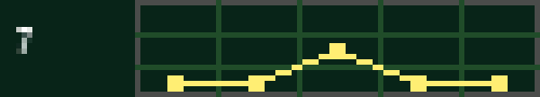</a>

[View the original chart, page 2 of 9](media/gameplay/screens/menus/paylines-50-2.png).

#### Line 8

**Middle → Bottom → Bottom → Bottom → Middle**

[View the original chart, page 2 of 9](media/gameplay/screens/menus/paylines-50-2.png).

#### Line 9

**Middle → Top → Top → Top → Middle**

[View the original chart, page 2 of 9](media/gameplay/screens/menus/paylines-50-2.png).

#### Line 10

**Top → Middle → Middle → Middle → Top**

[View the original chart, page 2 of 9](media/gameplay/screens/menus/paylines-50-2.png).

#### Line 11

**Bottom → Middle → Middle → Middle → Bottom**

<a href="media/gameplay/artwork/paylines/50-lines/line-011.png">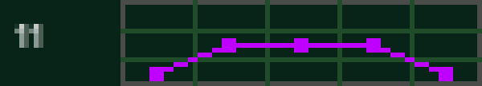</a>

[View the original chart, page 2 of 9](media/gameplay/screens/menus/paylines-50-2.png).

#### Line 12

**Top → Middle → Top → Middle → Top**

<a href="media/gameplay/artwork/paylines/50-lines/line-012.png">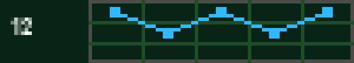</a>

[View the original chart, page 2 of 9](media/gameplay/screens/menus/paylines-50-2.png).

#### Line 13

**Bottom → Middle → Bottom → Middle → Bottom**

<a href="media/gameplay/artwork/paylines/50-lines/line-013.png">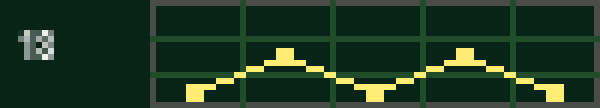</a>

[View the original chart, page 3 of 9](media/gameplay/screens/menus/paylines-50-3.png).

#### Line 14

**Middle → Top → Middle → Top → Middle**

<a href="media/gameplay/artwork/paylines/50-lines/line-014.png">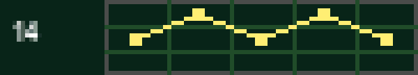</a>

[View the original chart, page 3 of 9](media/gameplay/screens/menus/paylines-50-3.png).

#### Line 15

**Middle → Bottom → Middle → Bottom → Middle**

<a href="media/gameplay/artwork/paylines/50-lines/line-015.png">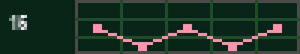</a>

[View the original chart, page 3 of 9](media/gameplay/screens/menus/paylines-50-3.png).

#### Line 16

**Middle → Middle → Top → Middle → Middle**

<a href="media/gameplay/artwork/paylines/50-lines/line-016.png">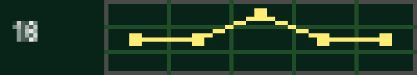</a>

[View the original chart, page 3 of 9](media/gameplay/screens/menus/paylines-50-3.png).

#### Line 17

**Middle → Middle → Bottom → Middle → Middle**

[View the original chart, page 3 of 9](media/gameplay/screens/menus/paylines-50-3.png).

#### Line 18

**Top → Bottom → Top → Bottom → Top**

<a href="media/gameplay/artwork/paylines/50-lines/line-018.png">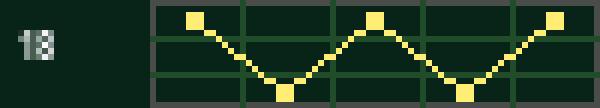</a>

[View the original chart, page 3 of 9](media/gameplay/screens/menus/paylines-50-3.png).

#### Line 19

**Bottom → Top → Bottom → Top → Bottom**

<a href="media/gameplay/artwork/paylines/50-lines/line-019.png">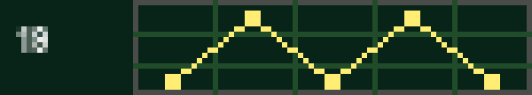</a>

[View the original chart, page 4 of 9](media/gameplay/screens/menus/paylines-50-4.png).

#### Line 20

**Middle → Top → Bottom → Top → Middle**

<a href="media/gameplay/artwork/paylines/50-lines/line-020.png">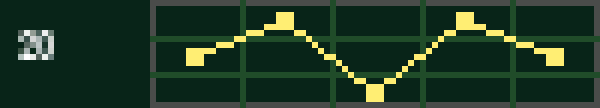</a>

[View the original chart, page 4 of 9](media/gameplay/screens/menus/paylines-50-4.png).

#### Line 21

**Middle → Bottom → Top → Bottom → Middle**

<a href="media/gameplay/artwork/paylines/50-lines/line-021.png">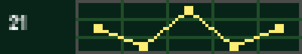</a>

[View the original chart, page 4 of 9](media/gameplay/screens/menus/paylines-50-4.png).

#### Line 22

**Top → Top → Bottom → Top → Top**

<a href="media/gameplay/artwork/paylines/50-lines/line-022.png">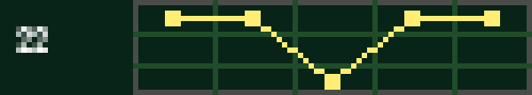</a>

[View the original chart, page 4 of 9](media/gameplay/screens/menus/paylines-50-4.png).

#### Line 23

**Bottom → Bottom → Top → Bottom → Bottom**

[View the original chart, page 4 of 9](media/gameplay/screens/menus/paylines-50-4.png).

#### Line 24

**Top → Bottom → Bottom → Bottom → Top**

<a href="media/gameplay/artwork/paylines/50-lines/line-024.png">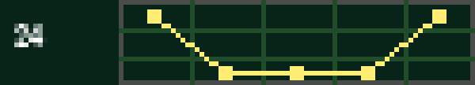</a>

[View the original chart, page 4 of 9](media/gameplay/screens/menus/paylines-50-4.png).

#### Line 25

**Bottom → Top → Top → Top → Bottom**

[View the original chart, page 5 of 9](media/gameplay/screens/menus/paylines-50-5.png).

#### Line 26

**Top → Bottom → Middle → Bottom → Top**

<a href="media/gameplay/artwork/paylines/50-lines/line-026.png">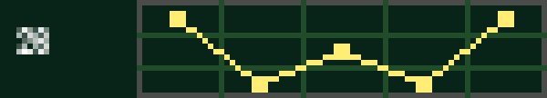</a>

[View the original chart, page 5 of 9](media/gameplay/screens/menus/paylines-50-5.png).

#### Line 27

**Bottom → Top → Middle → Top → Bottom**

<a href="media/gameplay/artwork/paylines/50-lines/line-027.png">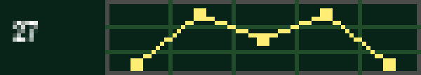</a>

[View the original chart, page 5 of 9](media/gameplay/screens/menus/paylines-50-5.png).

#### Line 28

**Middle → Middle → Middle → Middle → Bottom**

<a href="media/gameplay/artwork/paylines/50-lines/line-028.png">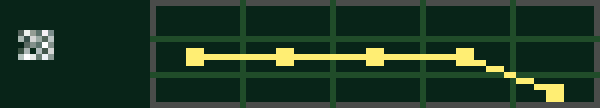</a>

[View the original chart, page 5 of 9](media/gameplay/screens/menus/paylines-50-5.png).

#### Line 29

**Top → Top → Middle → Bottom → Bottom**

<a href="media/gameplay/artwork/paylines/50-lines/line-029.png">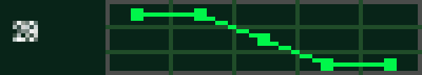</a>

[View the original chart, page 5 of 9](media/gameplay/screens/menus/paylines-50-5.png).

#### Line 30

**Bottom → Bottom → Middle → Top → Top**

<a href="media/gameplay/artwork/paylines/50-lines/line-030.png">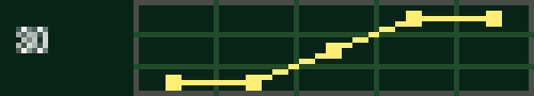</a>

[View the original chart, page 5 of 9](media/gameplay/screens/menus/paylines-50-5.png).

#### Line 31

**Top → Bottom → Top → Top → Top**

<a href="media/gameplay/artwork/paylines/50-lines/line-031.png">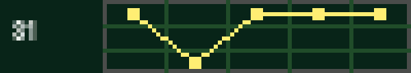</a>

[View the original chart, page 6 of 9](media/gameplay/screens/menus/paylines-50-6.png).

#### Line 32

**Bottom → Middle → Middle → Middle → Top**

<a href="media/gameplay/artwork/paylines/50-lines/line-032.png">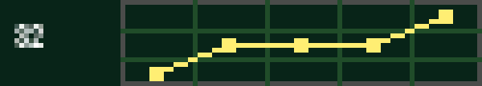</a>

[View the original chart, page 6 of 9](media/gameplay/screens/menus/paylines-50-6.png).

#### Line 33

**Bottom → Bottom → Top → Top → Top**

<a href="media/gameplay/artwork/paylines/50-lines/line-033.png">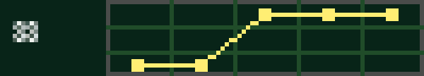</a>

[View the original chart, page 6 of 9](media/gameplay/screens/menus/paylines-50-6.png).

#### Line 34

**Bottom → Middle → Top → Middle → Top**

<a href="media/gameplay/artwork/paylines/50-lines/line-034.png">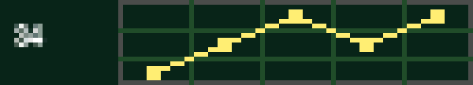</a>

[View the original chart, page 6 of 9](media/gameplay/screens/menus/paylines-50-6.png).

#### Line 35

**Top → Top → Top → Top → Middle**

<a href="media/gameplay/artwork/paylines/50-lines/line-035.png">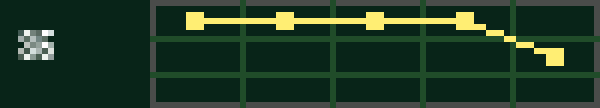</a>

[View the original chart, page 6 of 9](media/gameplay/screens/menus/paylines-50-6.png).

#### Line 36

**Bottom → Bottom → Bottom → Bottom → Middle**

<a href="media/gameplay/artwork/paylines/50-lines/line-036.png">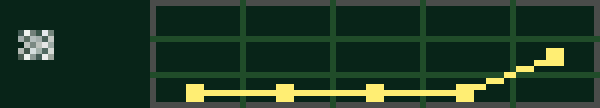</a>

[View the original chart, page 6 of 9](media/gameplay/screens/menus/paylines-50-6.png).

#### Line 37

**Top → Middle → Top → Middle → Bottom**

<a href="media/gameplay/artwork/paylines/50-lines/line-037.png">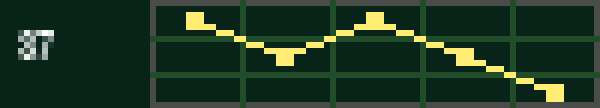</a>

[View the original chart, page 7 of 9](media/gameplay/screens/menus/paylines-50-7.png).

#### Line 38

**Bottom → Middle → Bottom → Middle → Top**

<a href="media/gameplay/artwork/paylines/50-lines/line-038.png">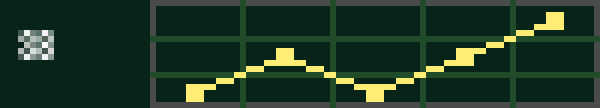</a>

[View the original chart, page 7 of 9](media/gameplay/screens/menus/paylines-50-7.png).

#### Line 39

**Bottom → Middle → Middle → Top → Top**

<a href="media/gameplay/artwork/paylines/50-lines/line-039.png">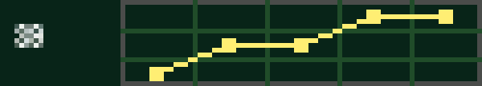</a>

[View the original chart, page 7 of 9](media/gameplay/screens/menus/paylines-50-7.png).

#### Line 40

**Middle → Bottom → Middle → Top → Middle**

<a href="media/gameplay/artwork/paylines/50-lines/line-040.png">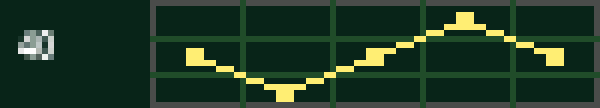</a>

[View the original chart, page 7 of 9](media/gameplay/screens/menus/paylines-50-7.png).

#### Line 41

**Middle → Middle → Top → Top → Top**

<a href="media/gameplay/artwork/paylines/50-lines/line-041.png">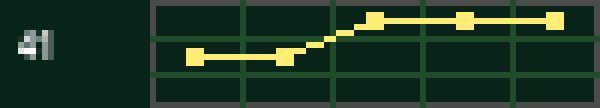</a>

[View the original chart, page 7 of 9](media/gameplay/screens/menus/paylines-50-7.png).

#### Line 42

**Middle → Top → Bottom → Top → Top**

<a href="media/gameplay/artwork/paylines/50-lines/line-042.png">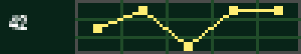</a>

[View the original chart, page 7 of 9](media/gameplay/screens/menus/paylines-50-7.png).

#### Line 43

**Middle → Top → Top → Middle → Bottom**

<a href="media/gameplay/artwork/paylines/50-lines/line-043.png">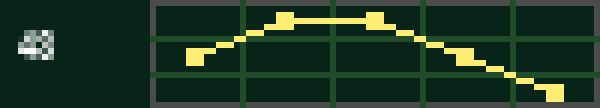</a>

[View the original chart, page 8 of 9](media/gameplay/screens/menus/paylines-50-8.png).

#### Line 44

**Top → Middle → Bottom → Top → Top**

<a href="media/gameplay/artwork/paylines/50-lines/line-044.png">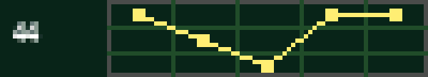</a>

[View the original chart, page 8 of 9](media/gameplay/screens/menus/paylines-50-8.png).

#### Line 45

**Middle → Middle → Bottom → Top → Top**

[View the original chart, page 8 of 9](media/gameplay/screens/menus/paylines-50-8.png).

#### Line 46

**Middle → Bottom → Middle → Top → Top**

<a href="media/gameplay/artwork/paylines/50-lines/line-046.png">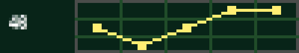</a>

[View the original chart, page 8 of 9](media/gameplay/screens/menus/paylines-50-8.png).

#### Line 47

**Bottom → Middle → Top → Top → Middle**

<a href="media/gameplay/artwork/paylines/50-lines/line-047.png">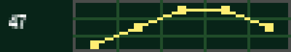</a>

[View the original chart, page 8 of 9](media/gameplay/screens/menus/paylines-50-8.png).

#### Line 48

**Middle → Bottom → Bottom → Top → Top**

<a href="media/gameplay/artwork/paylines/50-lines/line-048.png">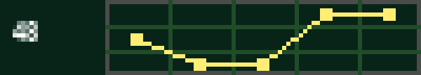</a>

[View the original chart, page 8 of 9](media/gameplay/screens/menus/paylines-50-8.png).

#### Line 49

**Top → Top → Middle → Bottom → Middle**

<a href="media/gameplay/artwork/paylines/50-lines/line-049.png">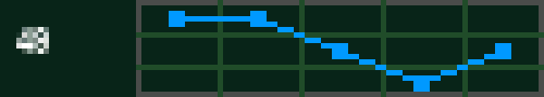</a>

[View the original chart, page 9 of 9](media/gameplay/screens/menus/paylines-50-9.png).

#### Line 50

**Top → Top → Top → Middle → Top**

[View the original chart, page 9 of 9](media/gameplay/screens/menus/paylines-50-9.png).

[Back to the layout list](#every-line)

### 100-line layout — every line from 1 to 100

100 routes, shown on 17 original chart pages. Every diagram below is visible directly on this page.

Jump to line: [1](#layout-100-line-1) · [10](#layout-100-line-10) · [20](#layout-100-line-20) · [30](#layout-100-line-30) · [40](#layout-100-line-40) · [50](#layout-100-line-50) · [60](#layout-100-line-60) · [70](#layout-100-line-70) · [80](#layout-100-line-80) · [90](#layout-100-line-90) · [100](#layout-100-line-100)

#### Line 1

**Middle → Middle → Middle → Middle → Middle**

[View the original chart, page 1 of 17](media/gameplay/screens/menus/paylines-100-1.png).

#### Line 2

**Top → Top → Top → Top → Top**

[View the original chart, page 1 of 17](media/gameplay/screens/menus/paylines-100-1.png).

#### Line 3

**Bottom → Bottom → Bottom → Bottom → Bottom**

[View the original chart, page 1 of 17](media/gameplay/screens/menus/paylines-100-1.png).

#### Line 4

**Top → Middle → Bottom → Middle → Top**

[View the original chart, page 1 of 17](media/gameplay/screens/menus/paylines-100-1.png).

#### Line 5

**Bottom → Middle → Top → Middle → Bottom**

[View the original chart, page 1 of 17](media/gameplay/screens/menus/paylines-100-1.png).

#### Line 6

**Top → Top → Middle → Top → Top**

[View the original chart, page 1 of 17](media/gameplay/screens/menus/paylines-100-1.png).

#### Line 7

**Bottom → Bottom → Middle → Top → Top**

[View the original chart, page 2 of 17](media/gameplay/screens/menus/paylines-100-2.png).

#### Line 8

**Middle → Bottom → Bottom → Bottom → Middle**

[View the original chart, page 2 of 17](media/gameplay/screens/menus/paylines-100-2.png).

#### Line 9

**Middle → Top → Top → Top → Middle**

[View the original chart, page 2 of 17](media/gameplay/screens/menus/paylines-100-2.png).

#### Line 10

**Top → Middle → Middle → Middle → Top**

[View the original chart, page 2 of 17](media/gameplay/screens/menus/paylines-100-2.png).

#### Line 11

**Bottom → Middle → Middle → Middle → Bottom**

[View the original chart, page 2 of 17](media/gameplay/screens/menus/paylines-100-2.png).

#### Line 12

**Top → Middle → Top → Middle → Top**

[View the original chart, page 2 of 17](media/gameplay/screens/menus/paylines-100-2.png).

#### Line 13

**Middle → Bottom → Middle → Top → Middle**

[View the original chart, page 3 of 17](media/gameplay/screens/menus/paylines-100-3.png).

#### Line 14

**Middle → Top → Middle → Bottom → Middle**

[View the original chart, page 3 of 17](media/gameplay/screens/menus/paylines-100-3.png).

#### Line 15

**Bottom → Middle → Bottom → Middle → Bottom**

[View the original chart, page 3 of 17](media/gameplay/screens/menus/paylines-100-3.png).

#### Line 16

**Middle → Middle → Top → Middle → Middle**

[View the original chart, page 3 of 17](media/gameplay/screens/menus/paylines-100-3.png).

#### Line 17

**Middle → Middle → Bottom → Middle → Middle**

[View the original chart, page 3 of 17](media/gameplay/screens/menus/paylines-100-3.png).

#### Line 18

**Top → Bottom → Top → Bottom → Top**

[View the original chart, page 3 of 17](media/gameplay/screens/menus/paylines-100-3.png).

#### Line 19

**Middle → Bottom → Top → Bottom → Middle**

[View the original chart, page 4 of 17](media/gameplay/screens/menus/paylines-100-4.png).

#### Line 20

**Top → Bottom → Bottom → Bottom → Top**

[View the original chart, page 4 of 17](media/gameplay/screens/menus/paylines-100-4.png).

#### Line 21

**Bottom → Top → Bottom → Top → Bottom**

[View the original chart, page 4 of 17](media/gameplay/screens/menus/paylines-100-4.png).

#### Line 22

**Middle → Top → Bottom → Top → Middle**

[View the original chart, page 4 of 17](media/gameplay/screens/menus/paylines-100-4.png).

#### Line 23

**Bottom → Bottom → Top → Bottom → Bottom**

[View the original chart, page 4 of 17](media/gameplay/screens/menus/paylines-100-4.png).

#### Line 24

**Top → Top → Bottom → Top → Top**

[View the original chart, page 4 of 17](media/gameplay/screens/menus/paylines-100-4.png).

#### Line 25

**Bottom → Top → Top → Top → Bottom**

[View the original chart, page 5 of 17](media/gameplay/screens/menus/paylines-100-5.png).

#### Line 26

**Middle → Top → Top → Top → Top**

[View the original chart, page 5 of 17](media/gameplay/screens/menus/paylines-100-5.png).

#### Line 27

**Bottom → Top → Top → Top → Top**

[View the original chart, page 5 of 17](media/gameplay/screens/menus/paylines-100-5.png).

#### Line 28

**Top → Middle → Top → Top → Top**

[View the original chart, page 5 of 17](media/gameplay/screens/menus/paylines-100-5.png).

#### Line 29

**Middle → Middle → Top → Top → Top**

[View the original chart, page 5 of 17](media/gameplay/screens/menus/paylines-100-5.png).

#### Line 30

**Bottom → Middle → Top → Top → Top**

[View the original chart, page 5 of 17](media/gameplay/screens/menus/paylines-100-5.png).

#### Line 31

**Top → Bottom → Top → Top → Top**

[View the original chart, page 6 of 17](media/gameplay/screens/menus/paylines-100-6.png).

#### Line 32

**Middle → Bottom → Top → Top → Top**

[View the original chart, page 6 of 17](media/gameplay/screens/menus/paylines-100-6.png).

#### Line 33

**Bottom → Bottom → Top → Top → Top**

[View the original chart, page 6 of 17](media/gameplay/screens/menus/paylines-100-6.png).

#### Line 34

**Top → Top → Middle → Bottom → Bottom**

[View the original chart, page 6 of 17](media/gameplay/screens/menus/paylines-100-6.png).

#### Line 35

**Middle → Top → Middle → Top → Top**

[View the original chart, page 6 of 17](media/gameplay/screens/menus/paylines-100-6.png).

#### Line 36

**Bottom → Top → Middle → Top → Top**

[View the original chart, page 6 of 17](media/gameplay/screens/menus/paylines-100-6.png).

#### Line 37

**Top → Middle → Middle → Top → Top**

[View the original chart, page 7 of 17](media/gameplay/screens/menus/paylines-100-7.png).

#### Line 38

**Middle → Middle → Middle → Top → Top**

[View the original chart, page 7 of 17](media/gameplay/screens/menus/paylines-100-7.png).

#### Line 39

**Bottom → Middle → Middle → Top → Top**

[View the original chart, page 7 of 17](media/gameplay/screens/menus/paylines-100-7.png).

#### Line 40

**Top → Bottom → Middle → Top → Top**

[View the original chart, page 7 of 17](media/gameplay/screens/menus/paylines-100-7.png).

#### Line 41

**Middle → Bottom → Middle → Top → Top**

[View the original chart, page 7 of 17](media/gameplay/screens/menus/paylines-100-7.png).

#### Line 42

**Middle → Top → Bottom → Top → Top**

[View the original chart, page 7 of 17](media/gameplay/screens/menus/paylines-100-7.png).

#### Line 43

**Bottom → Top → Bottom → Top → Top**

[View the original chart, page 8 of 17](media/gameplay/screens/menus/paylines-100-8.png).

#### Line 44

**Top → Middle → Bottom → Top → Top**

[View the original chart, page 8 of 17](media/gameplay/screens/menus/paylines-100-8.png).

#### Line 45

**Middle → Middle → Bottom → Top → Top**

[View the original chart, page 8 of 17](media/gameplay/screens/menus/paylines-100-8.png).

#### Line 46

**Bottom → Middle → Bottom → Top → Top**

[View the original chart, page 8 of 17](media/gameplay/screens/menus/paylines-100-8.png).

#### Line 47

**Top → Bottom → Bottom → Top → Top**

[View the original chart, page 8 of 17](media/gameplay/screens/menus/paylines-100-8.png).

#### Line 48

**Middle → Bottom → Bottom → Top → Top**

[View the original chart, page 8 of 17](media/gameplay/screens/menus/paylines-100-8.png).

#### Line 49

**Bottom → Bottom → Bottom → Top → Top**

[View the original chart, page 9 of 17](media/gameplay/screens/menus/paylines-100-9.png).

#### Line 50

**Top → Top → Top → Middle → Top**

[View the original chart, page 9 of 17](media/gameplay/screens/menus/paylines-100-9.png).

#### Line 51

**Middle → Top → Top → Middle → Top**

[View the original chart, page 9 of 17](media/gameplay/screens/menus/paylines-100-9.png).

#### Line 52

**Bottom → Top → Top → Middle → Top**

[View the original chart, page 9 of 17](media/gameplay/screens/menus/paylines-100-9.png).

#### Line 53

**Middle → Middle → Top → Middle → Top**

[View the original chart, page 9 of 17](media/gameplay/screens/menus/paylines-100-9.png).

#### Line 54

**Bottom → Middle → Top → Middle → Top**

[View the original chart, page 9 of 17](media/gameplay/screens/menus/paylines-100-9.png).

#### Line 55

**Top → Bottom → Top → Middle → Top**

[View the original chart, page 10 of 17](media/gameplay/screens/menus/paylines-100-10.png).

#### Line 56

**Middle → Bottom → Top → Middle → Top**

[View the original chart, page 10 of 17](media/gameplay/screens/menus/paylines-100-10.png).

#### Line 57

**Bottom → Bottom → Top → Middle → Top**

[View the original chart, page 10 of 17](media/gameplay/screens/menus/paylines-100-10.png).

#### Line 58

**Top → Top → Middle → Middle → Top**

[View the original chart, page 10 of 17](media/gameplay/screens/menus/paylines-100-10.png).

#### Line 59

**Middle → Top → Middle → Middle → Top**

[View the original chart, page 10 of 17](media/gameplay/screens/menus/paylines-100-10.png).

#### Line 60

**Bottom → Top → Middle → Middle → Top**

[View the original chart, page 10 of 17](media/gameplay/screens/menus/paylines-100-10.png).

#### Line 61

**Middle → Middle → Middle → Middle → Top**

[View the original chart, page 11 of 17](media/gameplay/screens/menus/paylines-100-11.png).

#### Line 62

**Bottom → Middle → Middle → Middle → Top**

[View the original chart, page 11 of 17](media/gameplay/screens/menus/paylines-100-11.png).

#### Line 63

**Top → Bottom → Middle → Middle → Top**

[View the original chart, page 11 of 17](media/gameplay/screens/menus/paylines-100-11.png).

#### Line 64

**Middle → Bottom → Middle → Middle → Top**

[View the original chart, page 11 of 17](media/gameplay/screens/menus/paylines-100-11.png).

#### Line 65

**Bottom → Bottom → Middle → Middle → Top**

[View the original chart, page 11 of 17](media/gameplay/screens/menus/paylines-100-11.png).

#### Line 66

**Top → Top → Bottom → Middle → Top**

[View the original chart, page 11 of 17](media/gameplay/screens/menus/paylines-100-11.png).

#### Line 67

**Middle → Top → Bottom → Middle → Top**

[View the original chart, page 12 of 17](media/gameplay/screens/menus/paylines-100-12.png).

#### Line 68

**Bottom → Top → Bottom → Middle → Top**

[View the original chart, page 12 of 17](media/gameplay/screens/menus/paylines-100-12.png).

#### Line 69

**Middle → Middle → Bottom → Middle → Top**

[View the original chart, page 12 of 17](media/gameplay/screens/menus/paylines-100-12.png).

#### Line 70

**Bottom → Middle → Bottom → Middle → Top**

[View the original chart, page 12 of 17](media/gameplay/screens/menus/paylines-100-12.png).

#### Line 71

**Top → Bottom → Bottom → Middle → Top**

[View the original chart, page 12 of 17](media/gameplay/screens/menus/paylines-100-12.png).

#### Line 72

**Middle → Bottom → Bottom → Middle → Top**

[View the original chart, page 12 of 17](media/gameplay/screens/menus/paylines-100-12.png).

#### Line 73

**Bottom → Bottom → Bottom → Middle → Top**

[View the original chart, page 13 of 17](media/gameplay/screens/menus/paylines-100-13.png).

#### Line 74

**Top → Top → Top → Bottom → Top**

[View the original chart, page 13 of 17](media/gameplay/screens/menus/paylines-100-13.png).

#### Line 75

**Middle → Top → Top → Bottom → Top**

[View the original chart, page 13 of 17](media/gameplay/screens/menus/paylines-100-13.png).

#### Line 76

**Bottom → Top → Top → Bottom → Top**

[View the original chart, page 13 of 17](media/gameplay/screens/menus/paylines-100-13.png).

#### Line 77

**Top → Middle → Top → Bottom → Top**

[View the original chart, page 13 of 17](media/gameplay/screens/menus/paylines-100-13.png).

#### Line 78

**Middle → Middle → Top → Bottom → Top**

[View the original chart, page 13 of 17](media/gameplay/screens/menus/paylines-100-13.png).

#### Line 79

**Bottom → Middle → Top → Bottom → Top**

[View the original chart, page 14 of 17](media/gameplay/screens/menus/paylines-100-14.png).

#### Line 80

**Middle → Bottom → Top → Bottom → Top**

[View the original chart, page 14 of 17](media/gameplay/screens/menus/paylines-100-14.png).

#### Line 81

**Bottom → Bottom → Top → Bottom → Top**

[View the original chart, page 14 of 17](media/gameplay/screens/menus/paylines-100-14.png).

#### Line 82

**Top → Top → Middle → Bottom → Top**

[View the original chart, page 14 of 17](media/gameplay/screens/menus/paylines-100-14.png).

#### Line 83

**Middle → Top → Middle → Bottom → Top**

[View the original chart, page 14 of 17](media/gameplay/screens/menus/paylines-100-14.png).

#### Line 84

**Bottom → Top → Middle → Bottom → Top**

[View the original chart, page 14 of 17](media/gameplay/screens/menus/paylines-100-14.png).

#### Line 85

**Top → Middle → Middle → Bottom → Top**

[View the original chart, page 15 of 17](media/gameplay/screens/menus/paylines-100-15.png).

#### Line 86

**Middle → Middle → Middle → Bottom → Top**

[View the original chart, page 15 of 17](media/gameplay/screens/menus/paylines-100-15.png).

#### Line 87

**Bottom → Middle → Middle → Bottom → Top**

[View the original chart, page 15 of 17](media/gameplay/screens/menus/paylines-100-15.png).

#### Line 88

**Top → Bottom → Middle → Bottom → Top**

[View the original chart, page 15 of 17](media/gameplay/screens/menus/paylines-100-15.png).

#### Line 89

**Middle → Bottom → Middle → Bottom → Top**

[View the original chart, page 15 of 17](media/gameplay/screens/menus/paylines-100-15.png).

#### Line 90

**Bottom → Top → Top → Top → Middle**

[View the original chart, page 15 of 17](media/gameplay/screens/menus/paylines-100-15.png).

#### Line 91

**Top → Top → Bottom → Bottom → Top**

[View the original chart, page 16 of 17](media/gameplay/screens/menus/paylines-100-16.png).

#### Line 92

**Middle → Top → Bottom → Bottom → Top**

[View the original chart, page 16 of 17](media/gameplay/screens/menus/paylines-100-16.png).

#### Line 93

**Bottom → Top → Bottom → Bottom → Top**

[View the original chart, page 16 of 17](media/gameplay/screens/menus/paylines-100-16.png).

#### Line 94

**Top → Middle → Bottom → Bottom → Top**

[View the original chart, page 16 of 17](media/gameplay/screens/menus/paylines-100-16.png).

#### Line 95

**Middle → Middle → Bottom → Bottom → Top**

[View the original chart, page 16 of 17](media/gameplay/screens/menus/paylines-100-16.png).

#### Line 96

**Bottom → Middle → Bottom → Bottom → Top**

[View the original chart, page 16 of 17](media/gameplay/screens/menus/paylines-100-16.png).

#### Line 97

**Middle → Bottom → Bottom → Bottom → Top**

[View the original chart, page 17 of 17](media/gameplay/screens/menus/paylines-100-17.png).

#### Line 98

**Bottom → Bottom → Bottom → Bottom → Top**

[View the original chart, page 17 of 17](media/gameplay/screens/menus/paylines-100-17.png).

#### Line 99

**Top → Top → Top → Top → Middle**

[View the original chart, page 17 of 17](media/gameplay/screens/menus/paylines-100-17.png).

#### Line 100

**Bottom → Bottom → Middle → Bottom → Top**

[View the original chart, page 17 of 17](media/gameplay/screens/menus/paylines-100-17.png).

[Back to the layout list](#every-line)

<!-- END COMPLETE PAYLINE REFERENCE -->

## Open the charts while playing

Hold grey to open **Game Menu**, then select **Paylines**. Your active line setting opens first and is labelled **CURRENT**.

- **Grey:** move to the next chart page.
- **Blue:** browse the other line settings.
- **Hold grey:** return to the menu.

Browsing the charts does not change your bet. Each page shows up to six routes. Blue visits the other settings in ascending order, then returns to CURRENT.

[See all 37 actual chart pages in the Gallery →](graphics.md#menus-and-artwork)

## Every actual chart page

Open a group below to see all of that setting’s routes. These are the game’s actual chart pages, captured through its menu.

5 lines — 1 chart page

**Page 1 of 1**

10 lines — 2 chart pages

**Page 1 of 2**

**Page 2 of 2**

15 lines — 3 chart pages

**Page 1 of 3**

**Page 2 of 3**

**Page 3 of 3**

25 lines — 5 chart pages

**Page 1 of 5**

**Page 2 of 5**

**Page 3 of 5**

**Page 4 of 5**

**Page 5 of 5**

50 lines — 9 chart pages

**Page 1 of 9**

**Page 2 of 9**

**Page 3 of 9**

**Page 4 of 9**

**Page 5 of 9**

**Page 6 of 9**

**Page 7 of 9**

**Page 8 of 9**

**Page 9 of 9**

100 lines — 17 chart pages

**Page 1 of 17**

**Page 2 of 17**

**Page 3 of 17**

**Page 4 of 17**

**Page 5 of 17**

**Page 6 of 17**

**Page 7 of 17**

**Page 8 of 17**

**Page 9 of 17**

**Page 10 of 17**

**Page 11 of 17**

**Page 12 of 17**

**Page 13 of 17**

**Page 14 of 17**

**Page 15 of 17**

**Page 16 of 17**

**Page 17 of 17**

Developer reference: route data and source evidence

[Download every implemented route](data/implemented-paylines.csv). The CSV uses 0 for the top row, 1 for the middle and 2 for the bottom. Its evidence column identifies observed geometry that matches the implementation and provisional local routes. It describes the simulator; the complete original charts and program variants have not been recovered.

## Documented geometry coverage

| Layout | Implemented routes matching documented geometry | Scope |
|---|---:|---|
| 5 lines | 1 | Legacy scoped Line 4 observation |
| 10 lines | 0 | Local fallback paths |
| 15 lines | 2 | Scoped Lines 6 and 8; legacy timing/program records remain incomplete |
| 25 lines | 25 | Retained US 25-chart reconstruction; wider program transport is conditional |
| 50 lines | 42 of 45 documented IDs | Five IDs remain unrecovered; three observed vectors are deferred |
| 100 lines | 13 of 17 documented IDs | Four observed vectors are deferred; the other 83 IDs lack documented geometry |

For 50 lines, **31, 33, 39, 45, 48** are unrecovered. Observed **42, 44, 50** differ from the current implementation. All first 25 implemented 50-line vectors match the retained observations. For 100 lines, the documented but deferred IDs are **15, 36, 37, 43**. Their observed vectors remain evidence; adding them while holding other local placeholders/prices fixed does not yet reproduce all qualified round totals. No unobserved ID is assigned a factory path from a payout residual.

Evidence labels are attached to the actual count, numbered ID and vector. A 50-line observation does not automatically establish the same ID in the 100-line chart. Matching a filmed path at one mode/wager also does not authenticate every program variant. Source facts remain separate from the current playable chart and from random outcome frequencies.

The source implementation is [linePath and evaluateLine in phoenix_engine.h](../firmware/src/phoenix_engine.h); the viewer and winning-line markers are in [ui.cpp](../firmware/src/ui.cpp).

