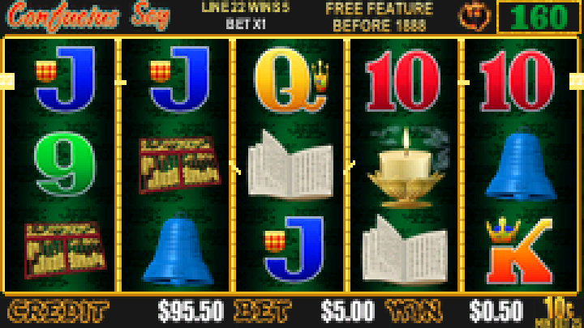

# Symbols, winning combinations and payouts

The complete implemented lookup tables are exported from the included C++ evaluator. They contain source-observed corrections and local fallback values; they are not recovered casino PAR sheets.

## Symbol roles

| Symbol | Role |
|---|---|
| 9, 10, J, Q, K | Regular line-pay symbols |
| Bell, abacus, book, candle | Picture symbols with line pays and winning animations |
| Confucius / Sage | Wild substitute for regular symbols; adjacent awarded faces can visually join into a taller gold figure |
| Red Wisdom tile | Scatter; can award a scatter win and Free Games |
| Phoenix | Carries a cash or named-prize value, contributes to the active collection counter and can trigger Hold & Spin |

## Line wins

A line win starts on the leftmost reel and continues through adjacent reels on a selected active path. Wilds substitute for regular symbols. Phoenix and Wisdom do not act as regular line-pay substitutes. The highest compatible award pays once on a line; awards on different lines are added.

The implemented lookup takes the symbol, match count, Base/Free mode and exact denomination/line/multiplier configuration. Some source-observed corrections currently apply only to the filmed configuration; other lookups retain local fallback prices. These coverage boundaries do **not** establish that a real machine changes a symbol's unit price when only its multiplier changes. The operator rules state that line awards are multiplied by the bet multiplier, while the full numeric tables and matching US program identities remain incomplete.

**Line award in credits = unit-credit price × bet multiplier.**

**Line award in money = line-award credits × denomination.**

The number of active lines is already used to select and evaluate the paths. Do not multiply a single line award by the total number of lines again. Multiple paying lines add separately.

## Complete implemented combination reference

- [All implemented line-pay entries](data/implemented-line-pays.csv): 48,000 rows, including zero-pay entries, both modes, ten evaluator symbols and match counts 2–5 across 600 internal denomination/line/multiplier profiles.
- [All active selected-line paths](data/implemented-paylines.csv): 205 paths across the six internal line selections. Rows use top=0, middle=1, bottom=2.
- [The current menu's 55 offered wagers](data/offered-wagers.csv): denomination, lines, multiplier, stake credits and stake money.
- [Export metadata](data/reference-metadata.json): source version, input hashes, exporter hash and dataset hashes.

The internal evaluator can represent more profiles than the wager menu offers. The CSV marks whether each profile is currently selectable. Its complete internal data must not be mistaken for additional real-machine buttons.

A positive evaluator entry does not prove that every compatible board can naturally occur. Wild placement, correlated reels and the local generator constrain which patterns can be drawn. The original joint reel law remains unrecovered.

The current **T (`0x0002001d`)** chart matches **42 of 45 documented 50-line IDs** and **13 of 17 documented 100-line IDs**. Matching observations are scoped to their filmed modes, wagers and program context; applying a common chart more widely remains a model assumption. [The coverage table](paylines.md#documented-geometry-coverage) separates implemented matches, observed-but-deferred vectors and unrecovered IDs.

The implemented 50-line Line7 is **bottom, bottom, middle, bottom, bottom**, matching the retained Base and Free observations. Complete original 50- and 100-line charts remain unrecovered. Other rows still use explicit local fallbacks, and some recorded whole-round totals remain unresolved even when an individual caption matches. A caption is not proof of full-event reproduction.

### Reading a row

For Base, 1¢ / 50 lines / 10×, a three-Jack line has unit price 5. Its award is 50 credits, or $0.50. The stake for the whole spin is 500 credits, or $5.00. Additional winning lines add to the $0.50.

An entry with unit price 0 does not pay that combination in that particular implemented profile.

## Observed Base prices

These entries are implemented at the exact filmed Base configurations below. Unit credits are multiplied by the selected bet multiplier, then by the denomination to obtain money.

### Bell, Jack and Queen prices

| Exact Base configuration | Combination | Unit credits | Award after multiplier |
|---|---|---:|---|
| 1¢ / 50 lines / 10× | Two Bells | 2 | 20 credits / $0.20 |
| 1¢ / 50 lines / 10× | Three Jacks | 5 | 50 credits / $0.50 |
| 10¢ / 100 lines / 1× | Two Bells | 2 | 2 credits / $0.20 |
| 10¢ / 100 lines / 1× | Three Jacks | 5 | 5 credits / $0.50 |
| 10¢ / 100 lines / 1× | Four Queens | 10 | 10 credits / $1.00 |

The source contexts are the [1¢/50/10× recording](https://www.youtube.com/watch?v=GclIM2tutCg) and [10¢/100/1× recording](https://www.youtube.com/watch?v=Zfc-LBjwXQA). The annotated [Engine lookup](../firmware/src/phoenix_engine.h) preserves their individual caption evidence.

### Two-cent, 50-line prices

| Exact Base configuration | Combination | Unit credits | Award after multiplier |
|---|---|---:|---|
| 2¢ / 50 lines / 3× | Two Bells | 2 | 6 credits / $0.12 |
| 2¢ / 50 lines / 3× | Three Kings | 5 | 15 credits / $0.30 |

The [Confucius Say recording](https://www.youtube.com/watch?v=3pfZnZUWGhI) contains Bell-prefix line captions paying six credits and three-King captions paying fifteen at this configuration. These are line awards, not inferred terminal round totals.

### Ten-cent, 25-line prices

| Exact Base configuration | Combination | Unit credits | Award after multiplier |
|---|---|---:|---|
| 10¢ / 25 lines / 1× | Three Kings, including Wild substitutes | 5 | 5 credits / $0.50 |
| 10¢ / 25 lines / 1× | Five Books | 100 | 100 credits / $10.00 |

The original [King line caption near 4:50](https://www.youtube.com/watch?v=wO4wC7v3Ouw&t=290s) shows “Line 11 wins 5”; the [Book caption at 5:03](https://www.youtube.com/watch?v=wO4wC7v3Ouw&t=303s) shows “Line 22 wins 100”. These establish the individual line prices, not the complete round totals.

None of these observations qualifies the same price at another denomination, line count, multiplier, regional program or Free Games table. They do not determine the random generator or Grand schedule. Other current lookup rows remain subject to their own [source annotations and evidence limits](math-and-evidence.md).

## Additional exact-profile Base corrections

| Exact Base configuration | Combination | Unit credits | Line award |
|---|---|---:|---|
| 2¢ / 50 / 5× | Two Bells | 2 | 10 credits / $0.20 |
| 2¢ / 50 / 5× | Three Kings | 5 | 25 credits / $0.50 |
| 2¢ / 50 / 5× | Five Bells | 150 | 750 credits / $15.00 |
| 2¢ / 50 / 5× | Five Books | 100 | 500 credits / $10.00 |
| 5¢ / 25 / 5× | Three Kings | 5 | 25 credits / $1.25 |
| 5¢ / 25 / 5× | Four Queens | 10 | 50 credits / $2.50 |
| $1 / 5 / 1× | Two Abacuses | 2 | 2 credits / $2.00 |
| $1 / 5 / 1× | Four Kings | 20 | 20 credits / $20.00 |
| $1 / 5 / 1× | Four Queens | 10 | 10 credits / $10.00 |
| 2¢ / 100 / 3× | Three Jacks | 5 | 15 credits / $0.30 |
| 2¢ / 100 / 3× | Five Abacuses | 100 | 300 credits / $6.00 |

The [3pf recording](https://www.youtube.com/watch?v=3pfZnZUWGhI), [Rio recording](https://www.youtube.com/watch?v=GclIM2tutCg) and [Cannery recording](https://www.youtube.com/watch?v=YoyplGW4DPM) supply the scoped captions retained beside the Engine branches. Several contain selected Wilds: those constrain effective awards under the current substitution-only model, rather than authenticating a universal bare-price or extra Wild-multiplier rule. The $1/5/1× two-Abacus value uses a joint prefix/terminal-total integer constraint; its cropped caption is not an independent uncropped witness. Values are not extended to unfilmed profiles or Free. Current 100-line placeholders and unqualified prices can still conflict with recorded whole-round money; no missing route or price is filled from a residual.

## Ten-cent, 50-line observation

At **10¢ / 50 lines / 1× in Base**, three Jacks pay **5 unit credits**, or **$0.50** for that line. The [Confucius recording near 1:45](https://www.youtube.com/watch?v=nmcPHvRQYDE&t=105s) shows a numbered Line 22 caption paying five. The numbered endpoints and divider markers identify its path as **top, top, bottom, top, top**. The publisher labels the recording Las Vegas; the exact property and software program are unreadable.

The current 50-line evaluator assigns that observed path to Line 22. This observation establishes that numbered route at the filmed configuration; it does not qualify a complete 50- or 100-line chart.

The five-credit Jack price is scoped to this exact Base configuration. Other denominations, line counts, multipliers and Free prices retain their own observations or local fallbacks. A line caption establishes its individual award, not an unobserved terminal round total or random frequency.



## Wisdom scatter awards

Scatter awards use the **total stake**, rather than a line's bet multiplier alone. The implemented Base and Free tables differ.

| Wisdom count used by the award lookup | Base: total-stake multiple | Free: total-stake multiple |
|---|---:|---:|
| 0–2 | 0 | 0 |
| 3 | 2× | 1× |
| 4 | 10× | 15× |
| 5 | 75× | 50× |

Some entries are observed, and others remain local assumptions; consult the source annotations before treating a number as a machine fact. The implemented numeric lookup uses the five-symbol row for five or more Wisdoms. The natural generator's support is a separate unresolved issue.

The scatter win and the award of Free Games are separate effects. See [Free Games](free-games.md) for entry, retrigger and continuation rules.

## Phoenix and jackpots

Phoenix values are collected under the feature rules, separately from ordinary line wins. Named Mini, Minor and Major symbols can carry their own multipliers. In the current implementation, these named multipliers do not multiply a plain cash Phoenix. A full 15-cell board can award Grand **in addition to** the displayed Phoenix values.

The actual amount and applicable prize rules depend on the active configuration and any prize already locked in the live feature. Grand amounts are local simulator schedules, not live casino progressive values. See [Hold & Spin](hold-and-spin.md), [the collection counter](collection-counter.md) and [math and evidence](math-and-evidence.md).

The jackpot board opens with double-grey. All four future amounts can be edited under [Counter & Jackpots](settings.md#feature-counter-and-jackpot-amounts). A custom amount stays fixed in cash across wager changes until restored or the session restarts. Already landed prizes keep their committed values. Default-profile examples in this guide assume no custom override.

Money is settled in integer cents. Credit-valued prizes are converted at the denomination; explicit cash amounts retain their exact cents, including amounts that are not a whole denomination credit. Named 2×/3× prizes apply the multiplier once.

## Regenerating the reference

From the repository root:

```sh
c++ -std=c++17 -O2 -Ifirmware/src tools/export_wiki_tables.cpp -o /tmp/export-wiki
/tmp/export-wiki docs/data
```

Regenerate the tables and verify every input and dataset hash against the current release source.
