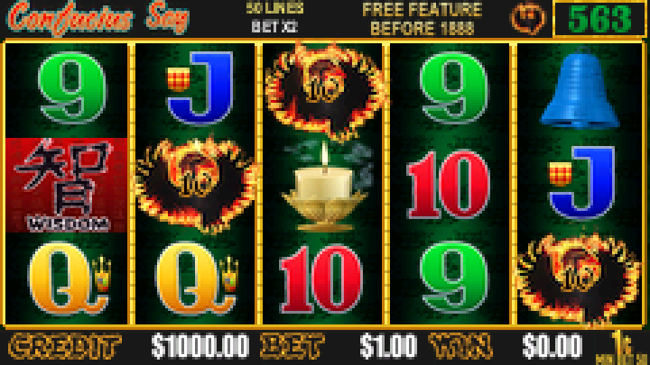
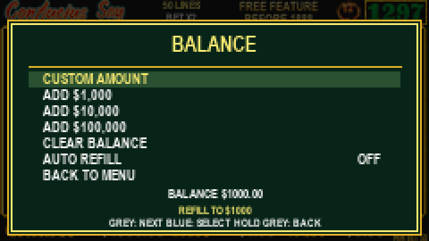

# Fresh sessions, funding and action safety

[← Full player guide](README.md) · [Gallery](graphics.md)

Progress is **session-only**. Every device boot, browser reload and firmware flash opens the denomination chooser with a **$0 balance**. Choose denomination, lines and bet, then use the editable voucher to fund the game. Autoplay starts off. Credits, collection-meter buckets, statistics, settings and unfinished features are not loaded from a prior game.

## Balance and meters

During a live session, the Balance menu offers Custom Amount through an editable voucher, plus $1,000, $10,000 or $100,000 additions to the money balance. A successful addition returns to manual gameplay during play, or to denomination setup if opened from the startup menu. It does not reset that session's wager, meters or statistics. CLEAR BALANCE sets the money balance to zero at a safe closed Base boundary and returns to manual play. It preserves the live wager, meter buckets and statistics, and leaves Auto Refill unchanged. Auto Refill uses the last successful addition amount, including Custom Amount; see [settings](settings.md#balance).

Meter buckets are keyed by denomination and total bet credits within the current session. Switching away and back selects that bucket again. A new boot or reload starts new meter state.

## Outcome ownership

The Engine computes an action once before its animation. It uses a private scratch copy and commits game state and presentation only when the random service succeeds. A failed action cannot leave a partial stake, grid, meter increment or award. Animation, quick-stop and audio do not draw another result.

Locked Phoenix values and queued Free/Hold work remain part of the live round. A visual count-up is not an additional payment, and a future Grand selection cannot reprice a prize already committed in that round.

## Random-source errors

The error page stops play and says that no new outcome was committed. There is no weak-source fallback or automatic re-deal. Restarting creates a new session; it does not recover the interrupted game. See [troubleshooting](troubleshooting.md#random-source-error).

## No game import or export

There is no player saved-game download, upload, bank restoration or cross-version recovery flow. The outcome generator's key, counter and unused output are never game records or USB/browser exports. Static asset caching in the browser does not save game progress.

Implementation: [Engine](../firmware/src/phoenix_engine.h), [random service](../firmware/src/phoenix_random.cpp), [native startup](../firmware/src/main.cpp), [UI](../firmware/src/ui.cpp). The [build guide](build-and-flash.md) describes installation; [browser play](browser-play.md) explains page reloads.

The unpaid opening reels are sampled afresh during initialization. They do not debit credits, record a spin, pay a win, advance the collection counter or award a feature. The first paid spin begins normal play.
