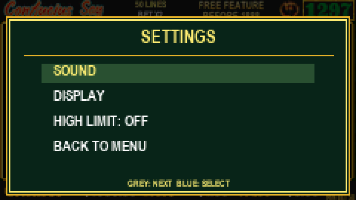
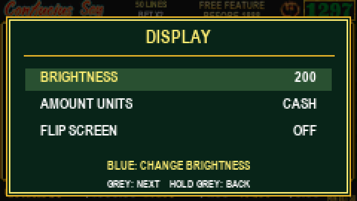
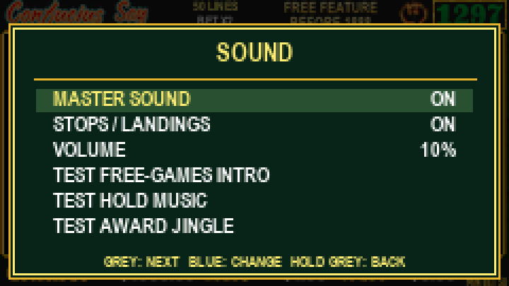
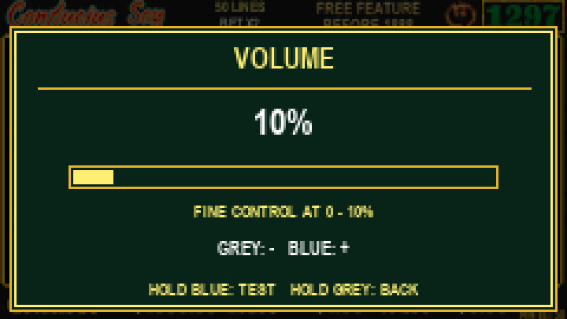
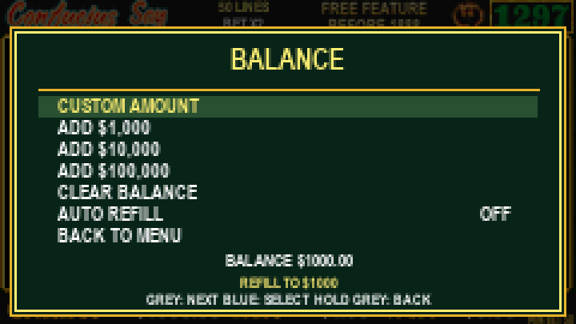
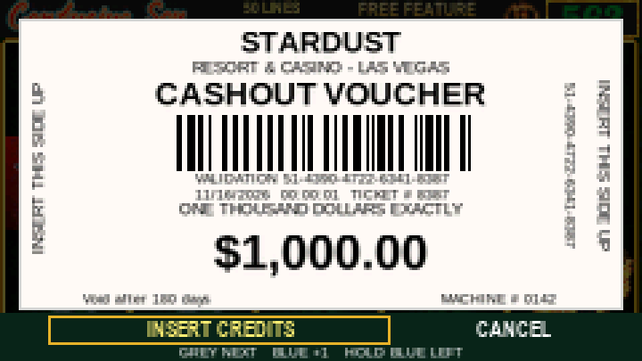
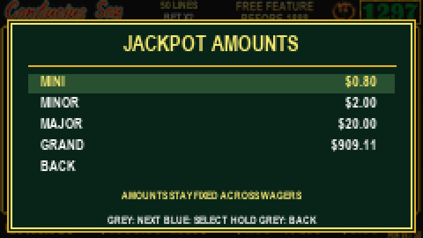
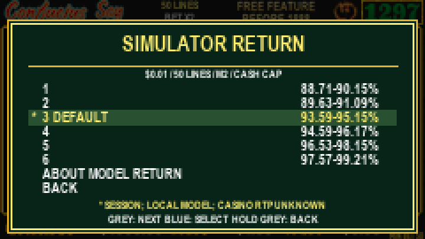

# Settings and play-money funding

[← Full player guide](README.md) · [Gallery](graphics.md)

Hold the large grey button during gameplay for Game Menu. Grey moves and blue selects. The small power key is separate. On the startup denomination page, hold-grey opens the full Game Menu. Closing it returns to setup; on the initial line/bet page, hold-grey goes back to denominations. In the normal wager panel, it returns directly to Game.

## Rules and wagers

Game Rules has six pages covering play, features, Base pays, Free pays, units and Phoenix awards. Pay pages use the current configuration and show unit credits before the bet multiplier. See [payouts](payouts.md).

Short-grey during play opens the cabinet panel. Browsing/cancelling does not stake money. Selecting a funded red BET choice commits its wager and starts immediately. Unfinished features prevent changing their wager.

## Settings menu

**Game Menu → Settings** contains Sound, Display and Back to Menu. Hold grey in Sound or Display to return to Settings; hold grey in Settings to return to Game Menu.

## Display

Brightness cycles the implemented levels. Amount Units switches between cash and denomination credits without changing the money balance. Flip Screen rotates 180 degrees. Open **Settings → Display** for these controls. Double-grey in gameplay opens the live Jackpots board. A new session starts with its default display state.

## Sound

Open **Settings → Sound**. Master sound and stops/landings have separate controls. Volume adjusts the level; Test Free-Games Intro, Test Hold Music and Test Award Jingle play their named programs. See [audio](audio.md) for current routing and acoustic limits.

## Balance

Startup opens denomination and wager selection at **$0**. From the unfunded reels, blue opens Custom Amount directly. Game Menu → BALANCE also offers:

| Choice | Effect |
|---|---|
| Custom Amount | Edit a cash voucher; Insert Credits adds the amount and returns to Game with the cash-in cue |
| Add $1,000 | Add to the current money balance, return to Game with autoplay off |
| Add $10,000 | Add to the current money balance, return to Game with autoplay off |
| Add $100,000 | Add to the current money balance, return to Game with autoplay off |
| Clear Balance | Set the money balance to zero and return to Game with autoplay off |
| Auto Refill | Toggle refill when another paid spin is unaffordable |
| Back to Menu | Return to Game Menu |

When Balance is opened from the startup menu, funding returns to denomination setup instead of the reels.

Auto Refill uses the last successful addition amount for this session; its initial default is $10,000. It sets an unaffordable balance to that amount or the current full stake, whichever is larger. The manual Add choices are additive. Clear Balance is available with a nonzero balance at a closed Ready/Base boundary; unfinished Free/Hold/queued work and service or selector faults block it. It preserves the live wager, meter buckets and statistics, and does not change the Auto Refill preference. A later unaffordable paid spin can therefore refill the balance if that option is on. There is no fixed $1 million button; Custom Amount accepts $0.01–$9,999,999.99.

Custom Amount is the first Balance choice. It opens a Stardust voucher. Grey moves right through digits, Insert Credits and Cancel; short blue changes a digit. **Hold blue moves one digit left**, revealing a leading place without cycling around the form. Hold grey cancels. Insert Credits adds the amount once with the cash-in sound. It returns to Game during regular play, or back to denomination setup if opened from the startup menu. New vouchers open at **$0,000.00**, focused on the thousands zero. Unused leading zeros disappear as you move right: one dollar displays as **$1.00**. Hold blue to reveal a larger place again. The amount in words follows the editable cash value. The matching barcode and validation identifiers are decorative, remain fixed during editing and change for each newly opened voucher. The issue stamp uses the release date and session time, not a synchronized casino clock.

## Feature counter and jackpot amounts

Open **Game Menu → Counter & Jackpots**. **Set Feature Counter** edits the active wager's counter from **0 to 1887**. **Jackpot Amounts** lets you select Mini, Minor, Major or Grand and enter an amount from **$0.01 to $30,000,000.00**.

Grey moves between digits, Apply and Cancel; blue changes the selected digit or confirms the selected action. Counter digits wrap within the legal range; the leading digit alternates between 0 and 1. Hold grey to go back without applying. A successful Apply returns to the regular game with autoplay off. The balance and statistics are unchanged. Finish any current spin or owed feature before editing.

Jackpot amounts are absolute cash values: changing denomination or wager does not rescale an edited amount. They apply to future prizes; already landed prizes retain their values. **Restore Default Jackpots** restores all four tiers for the current configuration, including the selected return option's Grand. Boot or reload starts fresh defaults.

Double-grey during gameplay opens the jackpot board. Blue or grey closes it without spinning. It shows the amounts available for future prizes at the current configuration. See [jackpot values and configurations](jackpot-values.md) for the denomination rules, observed prices and local assumptions.

The counter ceiling is the simulator’s closed-state limit, derived from its hidden-threshold and immediate-reset policy. It is not an authenticated factory display maximum; see [counter scope](collection-counter.md#local-meter-model).

## Battery display

Battery percentage is not shown. See the [M5Unified implementation](https://github.com/m5stack/M5Unified/blob/96576a14247ddc935149145aa6b51943464120f1/src/utility/Power_Class.inl) and [StickS3 battery example](https://docs.m5stack.com/en/arduino/m5sticks3/battery).

## Simulator Return

SIMULATOR RETURN shows six retained Grand schedules for the current profile; **Option 3 is the default**. Review the future Grand amount, then press blue to apply or grey to go back. Context includes denomination, lines, multiplier and prize-cap profile.

Applying a choice changes future Grand only. The amounts are retained from 0.2.170. Because 0.2.171 corrects the counter boundary, its return and edge are **not calculated**; old numerical ranges are not presented as current. See [math](math-and-evidence.md#return-and-house-edge).

Custom jackpot amounts lock this page. Restore Default Jackpots to use the preset choices again. Editing amounts changes payouts without changing their arrival probabilities.

## High Limit

Settings → High Limit switches between the standard and high-limit denomination menus. See [the high-limit wagers](wagers.md#high-limit).

The startup menu includes the regular sound, brightness, screen-flip and High Limit controls. Empty balances cannot be cleared again; feature-state restrictions apply to value editing during play.

Sound starts at **10%**.
