# Symbols and combination categories

[← Full player guide](README.md) · [Gallery](graphics.md)

This is the complete symbol inventory in the current [Engine](../firmware/src/phoenix_engine.h). The numeric payouts are in the separate [compiled payout reference](payouts.md); this page explains how to interpret them.

Open the [Gallery: reel symbols](graphics.md#reel-symbols) for close-up views, with the [gameplay gallery](graphics.md) showing the surrounding reels.

## The twelve symbols

| Preview from real play | Symbol | Role | Important distinction |
|---|---|---|---|
|   | 9 | Regular line symbol | Green numeral |
| 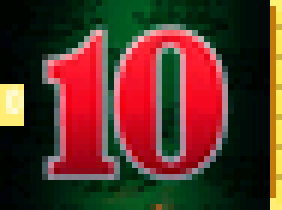 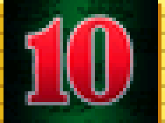 | 10 | Regular line symbol | Red numeral |
| 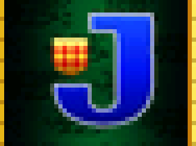 | J | Regular line symbol | Blue Jack |
| 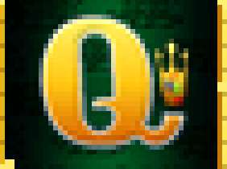 | Q | Regular line symbol | Yellow Queen |
| 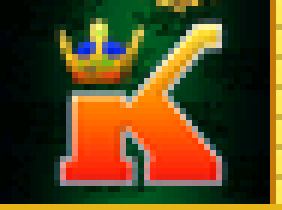 | K | Regular line symbol | Crowned King |
| 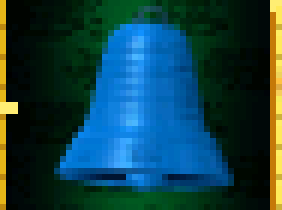 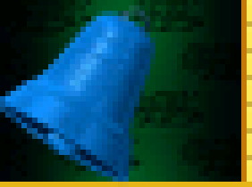 | Bell | Regular line symbol | Blue bell |
| 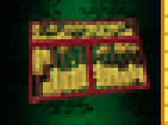 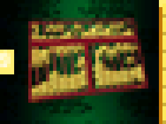 | Abacus | Regular line symbol | Beads and frame |
| 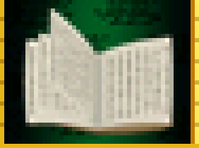 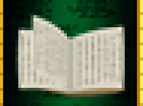 | Book | Regular line symbol | Open book |
|   | Candle | Regular line symbol | Flame and gold holder |
|  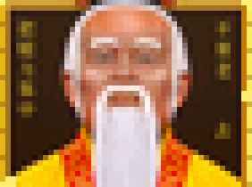 | Confucius / Sage | Wild and a separately priced line symbol | Can substitute for regular line symbols; cannot substitute for Wisdom or Phoenix |
| 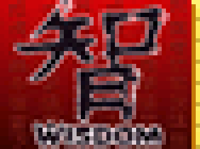 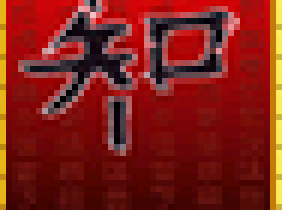 | Wisdom | Scatter | Any-position award and free-games trigger; does not require a selected payline |
| 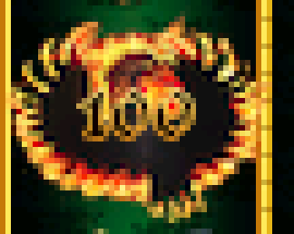 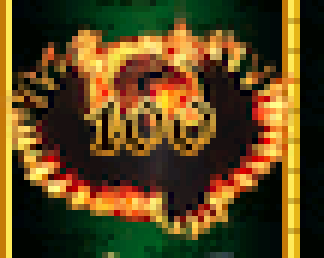 | Phoenix | Held value / named prize | Its displayed value belongs to the Phoenix feature, not the line-pay table |

## Named Phoenix prizes

Mini, Minor and Major each have **single, double and triple** artwork. Repeated names on one Phoenix represent multiples of that prize. The [named Phoenix gallery](graphics.md#named-phoenix-prizes) identifies the captured variants; the [gameplay gallery](graphics.md) shows named prizes in play.

## Regular line wins

Each selected line chooses one row from each of the five columns. The evaluator checks a matching prefix starting on column 1. A gap ends that prefix; a match on columns 3–5 alone is not a line win. Confucius can fill a regular-symbol position.

Only the highest compatible award pays on each line. Different winning lines add together. A line's cash award is:

`unit-credit pay for that symbol/count/profile × selected bet multiplier × denomination`

For example, a line `Book – Confucius – Book – 9 – K` is evaluated as a three-Book prefix. Its amount comes from the current Base or Free paytable and the exact configuration. A row `9 – Book – Book – Book – Book` does not pay a four-Book win from the right.

Two-symbol awards exist only for implemented, scoped entries. Do not assume that every two-Candle or two-Bell prefix pays on every denomination/line/multiplier combination. The [payout reference](payouts.md) records those cases without extending observations to unrelated profiles.

## Scatters, Phoenixes and mixed results

| Result category | How the simulator treats it |
|---|---|
| Regular line combination | Highest compatible price per active line; add different lines |
| Wisdom scatter combination | Count anywhere; apply one count tier to total bet |
| Line wins plus Wisdom | Add the line and scatter awards; free games can also be awarded |
| Phoenixes below the natural trigger | Advance the collection meter; displayed Phoenix values are not immediately line-paid |
| Six to fourteen Phoenixes | Enter Hold & Spin with those positions locked |
| Fifteen Phoenixes | Pay all Phoenix values plus Grand; no artificial extra Hold is required |
| Hold feature | Pay the locked Phoenix values at settlement; ordinary line pays are inactive |
| Simultaneous natural Hold and meter award | Preserve the natural Hold and queue the separate meter feature |

In this model, five or more Wisdoms use the five-scatter payout tier. That is an implementation fact, not evidence that the original strips can produce every count allowed by this local generator.

The regional operator rulebook supports left-to-right line evaluation, Wild exclusions and separate scatter/Phoenix categories; it does not supply this simulator's full numeric tables. See the [Loto-Québec rules, pages 3–4](https://casinos.lotoquebec.com/dam/jcr:4add9be1-336a-4efc-b4c9-e41696b876b2/Phoenix%20Link%20Confucius%20Say.pdf) and [evidence scope](sources.md).

## The tall gold Confucius

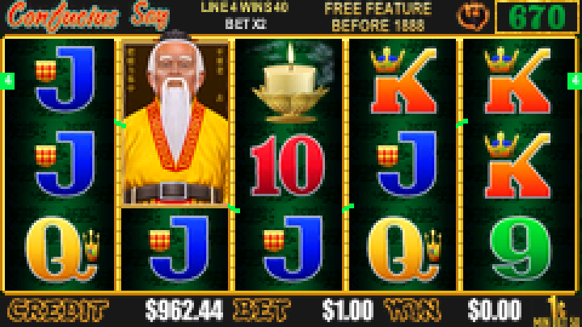

**Watch the captured sequence:**

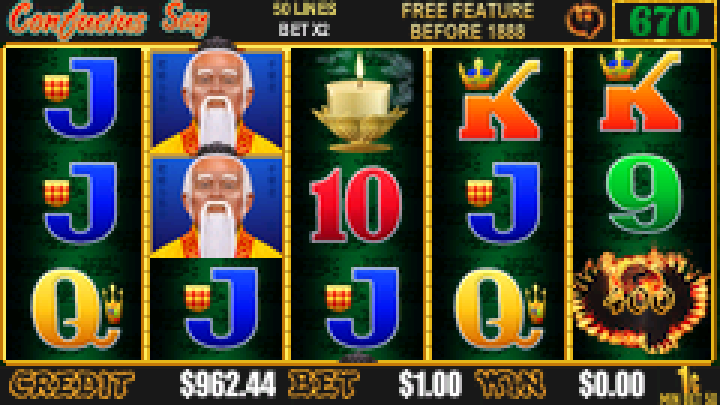

[See both two-row and three-row merges together →](graphics.md#confucius-merges)

Adjacent awarded Confucius faces in one column can join visually into a two- or three-position gold figure. Both neighboring faces must be included in the awarded mask; a nearby nonwinning face does not automatically join. A separated pair with another symbol between it stays separated.

This is presentation geometry. It adds no Wilds, replaces no unrelated symbol and recalculates no award. The original universal eligibility rule is not fully recovered. See the animated example and remaining limits in [graphics](graphics.md).
